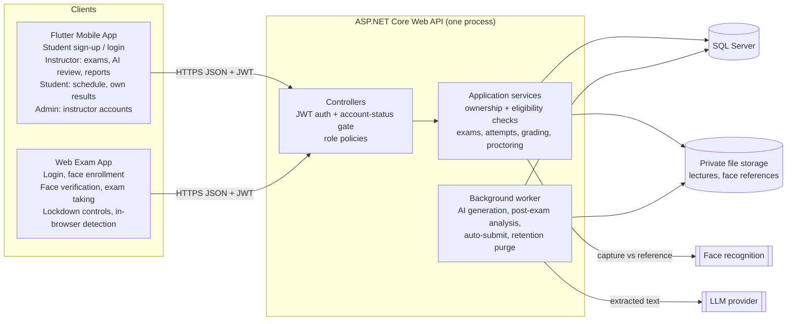
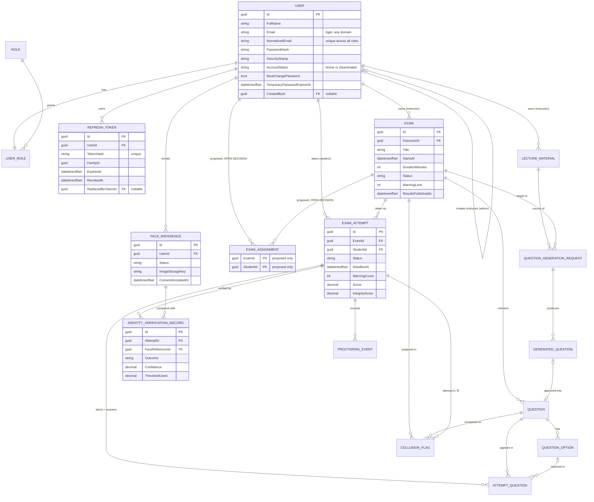
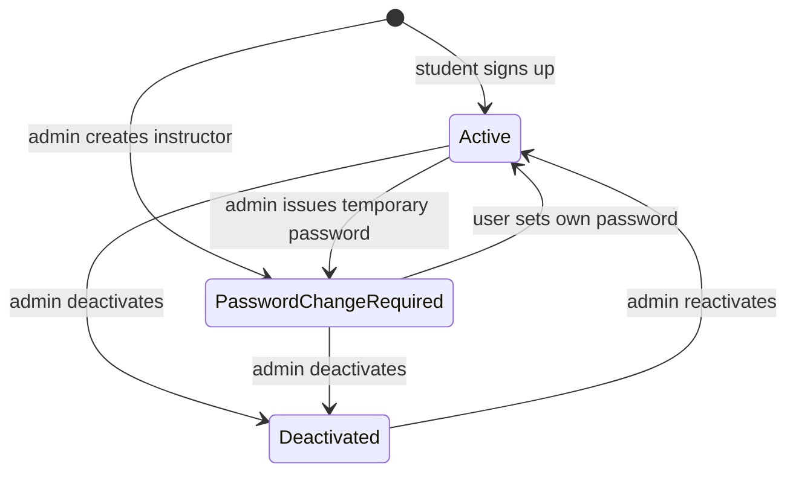

# AI-Based Exam Proctoring System: Final Architecture

**Status:** Revision 3.8, architecture targeting **.NET 10**. **Phase 0 (Project Foundation) is complete** (§10.1). **The Phase 1 authentication endpoints are implemented**: sign-up, login, refresh, logout, me and change-password (§6.9, §10.2). **First-admin seeding, admin instructor creation, temporary passwords, deactivation and reactivation are implemented** (Steps 5a-5c, §6.4, §6.8, §6.9). The rest of Phase 1, the admin account list and detail (Step 5d), is **not built yet**; its decisions are recorded (D23, Revision 3.7). Student sign-up is final: four fields, no university data (§6.4). **Password recovery by email is a confirmed decision (D17) but is not implemented**; its details are open (§6.11). One **OPEN DECISION** remains for later phases: exam assignment (§2.4). University affiliation and email verification are recorded as future OPEN DECISIONS that block nothing currently planned (§2.5).
**Sources:** `Requirments/Analysis Pahse Updated.pdf` (14 pages, including the use case and activity diagrams), your project brief, your decisions of 2026-10-18 to 2026-10-21, a read-only check of the Phase 0 solution on your laptop (2026-10-20), the Phase 1 commits up to `1c2e520` (Step 5b, 2026-10-21), and the Step 5c implementation you reviewed and approved on 2026-10-21. Earlier revisions are kept in `history/`.

| Revision | Date | Change |
|---|---|---|
| 1 | 2026-10-18 | Analysis and initial proposal |
| 2 | 2026-10-18 | Confirmed decisions D1-D6 (account approval, face verification, assignment, web exam app) |
| 3 | 2026-10-18 | Final: open questions resolved with defaults, .NET target selected from your machine, authentication/authorization architecture and permission model, final data model |
| 3.1 | 2026-10-19 | **.NET 10 is the final target** [CONF]: target framework, SDK pin, packages and .NET 10 configuration notes (§4.2, §4.4-§4.6, §6.8, §8, §10, §11). Architecture, requirements, security model and data model unchanged. |
| 3.2 | 2026-10-19 | **Account rules changed** [CONF]: students sign up and use the system immediately (no approval); instructors are created only by an admin with a temporary password that must be changed at first login. **Exam assignment mechanism marked OPEN DECISION**; `ExamAssignment` kept only as a proposal. Affected: §1, §2, §3, §4.3, §5, §6, §7, §8, §9, §10, §11. |
| 3.3 | 2026-10-20 | **Students from any university** [CONF]: no fixed `UniversityId` format, no university email domain, `UniversityId` unique **per university** instead of globally. **How a student's university is identified marked OPEN DECISION (§2.5).** Affected: §2.1 (D11), §2.2, §2.5, §2.6, §3.3, §5.2, §5.3, §5.6, §6.4, §6.7, §6.10, §8, §9, §10, §11. All other Revision 3.2 decisions unchanged. |
| 3.4 | 2026-10-20 | **Final student sign-up form** [CONF]: exactly four fields, `FullName`, `Email`, `Password`, `ConfirmPassword` (`ConfirmPassword` is validated, never stored). Email is the login and is unique across all accounts (Student, Instructor, Admin); a duplicate returns 409 `duplicate_account`, enforced by the backend and by a unique index on the normalized email, including for concurrent sign-ups. **`UniversityId` and the university reference are removed** from the account model, sign-up request, constraints, ER diagram and tests; the Revision 3.3 per-university uniqueness rule is superseded, and the email local part is never parsed as an ID. The Revision 3.3 OPEN DECISION on identifying the university is withdrawn; university affiliation and email verification are recorded as future OPEN DECISIONS that do not block Phase 1 (§2.5). Microsoft sign-in noted as a possible future option only. Affected: header, §2.1 (D11, D12), §2.2, §2.3, §2.5, §3.3, §5.2, §5.3, §5.6, §6.4, §6.10, §8, §9, §10, §11. The exam-assignment OPEN DECISION (§2.4) and all other Revision 3.3 decisions are unchanged. |
| 3.5 | 2026-10-20 | **Implementation status corrected**: Phase 0 is complete (six-project .NET 10 solution, empty `InitialBaseline` migration applied to the local SQL Server database, Phase 0 integration checks passed, first Git commit `Phase 0: project foundation`); Phase 1 has not started. Affected: header, §4.5 (pinned version), §6 intro, §10 (status of Phases 0 and 1, new §10.1 "Phase 0 as built"), §11 (readiness, environment, verdict). No design decision changed; all Revision 3.4 decisions are kept. |
| 3.6 | 2026-10-21 | **Phase 1 authentication implemented** (commits `0edaf31` to `781bfc7`): student sign-up, login, refresh, logout, me and change-password, with their implemented behaviour recorded in §2.2, §4.6, §6.3-§6.10 and §10.2. **New confirmed decisions** [CONF]: logout takes `{ refreshToken }` and ends one session (D13); only a rotated refresh token presented again counts as reuse (D14); the 72-hour temporary-password expiry also applies at refresh and change-password (D15); lockout and change-password failures (D16). In the Step 4 implementation plan these were labelled D3, D5, D7 and D9; they are numbered D13-D16 here because D3-D9 already have other meanings in this document. Session changes are serialized per account so that no session survives a password change, and every security-stamp change must revoke the user's refresh tokens (§6.3). **Password recovery by email is a confirmed decision (D17); the feature is not implemented** and its workflow, endpoints, email provider and credential details are open (§6.11). Implementation status updated (header, §2.2, §2.3, §2.5, §3.1, §4.5, §4.6, §6, §7, §8, §9, §10, §11). Text-only corrections: the Analysis PDF path (now under `Requirments/`) and the history folder (`history/`). No database model, ER diagram or migration change; all Revision 3.5 decisions are kept. |
| 3.7 | 2026-10-21 | **Admin account management decisions** [CONF], documentation only (nothing implemented): temporary passwords, their format and the `Auth:TemporaryPasswordHours` setting (D18); temporary passwords on locked or deactivated accounts (D19); first-admin seeding and its startup failure rule (D20); admin endpoints manage only Students and Instructors, with 404 `account_not_found` otherwise (D21); deactivation reasons and 409 `account_status_unchanged` (D22); the account-list filters, paging and fields (D23); no admin rate limits and no CORS change yet (D24). These answer Q1-Q11 of the Step 5 plan (Q1, Q8, Q9 → D18; Q7 → D19; Q2 → D20; Q4 → D21; Q5, Q6 → D22; Q3 → D23; Q10, Q11 → D24). The §11 confirmation on temporary-password handling is resolved. Affected: header, §2.1-§2.3, §6.2-§6.10, §8, §9, §10, §11. No code, database model, ER diagram or migration change; all Revision 3.6 decisions are kept. |
| 3.8 | 2026-10-21 | **Phase 1 Step 5c implemented** (reviewed and approved 2026-10-21): `POST /api/admin/accounts/{id}/temporary-password`, `/deactivate` and `/reactivate`, with their request rules, responses, status-audit fields, error codes `account_not_found` (404) and `account_status_unchanged` (409), and session revocation. **Change-password concurrency fix:** change-password now takes the account-row lock first and re-checks its access token's security stamp and `Active` status under it, so a password change that overlaps an admin action ends in 401 `token_invalid` or in the admin action ending the new session, never in a 500. **Implementation status corrected for Steps 5a and 5b**, which were committed without a document update: first-admin seeding (`79ad92a`) and admin instructor creation (`1c2e520`) are now marked implemented, and only the account list and detail (Step 5d) remain not built. Two factual corrections in §6.8: concurrent first-admin seeding is serialized by a SQL Server application lock (`sp_getapplock`), not by the unique email index, and the seeded admin's `FullName` is "Administrator". Affected: header, §2.2, §6 intro, §6.3, §6.4, §6.7, §6.8, §6.9, §6.10, §9, §10, §10.2, §11. No decision changed or added; no database model, ER diagram or migration change; all Revision 3.7 decisions are kept. |

Tags used: **[DOC]** Analysis Phase document · **[CONF]** decided by you · **[DEF]** default adopted in Revision 3 (changeable later, not blocking) · **[DEFER]** intentionally decided in a later phase, not blocking authentication · **[OPEN DECISION]** a business decision you have not made yet; the design deliberately does not choose it.

---

## 1. Analysis Summary

**Purpose [DOC]:** a controlled, secure environment for university exams with identity verification, AI proctoring, automated grading where applicable, AI question generation, randomized exams, an integrity score and a collusion report.

**Actors:** Instructor (the document's "Teacher"), Student, Administrator, AI Proctoring Module (system actor). This document uses **Instructor** everywhere, including role and column names.

| Area | Documented requirements |
|---|---|
| Authentication | Secure login for instructors and students (FR-01, FR-13); role-based access (use case "Login"). |
| Exam management | Create/manage exams (FR-02), questions and model answers (FR-03), date/time/duration (FR-04), publish (FR-05), view results (FR-06). |
| Student information | Upcoming exams and schedules (FR-14), previous grades (FR-15), exam info without taking the exam on mobile (FR-16). |
| Exam taking | Access assigned exams (FR-17; how students are matched to exams is an OPEN DECISION, §2.4), verify identity (FR-18), webcam and permissions (FR-19), take and submit in time (FR-20), store answers and grade (FR-23), randomized question and option order (FR-25). |
| Secure environment | Prevent window/tab switching (FR-24.1), block copy/paste, screenshots, recording (FR-24.2), log violations (FR-24.3); workflow 9.1 adds VMs and remote desktop. |
| AI proctoring | Monitor (FR-26), detect predefined behaviors (FR-27), warnings (FR-21, FR-28), voice detection (FR-29), terminate at the warning limit (FR-22). |
| Integrity score | Weighted violations per student per exam (FR-30), risk Low/Medium/High, instructor views after the exam (FR-11). |
| Anti-collusion | Post-exam answer similarity, especially essays (FR-31); instructor views flagged pairs (FR-12). |
| AI question generation | Upload PDF/Word lectures (FR-08), difficulty and count (FR-09), generate (FR-07), review/edit/reject before use (FR-10). |
| Non-functional | Security, privacy of identity/webcam data, low-latency proctoring, reliability of answers, schedule-based availability, scalability, maintainability. |
| Decision support | Score and collusion report support decisions; humans decide (Assumption 12). |

## 2. Decisions

### 2.1 Confirmed by you [CONF]

| # | Decision |
|---|---|
| D1 | Students use the Flutter app to see upcoming exams intended for them and their own results once results are made available. Students never access another student's private data. |
| D2 | **Superseded in Revision 3.2 by D8 and D9.** (It was: every account stays Pending until an admin approves it.) |
| D3 | Exams are taken only in a separate web exam application. The backend decides whether the student may access the exam. A website **cannot guarantee** prevention of OS-level screenshots or screen recording, and cannot detect VMs or remote desktop; this stays a documented limitation of FR-24.2. |
| D4 | Camera-based face verification must succeed before exam questions are released. Model/provider is replaceable. A face match is supporting evidence of identity, not proof. Not Apple Face ID. |
| D5 | **Revised in Revision 3.2.** Students may only see and access exams intended for them, and the backend enforces this. **How the system determines which students are intended for an exam is an OPEN DECISION (§2.4).** |
| D6 | Flutter serves instructor workflows. The integrity/suspicion score is not a grade and is never shown to students. |
| D7 | Architecture: ASP.NET Core Web API, SQL Server, EF Core, modular monolith (Domain, Application, Infrastructure, Api, UnitTests, IntegrationTests). AI-generated questions need instructor approval before they become exam questions. Proctoring, integrity scoring, randomization and anti-collusion stay in scope. |
| D8 | **Students** create their own accounts through sign-up and can log in immediately. There is no approval workflow for students. |
| D9 | **Instructors** cannot register. Only an admin creates instructor accounts. The instructor can sign in immediately with a temporary password and must change it at first login. Account deactivation and the other security controls stay. |
| D10 | .NET 10 (`net10.0`), SDK 10.0.402, EF Core 10, SQL Server (Revision 3.1). |
| D11 | **Revised in Revision 3.4.** The system serves students from any university. **Any email domain is accepted**; no university email domain is required. Student accounts carry **no `UniversityId` and no university reference**, and the part of an email before `@` is never parsed or stored as a student ID (for example, `324341896@sha.edu.eg` is only an email address). The Revision 3.3 rule that `UniversityId` is unique per university is superseded. |
| D12 | **Student sign-up form** (Revision 3.4): exactly four fields, `FullName`, `Email`, `Password`, `ConfirmPassword`, with no university field and no role field. `ConfirmPassword` is checked in request validation and never stored. `Email` is the login identifier and is unique across the whole system (Student, Instructor and Admin accounts); a duplicate is rejected with 409 `duplicate_account`, enforced by the backend. Registration and login stay traditional email and password. Microsoft sign-in is not implemented; it may be added later as an optional sign-in provider without changing the form. |
| D13 | **Logout** (Revision 3.6). `POST /api/auth/logout` requires a valid access token and takes `{ refreshToken }`. **Only when the supplied refresh token belongs to the authenticated caller** does it revoke every still-active token of that token's family, which ends that one session; the caller's other sessions stay active. A token that belongs to another user is left untouched: nothing in that user's session is revoked or modified. It returns 204 in every case (the caller's token, or an unknown, malformed, another user's, expired or already revoked one), so the answer reveals nothing about the token; a rotated token of the caller still ends its family. Without a valid access token it returns 401 `token_invalid`. The access token used for logout stays valid until it expires (§6.6). |
| D14 | **Refresh-token reuse** (Revision 3.6). A revoked refresh token without a replacement, for example one revoked by logout or a password change, returns 401 `token_invalid` when used for refresh. A token that was rotated and is presented again returns 401 `refresh_token_reused`, and every still-active token of its family is revoked. A rotation is recognised by the replacement link (`ReplacedByTokenId`), never by the free-text `RevokedReason`. There is no grace period: a client sends one refresh at a time per session. Refresh tokens last 7 days, rolling, with no absolute session cap. |
| D15 | **Temporary-password expiry** (Revision 3.6). The 72-hour expiry is enforced at login, refresh and change-password: 403 `temporary_password_expired`, and the rejected operation issues no token and changes no password. The user then needs a new temporary password from an admin. The mandatory first-login password change is unchanged. |
| D16 | **Lockout** (Revision 3.6). Five failed password attempts lock the account for 15 minutes; failures count at login and at change-password (a wrong current password). A lockout does not by itself revoke a session or block refresh of an otherwise valid session; account status, token validity, the security stamp and temporary-password expiry still apply. At change-password a wrong current password is 400 `validation_failed` on `currentPassword` and a locked account is 403 `account_locked` (at login a locked account is 401 `account_locked`). |
| D17 | **Password recovery by email** (Revision 3.6, 2026-10-21). A user who forgets their password recovers it through email. **Confirmed product direction; not implemented.** The workflow, endpoints, email provider, credential format, expiry and delivery configuration are decided before the feature is built (§6.11). Admin-issued temporary passwords (§2.2) remain available. |
| D18 | **Temporary passwords** (Revision 3.7; Step 5 plan Q1, Q8, Q9). The documented workflow is confirmed: a temporary password is shown to the admin **once**, delivered outside the system, never stored in plain text and never logged, and expires after 72 hours. Until password recovery by email (D17) is implemented, an admin may also issue one to a student who forgot their password. Format: 16 characters from a cryptographically secure random generator, letters and digits only, excluding the look-alikes `0`, `O`, `1`, `l` and `I`, with at least one upper-case letter, one lower-case letter and one digit; only its password hash is stored. The lifetime comes from `Auth:TemporaryPasswordHours` (default 72), validated at startup. |
| D19 | **Temporary password on a locked or deactivated account** (Revision 3.7; Q7). Issuing a temporary password clears a lockout. It is allowed for a deactivated account, which stays deactivated and cannot log in until it is reactivated. Like every security-stamp change, it revokes all of the user's active refresh tokens under the account-row lock and transaction pattern of §6.3. |
| D20 | **First-admin seeding** (Revision 3.7; Q2). `Seed:AdminEmail` and `Seed:AdminPassword` come from User Secrets in Development and environment variables elsewhere. If an admin already exists, missing seed settings do not prevent startup and the existing admin is never changed. If no admin exists and the settings are missing or invalid, the API **fails to start** with a clear message that never contains the password, instead of running without an admin. The email and password are validated against the documented rules (§2.2, §6.5); the password is never logged; the seeded admin has `MustChangePassword = false`. Seeding is idempotent and safe when several API instances start at the same time. |
| D21 | **Admin targets** (Revision 3.7; Q4). Admin endpoints never create or manage Admin accounts. An Admin target, the caller's own account or an unknown id → **404 `account_not_found`**, so the answer reveals nothing more. This also guarantees that an admin cannot change their own status and that the last active admin cannot be deactivated (§2.2). |
| D22 | **Status changes** (Revision 3.7; Q5, Q6). Deactivation requires a reason, trimmed, 1-500 characters; reactivation accepts an optional reason. Every status change records `StatusChangedAt`, `StatusChangedById` (the acting admin) and `StatusReason`. Deactivating an already deactivated account or reactivating an already active one → **409 `account_status_unchanged`**. |
| D23 | **Account list** (Revision 3.7; Q3). Students and Instructors only; filters `role` and `status`; newest first; `page` starts at 1; `pageSize` default 20, maximum 100. Response `{ items, page, pageSize, totalCount }`; each item contains only `id`, `fullName`, `email`, `role`, `accountStatus`, `mustChangePassword`, `temporaryPasswordExpiresAt`, `isLockedOut`, `createdAt`, `lastLoginAt`, `statusChangedAt`, `statusReason`. No search in this step. List and detail responses never contain password hashes, security stamps or temporary passwords. |
| D24 | **Deferred for Step 5** (Revision 3.7; Q10, Q11). No endpoint-specific rate limits for admin endpoints in Step 5; suitable limits are a future hardening item (§10, phase 7). Web exam app CORS origins wait until the app's real origin is known; the existing CORS configuration is not changed, and `AllowAnyOrigin` is never used as a workaround. |

### 2.2 Defaults [DEF]

| Topic | Default |
|---|---|
| Roles | Three roles: `Admin`, `Instructor`, `Student`. **Exactly one role per user**, assigned when the account is created. |
| How accounts are created | Student: self sign-up only. Instructor: admin only. Admin: startup seed from configuration only. The API cannot create admins, and admins cannot create students. Admin seeding rules: D20. |
| Account status | `Active` or `Deactivated`. No `Pending`/`Rejected` states. |
| Instructor credentials | The server generates a random 16-character temporary password that meets the password policy. It is returned **once** to the admin in the creation response, never stored in plain text, never logged and never retrievable again. The admin hands it to the instructor in person or through an official university channel, because the system has no email service. It expires after 72 hours. The instructor must set a new password at first login (§6.4). **Confirmed in Revision 3.7 (D18):** 16 letters and digits without `0`, `O`, `1`, `l`, `I`, with at least one upper-case letter, one lower-case letter and one digit; only the hash is stored; the 72 hours come from `Auth:TemporaryPasswordHours`. |
| Lost passwords | An admin can issue a new temporary password for an instructor or student account, using the same rules (implemented in Step 5c, §6.4). Self-service recovery **by email** is a confirmed decision (D17) but is **not implemented**; its details are open (§6.11). **Confirmed in Revision 3.7 (D18, D19):** until email recovery exists, a student who forgot their password gets a temporary password from an admin; issuing it clears a lockout, and on a deactivated account it is allowed but the account stays deactivated. |
| `FullName` | Required at student sign-up and instructor creation. Trimmed; not empty; at most 150 characters; no control characters. No format rule (any script, spaces, hyphens and apostrophes are allowed). |
| Email | Required; the login name for every role and the Identity `UserName`. **Any email domain is accepted**; no university domain is required. Surrounding spaces are trimmed, it must be a valid address of at most 256 characters, and it is kept as entered for display. For lookup and uniqueness it is normalized the ASP.NET Core Identity way (`ILookupNormalizer`, by default upper-case invariant, stored in `NormalizedEmail` and `NormalizedUserName`), with no other rewriting such as removing dots or `+` tags. **Unique across the whole system**, whichever role holds it (§5.3, §6.4). The email local part is never read as an ID (D11). **Format rule (approved 2026-10-20 and 2026-10-21, implemented in Phase 1):** after trimming, 1-256 characters; exactly one `@` with text on both sides; no whitespace, control or invisible format (Unicode `Cf`, such as U+200B) characters anywhere; the domain contains a dot, does not start or end with `.` or `-`, and contains no `..`; non-English letters are allowed. It checks the shape of the address only, not that the mailbox exists or belongs to the person. Identity's user-name character list is disabled so that every such address is accepted as the user name. |
| Deactivation | Admin can deactivate and reactivate instructor and student accounts. An admin cannot change their own status, and the last active admin cannot be deactivated. Deactivation ends all sessions immediately. **Revision 3.7:** admin endpoints never manage Admin accounts, so these two rules follow automatically; an Admin, own or unknown target gets 404 `account_not_found` (D21). Deactivation needs a reason (trimmed, 1-500 characters), reactivation takes an optional one, and asking for the current status again gets 409 `account_status_unchanged` (D22). **Implemented in Step 5c** (§6.4). |
| Question types | MCQ (one correct option; True/False is a 2-option MCQ) and Essay. |
| Grading | MCQ auto-graded on submit. Essays are marked by the exam owner. No AI essay grading. |
| Results release | The exam owner releases results per exam (`Exam.ResultsPublishedAt`). Students see only their own grade, and only after release. |
| Exam timing | Fixed window: `EndsAt = StartsAt + DurationMinutes`; a late student gets the remaining time; auto-submit at the deadline. |
| Editing | Exam content is locked once published; unpublish is allowed only before `StartsAt` and while no attempt exists. One attempt per student per exam. |
| Proctoring | Detection runs in the browser; only events are sent and stored, with no video, audio or screenshots. Event catalog and weights in §5.4; per-exam `WarningLimit` default 3; risk Low < 30 ≤ Medium < 60 ≤ High (configurable). |
| Face enrollment | Any time after sign-up, the student captures a reference face in the web exam app and gives consent → `FaceReference` is `PendingReview` → an admin compares it with the account details and approves it → `Active`. Only an `Active` reference allows exam attempts. Re-enrolling revokes the old reference. This review covers the face reference only; it is not account approval, and the student uses the rest of the system without it. |
| Face data | Reference image kept in private file storage (needed for admin review and for switching models). The face template, if the model produces one, is stored encrypted with ASP.NET Core Data Protection. Probe captures taken at exam time are discarded after matching. |
| Face matching | Server-side only (a browser result could be forged). Global configurable threshold, stored on every verification record. Liveness is used if the chosen model/provider supports it; otherwise it is a documented limitation. |
| Failed verification | Up to 3 tries per attempt. After that the attempt is `VerificationFailed`. The exam owner may record a manual override with a reason, which moves it to `InProgress`. No re-verification during the exam (face-presence proctoring covers it). |
| Retention | Face reference image and template deleted when the account is deactivated or on the student's request. Proctoring events and verification records (no images) kept 1 year after the exam (configurable), then purged. |
| Lecture files | `.pdf` and `.docx` only, 20 MB maximum. |
| Admin client | Role-gated admin screens in the Flutter app (instructor accounts, status, temporary passwords, face references). Swagger can be used during development. |
| Ownership | One instructor owns each exam and lecture. No co-instructors. |
| Admin data access | Admins manage accounts and face references only. They have no access to exams, answers, results or proctoring data. |

### 2.3 Deferred, not blocking authentication [DEFER]

| Item | Decided in |
|---|---|
| LLM provider for question generation (behind `IQuestionGenerator`) | Phase 3 |
| Face recognition model/provider (behind `IFaceVerifier`) and liveness support | Phase 4 |
| Web exam app front-end framework | Phase 4 |
| Password recovery by email: confirmed (D17); workflow, endpoints, email provider, credential format and expiry (§6.11) | Before the feature is built; not yet placed in a phase (§10) |
| Rate limits for admin endpoints (D24) | Future hardening (phase 7); none in Step 5 |
| Web exam app CORS origins (D24) | When the web app's real origin is known; never `AllowAnyOrigin` |
| Microsoft sign-in as an optional extra sign-in provider (D12); email and password stay the main method and the four-field form is unchanged | Not scheduled; only if you decide to add it |

### 2.4 OPEN DECISION: exam visibility and student assignment

| | |
|---|---|
| **Confirmed requirement** [CONF D5] | Students may only see and access exams intended for them. The backend enforces this on every student-facing exam endpoint. |
| **Undecided** [OPEN DECISION] | How the system determines **which** students are intended for each exam. |

**Not assumed.** The design does not assume any of these: roster files (Excel, CSV, PDF or other) uploaded by instructors, course enrollment, groups, manual selection, uploaded lists, AI extraction, or any other mechanism. **No student account is ever created automatically from uploaded or imported data**; student accounts come only from sign-up (D8).

**What the architecture fixes now (mechanism-neutral):**
- One backend **eligibility check** answers "is student S intended for exam E?" and "which exams is student S intended for?". Every student-facing exam endpoint (exam list, exam info, attempt start and every attempt call) uses it, so whatever mechanism you choose plugs in at one place.
- **Deny by default.** Until the decision is made and implemented, the check returns no exams, so no student can see or start any exam.

**Proposed only:** `ExamAssignment` (exam ↔ student) is one candidate way to store the result. Its creation workflow, who writes it, whether it is stored or derived from another source, and its link to any future data source are **not decided**. It is not built in Phases 0 or 1.

**Questions the decision has to answer:** who decides which students an exam is for; what information it is based on; when it is set (before publish, and can it change after publish or after attempts start); and what happens to students who sign up after an exam is published.

**Needed before:** the student side of Phase 2 (`me/exams`) and Phase 4 (exam taking). It does not block Phases 0 and 1.

### 2.5 Future OPEN DECISIONS (not blocking Phase 0 or Phase 1)

The Revision 3.3 OPEN DECISION on how a student's university is identified at sign-up is **withdrawn**: you confirmed that sign-up has no university field and that no university data is needed to create an account (D11, D12). Two related questions stay open and are recorded here so they are not lost. Neither is a registration requirement, and neither blocks any phase currently planned.

| Question | Current design | If it is decided later |
|---|---|---|
| **University affiliation** [OPEN DECISION, future] | Not stored. There is no `UniversityId`, university reference, university table or per-university constraint. The Analysis document lists "student ID" under User Data and assumes students "have valid university accounts" [DOC]; in this design the student ID used by other data (attempts, randomization, scores) is the account's `Id`, and no university-issued number is collected. | Decided only if a confirmed feature needs it (for example a §2.4 mechanism or a report that relies on it). It would be added to the student's profile or to that feature, **not** to the sign-up form, and never derived by parsing the email. |
| **Email verification** [OPEN DECISION, future] | Not included in the current registration flow. The system has no email service yet (one is now needed for password recovery, D17); a new student account is Active without confirming its email (D8). | Would use the email service chosen for password recovery (§6.11). It would be a separate step and would not change the four sign-up fields. |

### 2.6 Working assumptions
- All timestamps stored in UTC as `datetimeoffset`; clients display local time.
- Collusion detection is a server-side text-similarity algorithm, not an external AI service.
- Integrity scores and collusion flags are advisory; they never change grades automatically.

## 3. Architecture

### 3.1 Components

| Component | Responsibility | Talks to |
|---|---|---|
| **Flutter mobile app** | Student sign-up; login for all roles; instructor first-login password change. Instructor: exams, schedule, questions, lecture upload, AI review, results release, essay marking, integrity and collusion reports. Student: schedules of exams intended for them (OPEN DECISION, §2.4), exam info, own released results. Admin: instructor account creation, deactivation, temporary passwords, face reference review. Never takes exams. | API, HTTPS JSON, JWT bearer |
| **Web exam app** (separate website) | Student only: login, face enrollment, exams intended for them, face verification capture, camera/mic checks, fullscreen lockdown controls, randomized exam, autosave, submit; in-browser presence and voice detectors and browser violation detectors; shows warnings returned by the API. | API, HTTPS JSON, JWT bearer |
| **ASP.NET Core Web API** (one deployable) | All rules and enforcement: authentication, account-status gate, role and ownership checks, exam eligibility check (mechanism OPEN DECISION), verification gate, attempt lifecycle, randomization, grading, warnings/termination, integrity score, collusion analysis, text extraction, AI generation orchestration. | SQL Server, file storage, LLM, face recognition |
| **Background worker** (`BackgroundService` in the API process) | AI question generation, post-exam integrity/collusion analysis, auto-submit of expired attempts, retention purge. DB status columns act as the queue; no broker. | SQL Server, LLM |
| **SQL Server** | System of record. | API only |
| **File storage** | Lectures and face reference images in separate private folders outside the web root, behind `IFileStorage`. Never served directly. | API only |
| **LLM provider** [DEFER] | Generates question suggestions from extracted lecture text. | API/worker |
| **Face recognition** [DEFER] | Compares a live capture with the active reference and returns match + confidence. | API only, via `IFaceVerifier` |
| **Email delivery** [CONF D17, not built] | Sends password-recovery messages. Provider, configuration and secrets are not chosen yet (§6.11). | API only |

No message broker, SignalR or microservices. Warnings are detected in the browser and confirmed in the API's response to each event post, so no push channel is needed.

### 3.2 Diagram



### 3.3 Key flows

1. **Accounts:** a student signs up with full name, email, password and password confirmation (Active immediately, no university data) and then logs in. An admin creates an instructor (Active, temporary password) → the instructor logs in and must change the password before anything else. Every request re-checks account status, and deactivation cuts access immediately (§6).
2. **Question generation:** instructor uploads a lecture → text extracted → generation request queued → worker calls the LLM → `GeneratedQuestion` rows (Pending) → instructor edits/approves/rejects → approval **copies** into `Question`. Students are only ever served `Question` rows.
3. **Exam start:** student opens the exam in the web app → API checks active account, Student role, the **eligibility check** (OPEN DECISION, §2.4), published, window open, no prior attempt, active face reference → attempt `AwaitingVerification` → capture sent → server-side match recorded → `InProgress`, randomized order persisted, questions returned without correct or model answers. After 3 failed tries → `VerificationFailed` until an owner override.
4. **During exam:** per-question autosave; proctoring events posted; server applies weights, counts warnings and terminates at the limit; all writes rejected outside `InProgress` or after `DeadlineAt` (+ small grace).
5. **After exam:** submit/auto-submit → MCQ graded → after the window closes the worker computes integrity scores and collusion pairs → instructor marks essays, reviews reports, releases results → students see their own grade only.

## 4. Backend Solution Structure

### 4.1 Approach
Layered **modular monolith**: four projects for compile-time dependency direction, with features as folders inside them. Not used: microservices, MediatR/CQRS, AutoMapper, generic repositories, domain events, specification pattern. EF Core `DbContext` is the unit of work; mapping is hand-written.

### 4.2 Projects and references

```
ExamProctoring.slnx                solution (XML format, the .NET 10 SDK / VS 2026 default)
global.json                        pins SDK 10.0.402 (§4.4)
Directory.Build.props              net10.0, nullable, implicit usings for every project
Directory.Packages.props           one version per package (central package management)
.config/dotnet-tools.json          local dotnet-ef 10 tool
src/
  ExamProctoring.Domain            no references, no packages
  ExamProctoring.Application       → Domain
  ExamProctoring.Infrastructure    → Application, Domain
  ExamProctoring.Api               → Application, Infrastructure (DI registration only)
tests/
  ExamProctoring.UnitTests         → Domain, Application
  ExamProctoring.IntegrationTests  → Api
```

Direction: `Api → Infrastructure → Application → Domain`, no cycles. Application uses EF Core through `IAppDbContext` (DbSets + `SaveChangesAsync`) instead of repositories. `ApplicationUser` lives in Domain and inherits `IdentityUser<Guid>`, so Domain references the `Microsoft.Extensions.Identity.Stores` package (entity classes only, no EF). This is the one package exception in Domain, accepted to avoid a duplicate user entity.

### 4.3 Folder tree

```
src/ExamProctoring.Domain/
  Common/                 Entity base, shared enums
  Users/                  ApplicationUser, AccountStatus (Active/Deactivated), RefreshToken, RoleNames
  IdentityVerification/   FaceReference, IdentityVerificationRecord, enums
  Exams/                  Exam, Question, QuestionOption, enums (ExamAssignment only once §2.4 is decided)
  Lectures/               LectureMaterial, QuestionGenerationRequest, GeneratedQuestion, enums
  Attempts/               ExamAttempt, AttemptQuestion, AttemptStatus, grading rules
  Proctoring/             ProctoringEvent, ProctoringEventType, CollusionFlag, RiskLevel, score rule

src/ExamProctoring.Application/
  Abstractions/           IAppDbContext, ICurrentUser, ITokenService, IFileStorage, ITextExtractor,
                          IQuestionGenerator, IFaceVerifier, IClock
  Auth/                   AuthService (student sign-up, login, refresh, logout, me, change password), DTOs, validators
  Accounts/               AccountAdminService (create instructor, list, deactivate, reactivate, issue temporary password),
                          TemporaryPasswordGenerator, DTOs, validators
  IdentityVerification/   enrollment, reference review, verification and override rules
  Exams/                  exam and question services; exam eligibility check (deny-all until §2.4 is decided), DTOs, validators
  Lectures/               lecture, generation and review services, DTOs, validators
  Attempts/               attempt service, Randomizer, Grader, DTOs, validators
  Proctoring/             event service, IntegrityScoreCalculator, CollusionAnalyzer, report DTOs
  Results/                instructor and student result services
  Common/                 Result/error codes, paging, options classes

src/ExamProctoring.Infrastructure/
  Persistence/            AppDbContext (IdentityDbContext<ApplicationUser, IdentityRole<Guid>, Guid>),
                          Configurations/ (one per entity), Migrations/, DataSeeder (roles, first admin)
  Identity/               JwtTokenService (ITokenService), refresh-token hashing
  Files/                  LocalFileStorage
  TextExtraction/         PDF and DOCX extractors
  AI/                     LLM question generator adapter (phase 3)
  FaceRecognition/        IFaceVerifier adapter (phase 4) + fake for tests
  BackgroundJobs/         generation, post-exam analysis, attempt expiry, retention workers
  DependencyInjection.cs

src/ExamProctoring.Api/
  Controllers/            one per module in §7
  Authorization/          policy names and registration, JWT events (account-status gate), CurrentUser
  Middleware/             exception → ProblemDetails
  Program.cs, appsettings.json, appsettings.Development.json (no secrets)

tests/ExamProctoring.UnitTests/         domain and application rules
tests/ExamProctoring.IntegrationTests/  API + real SQL Server: auth, authorization boundaries, workflows
```

Placement: entities → Domain; DTOs, validators, interfaces, services → Application by feature; DbContext, configurations, migrations, token service, external adapters → Infrastructure; controllers, policies, middleware → Api. Ownership checks live in Application services, not controllers.

**Clients** live outside the .NET solution (separate repositories, or `mobile/` and `web-exam/` folders beside `backend/`). They share only the OpenAPI contract.

### 4.4 Target framework: **.NET 10 (`net10.0`)** [CONF]

Your development environment: Windows, Visual Studio 2026 Community, .NET SDK 10.0.402, SQL Server. On your laptop I can see the Visual Studio 2026 install folder (`Microsoft Visual Studio\18`) next to 2022, the SDKs `10.0.402` and `9.0.316`, the ASP.NET Core runtime `10.0.13`, and SQL Server 2022 instances `MSSQLSERVER` and `MSSQLSERVER01`.

| Item | Final value |
|---|---|
| Target framework, all 6 projects | `net10.0` (set once in `Directory.Build.props`) |
| Language | C# 14 (the .NET 10 default; no `LangVersion` override) |
| SDK pin | `global.json`: `"version": "10.0.402"`, `"rollForward": "latestPatch"`, `"allowPrerelease": false` |
| IDE | Visual Studio 2026 (18.x). The 10.0.4xx SDK band requires VS 18.0 or later and ships with 18.9, so keep VS 2026 updated. |
| Support window | .NET 10 is LTS, supported until November 2028, so it covers the whole project. This replaces the Revision 3 concern that .NET 8/9 support ends in November 2026. |

`rollForward: latestPatch` allows newer 10.0.4xx patch SDKs but never a different feature band or major version, so Visual Studio and `dotnet` command-line builds use the same SDK.

### 4.5 Packages (.NET 10 compatible)

All `Microsoft.AspNetCore.*`, `Microsoft.EntityFrameworkCore.*` and `Microsoft.Extensions.*` packages use **one identical 10.0.x patch version**: recorded once in `Directory.Packages.props` (Phase 0 pinned **10.0.13**, matching the installed ASP.NET Core runtime). Each package is added in the phase that first uses it; §10.1 lists what Phase 0 installed and §10.2 what Phase 1 added. EF Core 10 runs only on .NET 10, so mixing 9.x and 10.x packages must not happen.

| Package | Version line | Project | Purpose |
|---|---|---|---|
| Microsoft.Extensions.Identity.Stores | 10.0.x | Domain | `IdentityUser<Guid>` base class |
| Microsoft.EntityFrameworkCore | 10.0.x | Application | `IAppDbContext` (DbSet, async LINQ) |
| Microsoft.AspNetCore.Identity.EntityFrameworkCore | 10.0.x | Infrastructure | Identity stores, password hashing, lockout |
| Microsoft.EntityFrameworkCore.SqlServer | 10.0.x | Infrastructure | SQL Server provider (uses Microsoft.Data.SqlClient 6.x) |
| Microsoft.EntityFrameworkCore.Design | 10.0.x, `PrivateAssets=all` | **Api** | Migrations tooling; EF requires it in the startup project. Revision 3 listed it under Infrastructure, which was wrong. |
| dotnet-ef (local tool) | 10.0.x, same as EF packages | repo | `dotnet ef migrations add / database update` |
| Microsoft.AspNetCore.Authentication.JwtBearer | 10.0.x | Api | JWT validation; brings Microsoft.IdentityModel.JsonWebTokens for token creation |
| Microsoft.AspNetCore.OpenApi | 10.0.x | Api | Built-in OpenAPI document generation (OpenAPI 3.1) |
| Swashbuckle.AspNetCore.SwaggerUI | 10.x | Api | Swagger UI page over the built-in document (Development only) |
| FluentValidation.DependencyInjectionExtensions | 12.x | Application | Request validation (FluentValidation 12 supports .NET 8 and later) |
| UglyToad.PdfPig, DocumentFormat.OpenXml | latest stable | Infrastructure | Lecture text extraction (phase 3; .NET Standard 2.0 libraries, compatible) |
| xunit.v3, xunit.runner.visualstudio 3.x, Microsoft.NET.Test.Sdk | latest stable | tests | Test framework and VS 2026 Test Explorer / `dotnet test` runner |
| Microsoft.AspNetCore.Mvc.Testing | 10.0.x | IntegrationTests | `WebApplicationFactory<Program>` |

Change from Revision 3: Swagger now uses the **built-in OpenAPI generator plus the Swagger UI package** instead of full Swashbuckle. This is the .NET 10 template approach. It avoids running two document generators, and Swashbuckle 10's move to Microsoft.OpenApi 2.x breaks most older Swashbuckle examples anyway.

Integration tests use the **local SQL Server instance** with a dedicated, recreated test database (`ExamProctoring_Tests`), not Testcontainers. Built-in features replace packages for logging, rate limiting, background services, Data Protection and ProblemDetails.

### 4.6 .NET 10 configuration notes for Phases 0-1

| Area | Decision |
|---|---|
| API host | Controllers (`AddControllers`, `[ApiController]`), `AddProblemDetails` + `IExceptionHandler`, `AddRateLimiter`, CORS, HTTPS redirection, HSTS outside Development. .NET 10's new built-in validation (`AddValidation`) targets Minimal APIs, so we keep FluentValidation for controllers. |
| OpenAPI / Swagger | `AddOpenApi()` + `MapOpenApi()` (document at `/openapi/v1.json`) and `UseSwaggerUI` pointed at it, Development only. A document transformer adds the Bearer security scheme so Swagger UI shows an Authorize button. **Status (Revision 3.6):** the OpenAPI document and Swagger UI work and are anonymous in Development; the Bearer security-scheme transformer (Authorize button) is **not added yet**. |
| EF Core 10 + SQL Server | `UseSqlServer(connectionString, sql => sql.UseCompatibilityLevel(160))`. Level 160 is SQL Server 2022. EF Core 10 switches to the native `json` column type at level 170 (SQL Server 2025), and SQL Server 2022 doesn't have that type. Pinning 160 keeps `OptionsJson`/`OptionOrder` as `nvarchar(max)`. `DbContext` lives in Infrastructure; migrations are in `Infrastructure/Persistence/Migrations`. |
| Connection string (dev, User Secrets) | `Server=localhost;Database=ExamProctoring;Trusted_Connection=True;TrustServerCertificate=True` (default instance `MSSQLSERVER`). Microsoft.Data.SqlClient encrypts by default, and a local SQL Server uses a self-signed certificate, so `TrustServerCertificate=True` is for development only. |
| Migrations | `dotnet ef migrations add <Name> --project src/ExamProctoring.Infrastructure --startup-project src/ExamProctoring.Api`, then `dotnet ef database update` with the same options. Never applied automatically at startup. |
| Identity | `AddIdentityCore<ApplicationUser>(...)`, `.AddRoles<IdentityRole<Guid>>()`, `.AddEntityFrameworkStores<AppDbContext>()`, `.AddSignInManager()`. Not `AddIdentity` (it adds cookie schemes) and not `MapIdentityApi` (opaque tokens, no account-status gate or forced password change). Passkey support, new in .NET 10 Identity, is not used. **Implemented:** `options.Stores.SchemaVersion = IdentitySchemaVersions.Version1` is pinned (no passkey table), the user-name character list is disabled (§2.2), and the password and lockout options are those of §6.5. `AddSignInManager` is registered, but login uses `UserManager` (`CheckPasswordAsync`, `AccessFailedAsync`), because the Application project has no ASP.NET Core framework reference. |
| JWT | `AddAuthentication(JwtBearerDefaults.AuthenticationScheme).AddJwtBearer(...)` with `MapInboundClaims = false`, `NameClaimType = "sub"`, `RoleClaimType = "role"`, `ValidAlgorithms = [HS256]`, 30 s clock skew. Tokens are created with `JsonWebTokenHandler` (the handler JwtBearer uses since .NET 8), not the legacy `JwtSecurityTokenHandler`. **Implemented** in Infrastructure (`JwtTokenService`, shared validation rules in `JwtTokenValidation`). `Jwt:SigningKey` is a Base64 string that must decode to at least 32 bytes; otherwise the API refuses to start, with a message that never contains the key. |
| Data Protection | Keys persisted to a private folder (`PersistKeysToFileSystem`), so face templates encrypted in phase 4 stay readable after restarts. |
| Tests | `WebApplicationFactory<Program>` with the test database's connection string. Default VSTest runner (works in VS 2026 Test Explorer and `dotnet test`); no Microsoft.Testing.Platform opt-in. |

## 5. Database Design

### 5.1 Conventions
- Primary keys: `Guid` (EF Core generates sequential GUIDs for SQL Server). Composite keys only where shown.
- Enums stored as `nvarchar(30)` strings, so the database is readable.
- Times: `datetimeoffset` in UTC. Marks and scores: `decimal(6,2)`. Confidence and thresholds: `decimal(5,4)`.
- Concurrency: `rowversion` on `Exam` and `ExamAttempt`.
- Deletes: `Restrict` by default. `Cascade` only Exam (Draft) → Question → QuestionOption, and User → RefreshToken. Published exams, attempts and history are never hard-deleted.

### 5.2 Entities

| Entity | Purpose | Columns (beyond `Id`) |
|---|---|---|
| **`ApplicationUser`** (`AspNetUsers`) | Every account, its status and its credential state | Identity columns: `Email` nvarchar(256), `NormalizedEmail` (unique across all roles), `UserName` (= email), `NormalizedUserName` (unique), `PasswordHash`, `SecurityStamp`, `ConcurrencyStamp`, `LockoutEnd`, `LockoutEnabled`, `AccessFailedCount`. Custom: `FullName` nvarchar(150), `AccountStatus` (Active/Deactivated), `CreatedAt`, `CreatedById` null FK → user (the admin who created an instructor; null for self-registered students and the seeded admin), `MustChangePassword` bit, `TemporaryPasswordExpiresAt` null, `PasswordChangedAt` null, `StatusChangedAt` null, `StatusChangedById` null FK → user, `StatusReason` nvarchar(500) null, `LastLoginAt` null. No university columns (D11). `ConfirmPassword` is a request field only and has no column; of the password, only `PasswordHash` is stored. |
| `AspNetRoles`, `AspNetUserRoles` | Roles `Admin`, `Instructor`, `Student`; one row per user, assigned at creation | Identity standard. Other Identity tables are created by default and unused. |
| **`RefreshToken`** | Session renewal, rotation and revocation | `UserId` FK, `TokenHash` char(64) (SHA-256 hex), `FamilyId` Guid, `CreatedAt`, `ExpiresAt`, `RevokedAt` null, `RevokedReason` nvarchar(50) null, `ReplacedByTokenId` null FK → RefreshToken |
| `Exam` | Exam and its schedule | `InstructorId` FK (owner), `Title` nvarchar(200), `Description` null, `StartsAt`, `DurationMinutes`, `Status` (Draft/Published/Cancelled), `WarningLimit` (default 3), `PublishedAt`, `ResultsPublishedAt`, `AnalysisCompletedAt`, `RowVersion` |
| `Question` | Exam-ready question (authored or approved) | `ExamId` FK, `Type` (Mcq/Essay), `Text`, `ModelAnswer` null, `Marks`, `Position`, `SourceGeneratedQuestionId` null FK |
| `QuestionOption` | MCQ option | `QuestionId` FK, `Text`, `IsCorrect`, `Position` |
| `ExamAssignment` **[PROPOSED, OPEN DECISION]** | Candidate record of which students an exam is intended for (§2.4) | Proposed shape only: PK (`ExamId`, `StudentId`). Creation workflow, who writes it, extra columns and its link to any source are undecided. Not created until §2.4 is decided. |
| `LectureMaterial` | Uploaded lecture | `InstructorId` FK (owner), `OriginalFileName`, `StorageKey`, `FileType` (Pdf/Docx), `SizeBytes`, `UploadedAt`, `ExtractedText` nvarchar(max), `ExtractionStatus` |
| `QuestionGenerationRequest` | One AI run | `LectureMaterialId` FK, `ExamId` FK, `RequestedById` FK, `Difficulty` (Easy/Medium/Hard), `RequestedCount`, `Status` (Pending/Processing/Completed/Failed), `FailureReason` null, `CreatedAt`, `CompletedAt` null |
| `GeneratedQuestion` | AI suggestion awaiting review | `GenerationRequestId` FK, `Type`, `Difficulty`, `Text`, `OptionsJson`, `SuggestedAnswer`, `ReviewStatus` (Pending/Approved/Rejected), `ReviewedAt` null, `ApprovedQuestionId` null FK |
| **`FaceReference`** | Student's enrolled face | `UserId` FK, `Status` (PendingReview/Active/Revoked/Rejected), `ImageStorageKey`, `TemplateData` varbinary(max) null (encrypted), `ModelVersion` null, `ConsentAcceptedAt`, `CapturedAt`, `ReviewedById` null FK, `ReviewedAt` null |
| `ExamAttempt` | One student's sitting | `ExamId` FK, `StudentId` FK, `Status` (AwaitingVerification/VerificationFailed/InProgress/Submitted/AutoSubmitted/Terminated), `CreatedAt`, `IdentityVerifiedAt` null, `StartedAt` null, `DeadlineAt`, `SubmittedAt` null, `WarningCount`, `Score` null, `GradingStatus` (Pending/Graded), `IntegrityScore` null, `RiskLevel` null, `RowVersion` |
| **`IdentityVerificationRecord`** | One verification try or override | `AttemptId` FK, `FaceReferenceId` FK, `OccurredAt`, `Outcome` (Matched/NotMatched/NoFace/MultipleFaces/LivenessFailed/ProviderError/ManualOverride), `Confidence` null, `ThresholdUsed`, `ModelVersion`, `OverriddenById` null FK, `OverrideReason` null |
| `AttemptQuestion` | Randomized order and answer | PK (`AttemptId`, `QuestionId`), `DisplayOrder`, `OptionOrder` (JSON array of option ids), `SelectedOptionId` null FK, `EssayAnswer` null, `AwardedMarks` null, `AnsweredAt` null |
| `ProctoringEvent` | Violation/warning event | `AttemptId` FK, `EventType`, `Source` (Browser/Video/Audio), `ClientOccurredAt`, `ReceivedAt`, `Weight` (snapshot), `CountedAsWarning`, `Details` nvarchar(500) null |
| `CollusionFlag` | Suspicious answer pair | `ExamId` FK, `QuestionId` FK, `AttemptAId` FK, `AttemptBId` FK, `SimilarityPercent`, `IsFlagged`, `CalculatedAt` |

Why these shapes:
- Schedule lives on `Exam`, because the document's Schedule Data repeats Exam Data.
- Randomization and answers share `AttemptQuestion`, because both are keyed by (attempt, question).
- Integrity score and risk are columns on `ExamAttempt`; the violations list is that attempt's events.
- Account status and credential state (temporary password, forced change) are columns on `ApplicationUser`; no separate approval or request table is needed now that accounts are not approved.
- `GeneratedQuestion` stays separate from `Question`. That is the structural guarantee that unapproved AI output never reaches students.

**Persisted:** account status and credential state, verification outcomes and thresholds, `WarningCount`, scores, marks, integrity score and risk level (snapshots), collusion pairs, event weights.
**Calculated on read:** exam phase (Upcoming/Open/Closed), totals and averages, verification tries used, violation breakdowns, student schedules.

### 5.3 Constraints and indexes

| Table | Constraint / index | Purpose |
|---|---|---|
| AspNetUsers | Unique `NormalizedEmail` (filtered `IS NOT NULL`; configured explicitly, because Identity's own email index is not unique); Identity's unique `NormalizedUserName`, which holds the same normalized email; index (`AccountStatus`, `CreatedAt`) | One account per email across Student, Instructor and Admin, with the database as the final guard when two sign-ups with the same email arrive together (§6.4); admin account lists. No university index (D11). |
| AspNetUserRoles | Unique `UserId` (enforces one role per user) | Single-role model |
| RefreshToken | Unique `TokenHash`; index `UserId`; index `FamilyId` | Lookup, revoke all, reuse detection |
| Exam | Index (`InstructorId`, `StartsAt`); check `DurationMinutes > 0`, `WarningLimit > 0` | Instructor lists, validity |
| Question | Unique (`ExamId`, `Position`); check `Marks > 0` | Ordering |
| QuestionOption | Unique (`QuestionId`, `Position`) | Ordering; "exactly one correct option" enforced in Domain |
| ExamAssignment *(proposed, OPEN DECISION)* | PK (`ExamId`, `StudentId`); index `StudentId` | Only if §2.4 selects this shape |
| FaceReference | Unique `UserId` where `Status = 'Active'`; index (`Status`, `CapturedAt`) | One active reference; admin review queue |
| ExamAttempt | Unique (`ExamId`, `StudentId`); index (`Status`, `DeadlineAt`) | One attempt; expiry sweep |
| IdentityVerificationRecord | Index (`AttemptId`, `OccurredAt`) | Retry count, audit |
| AttemptQuestion | Unique (`AttemptId`, `DisplayOrder`) | Ordering |
| GeneratedQuestion | Index (`GenerationRequestId`, `ReviewStatus`); unique `ApprovedQuestionId` where not null | No double approval |
| ProctoringEvent | Index (`AttemptId`, `ReceivedAt`) | Reports |
| CollusionFlag | Unique (`QuestionId`, `AttemptAId`, `AttemptBId`); check `AttemptAId < AttemptBId` | No duplicate or mirrored pairs |

### 5.4 Proctoring event catalog (enum + weights in configuration)

| Event | Browser-detectable | Weight |
|---|---|---|
| TabOrWindowSwitch, FullscreenExit | Yes | 3 |
| CopyPasteAttempt, ContextMenuAttempt, ScreenshotKeyPressed | Yes (key/clipboard events only) | 2 |
| NoFaceDetected / MultipleFacesDetected / LookingAway | Yes, client ML | 3 / 5 / 2 |
| VoiceDetected | Yes, voice activity detection | 3 |
| CameraOrMicLost | Yes | 4 |
| VirtualMachine, RemoteAccess, ScreenRecording | **No** (D3 limitation) | reserved |

### 5.5 Ownership rules

| Data | Owner / who may read |
|---|---|
| Account, own profile | The user. Admins create instructor accounts, change account status and issue temporary passwords. |
| `FaceReference` | Student owner (status only); admins review the image. Instructors never see reference images. |
| `Exam`, `Question`, `QuestionOption`, `LectureMaterial`, generation data | Owning instructor (`InstructorId`) only |
| Exam schedule/info (no questions) | Students the exam is intended for, via the eligibility check. Mechanism: OPEN DECISION (§2.4). |
| Who may write student-to-exam data | OPEN DECISION (§2.4) |
| `ExamAttempt`, `AttemptQuestion` | Student owner during the attempt; owning instructor for results and marking |
| Released grade | Student owner, after `ResultsPublishedAt` |
| `IntegrityScore`, `RiskLevel`, `ProctoringEvent`, `CollusionFlag`, verification confidence | Owning instructor only. Never students [CONF D6] and never admins. |

### 5.6 ER diagram



Entities not expanded above (`QUESTION`, `QUESTION_OPTION`, `LECTURE_MATERIAL`, `QUESTION_GENERATION_REQUEST`, `GENERATED_QUESTION`, `ATTEMPT_QUESTION`, `PROCTORING_EVENT`, `COLLUSION_FLAG`) have the columns listed in §5.2.

## 6. Authentication and Authorization Architecture

This is the specification for Phase 1. **Its authentication endpoints are implemented as described here** (Revision 3.6, §10.2), and so are first-admin seeding (Step 5a, §6.8), admin instructor creation (Step 5b) and the admin temporary-password, deactivation and reactivation endpoints (Step 5c, Revision 3.8); only the admin account list and detail (§6.9, Step 5d) are not built yet.

### 6.1 Five separate checks

| # | Check | Question it answers | Where | Failure |
|---|---|---|---|---|
| 1 | **Authentication** | Is this a valid, unexpired JWT from us? | JwtBearer middleware (issuer, audience, lifetime, signature) | 401 |
| 2 | **Account gate** | Is the account still `Active`, with an unchanged security stamp? If `MustChangePassword` is set, is this one of the three allowed endpoints? | `JwtBearerEvents.OnTokenValidated`: one primary-key lookup of `AccountStatus`, `SecurityStamp`, `MustChangePassword` per request | 401 `token_invalid`, or 403 `password_change_required` |
| 3 | **Role authorization** | Is the role allowed for this endpoint? | Policies `AdminOnly`, `InstructorOnly`, `StudentOnly` on controllers | 403 |
| 4 | **Ownership / eligibility** | Does the resource belong to the caller, or (students) is the exam intended for them? | Application services, filtered queries using `ICurrentUser`; the student exam eligibility check (mechanism OPEN DECISION, deny by default) | 404 (no information leak) |
| 5 | **Workflow state** | Is the action allowed now (exam window, attempt status, verification passed)? | Domain/Application rules | 409 or 422 with code |

There is no account-approval check. Status (check 2), role (check 3) and ownership/eligibility (check 4) are independent of each other.

### 6.2 Permission model

| Capability | Admin | Instructor | Student |
|---|---|---|---|
| Sign up (anonymous) | — (seed only) | — (created by admin) | ✓ |
| Login, refresh, logout, me, change password | ✓ | ✓ | ✓ |
| Create instructor accounts | ✓ | — | — |
| List accounts, deactivate/reactivate, issue temporary password | ✓ (instructors and students only; never Admin accounts or their own, D21) | — | — |
| Review face references | ✓ | — | — |
| Create/edit/publish exams and questions | — | own exams | — |
| Decide which students an exam is for | **OPEN DECISION** | **OPEN DECISION** | — |
| Upload lectures, generate and review AI questions | — | own lectures/exams | — |
| Mark essays, release results, view results | — | own exams | — |
| Integrity and collusion reports, verification override | — | own exams | — |
| Enroll own face reference | — | — | ✓ |
| View exam schedule/info | — | — | exams intended for them (eligibility check) |
| Start attempt, verify, answer, submit, send events | — | — | own attempt, eligible exam |
| View grades | — | — | own, after release |

### 6.3 Account lifecycle



- `PasswordChangeRequired` is not a separate status: it is `AccountStatus = Active` with `MustChangePassword = true`.
- Only `Active` accounts receive tokens or pass check 2. While `MustChangePassword` is set, only `change-password`, `me` and `logout` work.
- Creating an instructor, issuing a temporary password, deactivating, reactivating and changing a password all regenerate `SecurityStamp` and revoke all refresh tokens, so existing access tokens stop working on the next request.
- Status changes record `StatusChangedAt`, `StatusChangedById` and `StatusReason`.
- **Every security-stamp change revokes the user's sessions** (Revision 3.6). Any operation that regenerates `SecurityStamp` revokes all of that user's still-active refresh tokens in the same transaction. Refresh tokens do not store the stamp, so this rule is what ends them. Implemented for change-password and, since Step 5c, for the admin temporary-password, deactivation and reactivation operations; the future password reset (§6.11) must do the same.
- **Admin actions** (Revision 3.7; implemented in Step 5c): issuing a temporary password clears a lockout and is allowed for a deactivated account, which stays deactivated (D19). Deactivation needs a reason; reactivation takes an optional one; asking for the current status again gets 409 `account_status_unchanged` (D22). Each of these actions takes the account-row lock as the first write of its transaction and only then reads the account, so it always works on current data. It then saves its changes with a new security stamp and revokes all of the user's still-active refresh tokens in the same transaction (`RevokedReason` `temporary_password_issued`, `account_deactivated` or `account_reactivated`).
- **Session changes are serialized per account** (Revision 3.6, implemented; extended in Revision 3.8). Login, refresh, logout, change-password and the three admin actions above take the user's `AspNetUsers` row lock as the first write of their transaction. Login, refresh and change-password re-check the security stamp and `Active` status under that lock; change-password compares with the security stamp in its own access token. A login or refresh that overlaps a password change or an admin action therefore fails instead of creating a session that survives it, and a logout, password change or admin action also revokes a token that a concurrent refresh was creating; a password change or admin action also ends a session that a concurrent login was creating. This holds across API instances and needs no schema change.
- **Change-password and admin actions** (Revision 3.8, implemented). When a password change and an admin action on the same account overlap, whichever takes the account-row lock first runs completely before the other. If the admin action is first, the password change finds its session ended and returns 401 `token_invalid` without changing anything. If the password change is first, the admin action then runs on the updated account and, if it changes the account, ends the new session (reactivating an account that is already active changes nothing and gets 409). Neither order returns a 500. (Revision 3.8 fixed a 500 here: change-password used to read the account before taking the lock, so an admin action that committed in between made Identity's concurrency check fail.)

### 6.4 Sign-up, instructor creation and login

**Student sign-up** `POST /api/auth/register` (anonymous, rate limited). The request has exactly four fields: `fullName`, `email`, `password`, `confirmPassword`. It has no role field and no university field. The role is always `Student`, and any extra JSON property (for example `role` or `universityId`) is ignored and never bound.
1. Validate `fullName` and `email` (§2.2). Any email domain is accepted.
2. Validate the password policy (§6.5) and that `confirmPassword` equals `password`. Failures → 400 `validation_failed` with per-field errors. `confirmPassword` is used only here; it is never stored or logged.
3. Look up the normalized email. If any account already has it, whatever its role or status (Deactivated included) → 409 `duplicate_account`. The client shows a message such as "This account already exists. Please log in instead." A frontend pre-check is optional; the backend check and the unique index are what enforce it.
4. Create the account: role `Student`, `AccountStatus = Active`, `MustChangePassword = false`, `CreatedById = null`.
5. Identity stores only `PasswordHash` (§6.5). The 201 response returns `id`, `fullName`, `email` and `role`; never a password or hash, and no tokens.
6. The client then calls `POST /api/auth/login` to start a session; sign-up itself never issues tokens.

**Concurrent duplicates:** step 3 can pass for two requests with the same email at the same moment. The unique `NormalizedEmail` index (§5.3) then rejects the second insert. The service maps that `DbUpdateException` (SQL Server errors 2601/2627) and Identity's `DuplicateEmail`/`DuplicateUserName` errors to the same 409 `duplicate_account`, never a 500. User creation and role assignment run in one transaction, so a failed sign-up leaves no account behind.

Returning 409 reveals that an email has an account; this is accepted for usability and limited by rate limiting. Email verification is not part of this flow (§2.5). No student account is ever created any other way.

**Instructor creation** `POST /api/admin/instructors` (Admin): `fullName`, `email`.
1. The server creates the account (`Active`, role `Instructor`, `CreatedById` = admin) with a generated 16-character temporary password, `MustChangePassword = true` and `TemporaryPasswordExpiresAt` = now + `Auth:TemporaryPasswordHours` (72). The password follows the D18 format.
2. The 201 response shows the temporary password to the admin **once**. It is never stored in plain text, logged or shown again.
3. The admin delivers it in person or through an official university channel.
4. An email already used by any account → 409 `duplicate_account`, as for sign-up.

**Temporary password for an existing account** `POST /api/admin/accounts/{id}/temporary-password` (Admin; instructor or student, not admins; no request body; implemented in Step 5c): same rules, and all sessions are revoked.
1. In one transaction under the account-row lock (§6.3): a new D18 password whose hash replaces the old one, `MustChangePassword = true`, `TemporaryPasswordExpiresAt` = now + `Auth:TemporaryPasswordHours`, the lockout cleared (`LockoutEnd` removed and the failure count reset, D19), a new `SecurityStamp`, and every refresh token of the user revoked. The old password, old access tokens and old refresh tokens stop working.
2. The 200 response `{ temporaryPassword, temporaryPasswordExpiresAt }` shows the password to the admin **once**, with `Cache-Control: no-store`. It is never stored in plain text, logged or shown again.
3. The account status and its status record are not changed: a deactivated account stays deactivated and cannot log in until reactivated (D19). The user logs in with the temporary password and must change it, as after instructor creation.
4. An Admin, own or unknown target, or an id that is not a GUID → 404 `account_not_found` (D21).

**Deactivate and reactivate** `POST /api/admin/accounts/{id}/deactivate` with `{ reason }` and `POST /api/admin/accounts/{id}/reactivate` with an optional `{ reason }` (Admin; Students and Instructors only, D21; implemented in Step 5c). Both return 204.
1. Deactivation: `reason` is required and trimmed, 1-500 characters after trimming. A missing, empty, blank or longer reason → 400 `validation_failed` on `reason`; a missing or malformed body → 400 `validation_failed`.
2. Reactivation: the body may be left out. `reason` is optional, trimmed and at most 500 characters (longer → 400 `validation_failed` on `reason`); a blank reason is stored as none.
3. Each, in one transaction under the account-row lock (§6.3): sets `AccountStatus`, records `StatusChangedAt`, `StatusChangedById` (the acting admin) and `StatusReason` (the trimmed reason, or null for a reactivation without one), regenerates the security stamp and revokes all refresh tokens.
4. After a deactivation, the user's existing access token fails on its next request (401 `token_invalid`), refresh fails (401 `token_invalid`) and login with the right password gets 403 `account_deactivated`. After a reactivation the user can log in again; tokens from before the deactivation stay invalid.
5. Deactivating a deactivated account or reactivating an active one → 409 `account_status_unchanged`, and nothing changes (D22). An Admin, own or unknown target, or an id that is not a GUID → 404 `account_not_found` (D21).

**Login** `POST /api/auth/login` (anonymous): `email`, `password`.
1. Find the user by normalized email; check the password with lockout counting. For an unknown email a dummy password hash is still verified, so the response takes as long as for a wrong password.
2. Wrong email or password → 401 `invalid_credentials` (same response for both). Locked → 401 `account_locked`; the failure that reaches the limit already answers `account_locked` (D16).
3. Only after a correct password: `Deactivated` → 403 `account_deactivated`; temporary password expired → 403 `temporary_password_expired` (an admin issues a new one).
4. Otherwise issue an access token and a refresh token in a **new token family** (one per login, D13), set `LastLoginAt`, and return `tokenType`, `accessToken`, `accessTokenExpiresAt`, `refreshToken`, `refreshTokenExpiresAt`, `mustChangePassword` (true for a temporary password) and `user` (`id`, `fullName`, `email`, `role`). Refresh and change-password return the same shape.

**First-login password change** `POST /api/auth/change-password` with `{ currentPassword, newPassword }` (no confirmation field). The new password must differ from the current one, which for a forced change is the temporary one. A missing field, a new password that breaks the policy (§6.5) or one equal to the current password → 400 `validation_failed`, not counted as a failed attempt. A wrong current password → 400 `validation_failed` on `currentPassword`, counted toward lockout; a locked account → 403 `account_locked`; an expired temporary password → 403 `temporary_password_expired` (D15, D16). On success, **in one transaction**: new password hash and new `SecurityStamp`, `MustChangePassword = false`, `TemporaryPasswordExpiresAt = null`, `PasswordChangedAt` set, failure count reset, every refresh token of the user revoked, and a fresh token pair (a new session) returned. Old access tokens fail on their next request. The request takes the account-row lock as the first write of its transaction and checks under it that the account is still `Active` with its access token's security stamp; if a concurrent admin action or password change has ended the session, it returns 401 `token_invalid` and changes nothing (§6.3, Revision 3.8). A wrong current password is counted under the same lock.

### 6.5 Passwords
- ASP.NET Core Identity `PasswordHasher` (PBKDF2, HMAC-SHA512, 100,000 iterations, random salt per password). Passwords, including temporary ones, are never stored in plain text, logged or returned, except the single creation/reset response to the admin.
- Temporary passwords come from a cryptographically secure random generator (`RandomNumberGenerator`).
- Policy: at least 8 characters, with an upper-case letter, a lower-case letter and a digit.
- Lockout: 5 failed attempts → 15 minutes, enabled for every account. Failures count at login and at change-password. A lockout alone does not end existing sessions or block refresh (D16). An admin-issued temporary password clears the lockout (D19).
- `POST /api/auth/change-password` requires the current password. It regenerates `SecurityStamp` and revokes all refresh tokens.
- HTTPS only (HSTS outside Development).

### 6.6 Tokens

| | Access token | Refresh token |
|---|---|---|
| Format | JWT, HS256; the key is a Base64 setting that decodes to at least 32 bytes (256 bits), from User Secrets or the `Jwt__SigningKey` environment variable; the API refuses to start without a valid key | 32 random bytes, Base64Url; only the SHA-256 hash is stored (64 lowercase hex characters) |
| Lifetime | 15 minutes (clock skew 30 s) | 7 days |
| Contents | `sub` (user id), `email`, `name`, `role`, `sstamp` (security stamp), `jti`; `iss`/`aud` from configuration | none (opaque) |
| Renewal | — | `POST /api/auth/refresh` rotates: old token revoked, new one in the same `FamilyId`, valid 7 days from the rotation (rolling, no absolute cap); requires the account still `Active` and, for a temporary password, that it has not expired (D15). The rotation is one conditional update inside a transaction, so of two concurrent refreshes of the same token at most one succeeds |
| Reuse detection | — | A **rotated** token (one with `ReplacedByTokenId`) presented again → revoke every still-active token of its family, return 401 `refresh_token_reused`, log a warning (user and family ids only). A token revoked without a replacement (logout, password change) → 401 `token_invalid` (D14). No grace period |
| Logout | expires naturally | `POST /api/auth/logout` with `{ refreshToken }` revokes that token's family (one session) only if the token belongs to the authenticated caller; another user's token is left untouched. Always 204 for a valid access token (D13) |

Client storage: Flutter uses `flutter_secure_storage`. The web exam app keeps the access token in memory and the refresh token in `sessionStorage`, so a page reload during an exam does not log the student out; it is cleared when the tab closes. The web app uses a strict Content-Security-Policy. Both clients receive tokens in the JSON body. No cookies, so no CSRF handling is needed. Clients send one refresh at a time per session (D14).

### 6.7 Authorization implementation rules
- A **fallback policy** requires an authenticated user for every endpoint. Only `register`, `login`, `refresh` and the health check are `[AllowAnonymous]`.
- Role policies are applied at controller level. A user has exactly one role.
- Ownership is enforced inside queries, never by loading and comparing afterwards: `Exams.Where(e => e.Id == id && e.InstructorId == me)`, `Attempts.Where(a => a.Id == id && a.StudentId == me)`. Student access to an exam always goes through the single **eligibility check** (OPEN DECISION, §2.4), which denies everything until the mechanism is decided. A miss returns 404.
- `ICurrentUser` (UserId, Role and, since Revision 3.8, the access token's security stamp, which change-password re-checks under the account-row lock) is read from claims and is the only way services learn who the caller is.
- Admins get no implicit access to exam data.
- CORS allows only the configured web exam app origin(s). Origins are added once the web app's real origin is known; `AllowAnyOrigin` is never used (D24).
- Rate limits (per IP, fixed window): register 5/min, login 10/min, refresh 30/min.
- Admin endpoints have no endpoint-specific rate limits in Step 5 (D24); suitable limits are a future hardening item.
- Request bodies of login, refresh, logout and change-password are limited to 16 KB (413 ProblemDetails). Sign-up has no such limit (implemented in Phase 1).
- On protected endpoints (every endpoint that requires authentication), a missing or invalid access token always gets 401 `token_invalid`, whichever check failed. Anonymous endpoints (`register`, `login`, `refresh`, the health check and the Development OpenAPI document) do not require an access token, and an invalid or expired access-token header does not block them: for example, a valid refresh request still succeeds. A wrong role gets 403 ProblemDetails without a `code`. A URL that matches no endpoint stays 404 despite the fallback policy (implemented in Phase 1).
- Errors use ProblemDetails with a stable `code` extension (`invalid_credentials`, `account_locked`, `account_deactivated`, `temporary_password_expired`, `password_change_required`, `token_invalid`, `refresh_token_reused`, `validation_failed`, `duplicate_account`, `account_not_found` (404, D21), `account_status_unchanged` (409, D22)). The last two are used by the Step 5c admin endpoints (Revision 3.8).

### 6.8 Seeding and configuration
- At startup an idempotent seeder creates the three roles and, if no admin exists, the first admin from `Seed:AdminEmail` / `Seed:AdminPassword` (User Secrets in development, environment variables elsewhere) with `FullName` "Administrator" (the seed settings carry no name), status `Active` and `MustChangePassword = false`. **Implemented:** the three roles (Revision 3.6) and the first admin (Step 5a, `79ad92a`). Because roles are seeded at startup, the API needs the migrations applied before it starts.
- **First-admin seeding rules** (Revision 3.7, D20; implemented in Step 5a): if an admin already exists, the `Seed:*` settings are ignored, missing settings do not prevent startup, and the existing admin is never changed. If no admin exists, `Seed:AdminEmail` must pass the §2.2 email rule and `Seed:AdminPassword` the §6.5 policy; if either is missing or invalid, the API fails to start with a clear message that never contains the password. The password is never logged. Seeding is idempotent and safe when several API instances start at once: the roles and the first admin are seeded in one transaction that first takes an exclusive SQL Server application lock (`sp_getapplock` on the resource `ExamProctoring.Seeding`, held until the transaction ends, 60-second timeout), so another instance waits and then finds the work already done; if the lock cannot be obtained, startup fails. Separately, the unique normalized-email index (§5.3) still rejects a second account with the same email.
- Configuration (.NET 10 specifics in §4.6): `Jwt:Issuer`, `Jwt:Audience`, `Jwt:SigningKey` (secret), `Jwt:AccessTokenMinutes`, `Jwt:RefreshTokenDays`, `Auth:TemporaryPasswordHours` (72), `Cors:WebExamOrigins`, `ConnectionStrings:Default` (secret). **Implemented so far:** the `Jwt:*` settings (non-secret values in `appsettings.json`, `Jwt:SigningKey` in User Secrets), `Cors:WebExamOrigins`, `ConnectionStrings:Default`, the `Seed:*` settings (Step 5a) and `Auth:TemporaryPasswordHours` (Step 5b, 72 in `appsettings.json`). `Auth:TemporaryPasswordHours` defaults to 72 and is validated at startup (D18).
- Migrations are applied manually with the local `dotnet-ef` 10 tool (command in §4.6), never automatically at startup.

### 6.9 Phase 1 API boundary

| Endpoint | Access | Status (Revision 3.8) |
|---|---|---|
| `POST /api/auth/register` (students only), `POST /api/auth/login`, `POST /api/auth/refresh` (`{ refreshToken }`) | Anonymous, rate limited per IP (5, 10 and 30 per minute); login and refresh: 16 KB body limit | Implemented |
| `POST /api/auth/logout` (`{ refreshToken }`, D13), `GET /api/auth/me`, `POST /api/auth/change-password` (`{ currentPassword, newPassword }`) | Any active user (also while `MustChangePassword`); logout and change-password: 16 KB body limit | Implemented |
| `POST /api/admin/instructors` | Admin | Implemented (Step 5b, `1c2e520`) |
| `GET /api/admin/accounts?role=&status=&page=&pageSize=`, `GET /api/admin/accounts/{id}` (D23) | Admin; Students and Instructors only | Not built yet (Step 5d) |
| `POST /api/admin/accounts/{id}/deactivate` (`reason` required, D22), `/reactivate` (optional `reason`), `/temporary-password` (D18, D19) | Admin; Students and Instructors only, never Admin accounts or the caller's own (404 `account_not_found`, D21) | Implemented (Step 5c, Revision 3.8) |

No exam-assignment endpoints exist in Phase 1 (§2.4). Password-recovery endpoints (D17) are not part of Phase 1 and do not exist yet (§6.11).

**Admin endpoint rules** (Revision 3.7; the account list is not built yet, the target and status-change rules are implemented in Step 5c):
- Account list (D23): Students and Instructors only; filters `role` and `status`; newest first; `page` starts at 1; `pageSize` default 20, maximum 100. Response `{ items, page, pageSize, totalCount }`. Each item contains only `id`, `fullName`, `email`, `role`, `accountStatus`, `mustChangePassword`, `temporaryPasswordExpiresAt`, `isLockedOut`, `createdAt`, `lastLoginAt`, `statusChangedAt`, `statusReason`. No search. List and detail responses never contain password hashes, security stamps or temporary passwords.
- An Admin target, the caller's own account, an unknown id or an id that is not a GUID → 404 `account_not_found` (D21). A repeated status change → 409 `account_status_unchanged` (D22).
- No endpoint-specific rate limits in Step 5 (D24).

### 6.10 Required auth tests
- Student sign-up: a valid four-field request → 201 with `id`, `fullName`, `email` and `role` = Student, account Active, and no password, hash or tokens in the response; the new student can log in immediately.
- Validation: missing or empty `fullName`, invalid email, a password that breaks the policy, and a `confirmPassword` that does not match → 400 `validation_failed`; `confirmPassword` is not stored anywhere.
- Email: addresses from any domain are accepted (for example `324341896@sha.edu.eg` and `name@gmail.com`); no ID is extracted from the local part; letter-case and surrounding-space variants of an existing email count as duplicates.
- System-wide uniqueness: an email already used by a Student, an Instructor, the Admin or a Deactivated account → 409 `duplicate_account`; admin instructor creation with an email already in use → 409 as well.
- Concurrency: two simultaneous sign-ups with the same email create exactly one account; the other gets 409, not 500.
- Extra fields are ignored: a request with `role` set to Instructor or Admin creates only a Student, and a `universityId` property is not stored.
- Instructor creation: admin only; temporary password returned once and never stored in plain text; instructor can log in; every endpoint except change-password/me/logout returns 403 `password_change_required` until the password is changed; expired temporary password → 403; the new password must differ.
- Admin temporary-password reset revokes existing sessions.
- Deactivated accounts cannot log in, and deactivation invalidates an existing access token on the next request; reactivation restores access.
- Login messages: same 401 for a wrong email or password; status codes only after a correct password; lockout.
- Refresh rotation and reuse detection.
- Role policies (Student or Instructor → admin endpoint = 403); admin endpoints never manage Admin accounts or the caller's own (404 `account_not_found`), which also covers "cannot deactivate self or the last admin"; anonymous access only on the four endpoints.
- First-admin seeding (D20): exactly one admin is created; running again changes nothing; an existing admin with missing settings still starts; no admin plus missing or invalid settings fails startup without showing the password.
- Temporary passwords (D18, D19): format and randomness; shown once and stored only as a hash; issuing one clears a lockout, revokes sessions, and on a deactivated account leaves it deactivated.
- Status changes (D22): reason rules; 409 `account_status_unchanged` on repeats; `StatusChangedAt`, `StatusChangedById` and `StatusReason` recorded.
- Account list (D23): filters, paging bounds, newest first, only the listed fields, Admin accounts never included.

**Status (Revision 3.6):** the tests for sign-up, login, refresh, logout, me, change-password, token validation, the account gate and the policies exist and pass (308 tests in the whole suite at `781bfc7`).

**Status (Revision 3.8, Steps 5a-5c):** every admin-related item above except the account list is covered. First-admin seeding (D20) is covered by Step 5a's tests, and instructor creation, including the 409 for an email already in use, by Step 5b's. Temporary passwords (D18, D19) are covered by Steps 5b and 5c. The temporary-password reset, deactivation and reactivation, status changes (D22), the 404 targets (D21) and the role policies of the Step 5c endpoints are covered by Step 5c's tests, together with races in which change-password and an admin action run as real overlapping requests. The whole suite (445 tests: 141 unit, 304 integration) passed on two consecutive runs. The account-list item (D23) waits for Step 5d.

### 6.11 Password recovery by email (D17): confirmed, not implemented

You confirmed that a user who forgets their password recovers it through email. **No part of it is built**: there are no recovery endpoints, no email delivery and no recovery credentials in the code or the database.

**Required properties** (any design must meet them):
- The user starts recovery with their email address.
- Responses never reveal whether an account exists for that address.
- Recovery credentials are random, short-lived and single-use, and are stored securely, preferably only as a hash (as refresh tokens are, §6.6).
- Recovery credentials never appear in application logs.
- A successful reset sets the new password, regenerates the security stamp and revokes all of the user's active refresh tokens, in one transaction (§6.3).
- Rate limiting and abuse protection are in place.
- Email delivery configuration and secrets are handled like the other secrets (User Secrets in development, environment variables elsewhere; never in `appsettings*.json` or logs).
- Recovery does not bypass account deactivation or the other account-security rules (§6.1-§6.5).

**To decide before it is built** (none is chosen yet): the workflow (for example a reset link or a code), the endpoints and their request and response shapes, the email provider or SMTP service, the credential format, length and expiry, the rate-limit values, the message content and language, how it interacts with lockout, forced password changes and temporary passwords, and where it sits in the roadmap (§10).

## 7. API Module Overview

Routes under `/api`, JSON, JWT bearer, ProblemDetails. All checks in §6.1 apply everywhere.

| Module | Representative endpoints | Access |
|---|---|---|
| Auth / Account admin | §6.9 | §6.9 |
| Face enrollment | `POST me/face-reference`, `GET me/face-reference`; `GET admin/face-references?status=PendingReview`, `POST admin/face-references/{id}/approve`, `/reject` | Student (own); Admin |
| Exams | `GET/POST exams`, `GET/PUT/DELETE exams/{id}`, `POST exams/{id}/publish`, `/unpublish` | Instructor, own |
| Questions | `GET/POST exams/{id}/questions`, `PUT/DELETE questions/{id}` | Instructor, own Draft exam |
| Student-to-exam assignment | **OPEN DECISION (§2.4).** No endpoints are defined until the mechanism is chosen. | Undecided |
| Lectures | `POST lectures`, `GET lectures`, `DELETE lectures/{id}` | Instructor, own |
| Question generation | `POST lectures/{id}/generations`, `GET generations/{id}`, `GET generations/{id}/questions`, `PUT generated-questions/{id}`, `POST generated-questions/{id}/approve`, `/reject` | Instructor, own lecture and own exam |
| Student exams | `GET me/exams`, `GET me/exams/{id}` (schedule/info, no questions) | Student; only exams passed by the eligibility check (returns none until §2.4 is decided) |
| Attempts | `POST exams/{id}/attempts`, `POST attempts/{id}/identity-verification`, `GET attempts/{id}`, `PUT attempts/{id}/answers/{questionId}`, `POST attempts/{id}/submit` | Student, own attempt, eligible exam; questions only when `InProgress` |
| Verification override | `POST attempts/{id}/identity-verification/override` | Instructor, own exam |
| Proctoring | `POST attempts/{id}/events` → `{warningCount, warningLimit, terminated}` | Student, own `InProgress` attempt |
| Results | `GET exams/{id}/results`, `GET exams/{id}/attempts/{attemptId}`, `PUT .../answers/{questionId}/marks`, `POST exams/{id}/results/publish`; `GET me/results` | Instructor, own; Student, own after release (grade only) |
| Reports | `GET exams/{id}/integrity`, `GET exams/{id}/attempts/{attemptId}/events`, `GET exams/{id}/collusion` | Instructor, own, after analysis |
| Password recovery | **Not defined yet** (D17, §6.11): start a recovery by email and complete it with a new password | Anonymous (planned); not implemented |

## 8. Security and Risk Checklist

| Area | Required control |
|---|---|
| Authentication & accounts | §6 in full. Temporary passwords: random, shown once, 72-hour expiry, forced change. Open self sign-up is rate limited. Email is unique across all accounts, enforced in the backend and by a unique index; sign-up never returns passwords or hashes, and `ConfirmPassword` is never stored. Any email domain is accepted and email is not verified (§2.5), so an email proves neither identity nor university membership; the admin-reviewed face reference is the identity check before any exam. Session changes are serialized per account, and every security-stamp change revokes the user's refresh tokens (§6.3). Admin endpoints manage only Students and Instructors (D21), and list or detail responses never contain password hashes, security stamps or temporary passwords (D23). |
| Exam visibility | Every student exam endpoint goes through one eligibility check; deny by default until §2.4 is decided. No student accounts are created from uploaded data. |
| Data leakage | Student DTOs never contain `IsCorrect`, `ModelAnswer`, other students' data, integrity scores, collusion flags or verification confidence. |
| Exam integrity | Server clock and `DeadlineAt`; status and deadline checked on every write; server-side warning count and termination; `rowversion` on attempts; auto-submit worker. |
| Identity verification | Server-side matching; questions withheld until `InProgress`; 3 tries; override audited; threshold and model version recorded; face match is evidence, not proof. |
| Biometric data | Consent recorded; private storage; template encrypted; probe images discarded; instructors never see reference images; deleted on deactivation or request; never logged. |
| AI approval | Only `Question` rows reach students; approval requires ownership of the request and the exam; publish requires ≥1 valid question. |
| File uploads | `.pdf`/`.docx` with magic-byte check, 20 MB limit, random storage names, outside the web root, never served directly, extraction timeout. |
| Validation | FluentValidation on every request DTO. |
| Secrets | User Secrets (dev) / environment variables; `.gitignore` before the first commit; nothing secret in `appsettings*.json`. |
| Errors & logging | ProblemDetails, no stack traces outside Development; never log passwords, tokens, answers, face data or lecture text. |
| AI failures | Timeouts, limited retries, `Failed` status with reason, validated JSON output, lecture text treated as data. |
| Retention | Purge worker per §2.2. |
| Password recovery (D17, future) | The required properties of §6.11: no account disclosure, random short-lived single-use credentials stored as hashes, never logged, sessions revoked on reset, rate limited, secrets protected, no bypass of deactivation. Not implemented. |
| Testing | §6.10 plus ownership-boundary integration tests for every module. |

**Known limitations (for the report):** browser lockdown is best effort and cannot stop OS screenshots or recording or detect VMs/remote desktop (D3). Client-side detection can be bypassed. Face recognition can produce false matches or rejections and, without liveness, can be fooled by photos. Detection accuracy depends on camera, lighting, microphone and noise. Collusion detection is weak on short answers.

**Future options:** desktop wrapper or Safe Exam Browser, evidence snapshots, cloud blob storage, CI pipeline, audit log, email verification, optional Microsoft sign-in. (Password recovery by email is no longer just an option: it is decided, D17, but not built; §6.11.)

## 9. Requirement-to-Design Mapping and Validation

| Requirement | Design |
|---|---|
| FR-01, FR-13 Login | §6: Identity, JWT, refresh tokens, account gate |
| D8 Student sign-up | `POST auth/register`, Active immediately |
| D12 Four-field sign-up, unique email | `fullName`, `email`, `password`, `confirmPassword`; unique `NormalizedEmail` across all roles; 409 `duplicate_account`, also under concurrency |
| D13-D16 Logout, refresh-token reuse, temporary-password expiry, lockout | §6.3-§6.6, `AuthService`; implemented in Phase 1 |
| D17 Password recovery by email | §6.11 (required properties); **not implemented** |
| D18-D24 Admin account management | §2.2, §6.3-§6.10; decided in Revision 3.7. First-admin seeding (D20) implemented in Step 5a (`79ad92a`); instructor creation with a temporary password (D18) in Step 5b (`1c2e520`); temporary passwords for existing accounts, deactivation and reactivation (D18, D19, D21, D22) in Step 5c (Revision 3.8); the account list and detail (D23) **not built yet** (Step 5d) |
| D11 Any university, any email domain | No university data on the account; no email-domain rule; the email local part is not parsed. University affiliation is a future OPEN DECISION (§2.5). |
| D9 Admin-created instructors | `POST admin/instructors`, temporary password, `MustChangePassword`, check 2 |
| FR-02-05 Exams, questions, schedule, publish | Exams/Questions modules, `Exam`, `Question`, `QuestionOption` |
| FR-06 Results | Results module, essay marking, release |
| FR-07-10 AI generation and review | `LectureMaterial`, `QuestionGenerationRequest`, `GeneratedQuestion` → copy to `Question` |
| FR-11, FR-30 Integrity score | `IntegrityScoreCalculator`, `ExamAttempt.IntegrityScore/RiskLevel`, instructor-only report |
| FR-12, FR-31 Anti-collusion | `CollusionAnalyzer`, `CollusionFlag`, post-exam worker |
| FR-14-16 Student schedule and grades | `me/exams`, `me/results` |
| FR-17 / D5 Exams intended for the student | Single eligibility check on every student exam endpoint, deny by default. **Mechanism OPEN DECISION (§2.4)**; `ExamAssignment` proposed only. |
| FR-18 Identity verification | `FaceReference`, `IdentityVerificationRecord`, verification gate, `IFaceVerifier` |
| FR-19 Webcam/permissions | Web app pre-checks; `CameraOrMicLost` event |
| FR-20, FR-23 Take, submit, grade | Attempts module, `AttemptQuestion`, `Grader`, expiry worker |
| FR-21, 22, 26-29 Proctoring | Browser detectors → `ProctoringEvent`; server warning limit and termination |
| FR-24.1, 24.3 Lockdown + logging | Web app controls → events |
| FR-24.2, VM/remote detection | Documented limitation (D3) |
| FR-25 Randomization | `Randomizer`, `AttemptQuestion.DisplayOrder/OptionOrder` |
| NFRs | §6, §8, autosave and `rowversion` for reliability, modular monolith for maintainability, indexes in §5.3 |

| Consistency check | Result |
|---|---|
| Active-account rule is the same everywhere | Login, check 2 and refresh all refuse deactivated accounts; status and password changes revoke sessions; temporary-password accounts are limited to the password change until it is done. |
| One gate for student exam access | `me/exams`, `me/exams/{id}`, attempt start and all attempt endpoints use the same eligibility check; its mechanism stays OPEN DECISION and it denies by default. |
| Registration rules are the same everywhere | §2.1, §2.2, §5.2, §5.3, §5.6, §6.4 and §6.10 all use: the four-field form, `ConfirmPassword` never stored, email unique across all roles with 409 `duplicate_account`, any email domain, and no `UniversityId` or university reference. No section requires university data for an account. |
| No approval workflow remains for students | Sign-up creates an Active Student; nothing in §5-§7 refers to Pending, Rejected or approval. |
| Questions released only after face verification | Questions are returned only for `InProgress` attempts, which require `Matched` or `ManualOverride`. |
| AI questions cannot bypass approval | Students read only `Question`; it is created only by instructor authoring or approval. |
| Students cannot see others' data or integrity data | Every student query filters by `StudentId`; integrity, collusion and confidence fields are absent from student DTOs. |
| Admin scope | Instructor creation, account status, temporary passwords and face references; no exam data. |
| No circular dependencies or duplicate logic | One-way references; rules live once in Domain/Application. |
| No unnecessary infrastructure | One API, one database, local private storage, two pluggable external services added in later phases. |
| No session survives a password change or an admin action | Change-password and the Step 5c admin actions regenerate the stamp and revoke every refresh token in one transaction; login, refresh and change-password re-check the stamp under the account row lock, so no session survives an overlapping password change or admin action, and the overlap never ends in a 500 (§6.3). The future password reset must follow the same rule. |

## 10. Implementation Roadmap

| Phase | Scope | Depends on |
|---|---|---|
| 0. Foundation | **Done** (§10.1). Git repo + `.gitignore`, `global.json` (SDK 10.0.402), `ExamProctoring.slnx` with 6 `net10.0` projects, `Directory.Build.props`, `Directory.Packages.props` (one 10.0.x version line), local `dotnet-ef` tool, configuration and User Secrets, ProblemDetails, OpenAPI + Swagger UI, `AppDbContext` with compatibility level 160, initial migration on local SQL Server. No exam or assignment tables. | — |
| **1. Authentication & Authorization** | **Authentication endpoints implemented** (§10.2): `ApplicationUser` + `RefreshToken`, Identity setup, password/lockout policy, student sign-up (four fields, §6.4), login/refresh/logout/me/change-password, JWT service, account gate (incl. forced password change), role policies, fallback policy, `ICurrentUser`, role seeding, rate limiting and the related §6.10 tests; its tables came in the migration after `InitialBaseline`. **Implemented in Step 5:** first-admin seeding (5a, `79ad92a`), admin instructor creation (5b, `1c2e520`), admin temporary passwords for existing accounts and deactivate/reactivate (5c, Revision 3.8), their §6.10 tests, and the change-password concurrency fix (§6.3). **Not built yet (Step 5d; decision D23 recorded in Revision 3.7):** the account list and detail, and their §6.10 tests. CORS origins for the web exam app wait until its origin is known (D24; the policy itself exists since Phase 0). | 0 (done) |
| 2. Exam management | Instructor side: exams, questions, publish rules. Student side (`me/exams`) only after §2.4 is decided; until then the eligibility check denies all. | 1; **OPEN DECISION** for the student side |
| 3. Lectures & AI generation | Upload, extraction, LLM adapter (choose provider), worker, review/approve | 2 |
| 4. Face verification & exam taking | Requires the §2.4 decision implemented. Choose face model; `IFaceVerifier`; enrollment and admin review; attempt start, verification gate and override; randomization; autosave; submit; expiry; grading; results release | 2 |
| 5. Proctoring | Event endpoint, weights, warning limit, termination | 4 |
| 6. Post-exam analysis | Integrity score, collusion analysis, reports | 5 |
| 7. Hardening | Retention purge, security-boundary test sweep, load check, rate limits for admin endpoints (D24) | all |
| Later: password recovery by email | Forgot-password and reset-password flow (D17), after the open details in §6.11 are decided. **Not implemented; not yet placed in a phase.** | 1; the email-provider decision |

Flutter work can start in phase 1 (student sign-up, login, first-login password change, admin instructor-account screens). The web exam app starts in phase 1 for login and gets most of its work in phases 4-5.

### 10.1 Phase 0 as built

Checked read-only on your laptop (`D:\Grad Project`) on 2026-10-20. The database creation and the passing test run are as you reported them; I could see the files, not run them.

| Item | State |
|---|---|
| Solution | `ExamProctoring.slnx` with the six `net10.0` projects under `src/` and `tests/`; project references as in §4.2 |
| SDK and build settings | `global.json`: 10.0.402, `rollForward: latestPatch`, no prerelease. `Directory.Build.props`: `net10.0`, nullable, implicit usings |
| Packages | Central package management with transitive pinning; all `Microsoft.AspNetCore.*`, `Microsoft.EntityFrameworkCore.*` and `Microsoft.Extensions.*` packages at **10.0.13**; local `dotnet-ef` 10.0.13. Installed so far: EF Core SQL Server and the EF Core health check (Infrastructure); OpenAPI, Swashbuckle.AspNetCore.SwaggerUI 10.3.1 and EF Core Design with `PrivateAssets=all` (Api); xunit.v3 3.2.2, xunit.runner.visualstudio 3.1.5, Microsoft.NET.Test.Sdk 18.11.0 and Mvc.Testing (tests). Security pin: System.Security.Cryptography.Pkcs 10.0.13, replacing the 9.0.11 version with known advisories that Microsoft.Data.SqlClient pulls in |
| API host | Controllers, ProblemDetails with `GlobalExceptionHandler` (no stack traces returned), status-code pages, OpenAPI document and Swagger UI in Development only, HSTS outside Development, HTTPS redirection, CORS policy from `Cors:WebExamOrigins` (empty by default), anonymous `/health` with a database check. `AddAuthentication()` and `AddAuthorization()` are placeholders with no scheme or policies yet |
| Persistence | `AppDbContext` is a plain `DbContext` with **no entities**; SQL Server compatibility level 160; connection string `ConnectionStrings:Default` from User Secrets |
| Baseline migration | `20261020150807_InitialBaseline`, with empty `Up` and `Down`. Applying it creates only EF Core's `__EFMigrationsHistory` table. It is kept as the baseline and is not edited; Phase 1 adds its tables in the next migration |
| Database | Local SQL Server development database created with the baseline migration applied (reported by you) |
| Tests | Integration: `ApiFactory` drops and recreates `ExamProctoring_Tests` on `localhost` (default instance) and applies migrations; `FoundationTests` checks that `/health` is Healthy, the OpenAPI document loads, and an unknown route returns ProblemDetails. These passed (reported by you). The unit test project exists with no tests yet |
| Git | Branch `main`, one commit `0b48c40`, "Phase 0: project foundation" |

**Built since, in Phase 1:** see §10.2.

### 10.2 Phase 1 authentication as built

Recorded from the commits on `main` (2026-10-20 and 2026-10-21) and the build and test runs reported with them. Nothing has been pushed; the repository has no remote.

| Item | State |
|---|---|
| Commits | `0edaf31` Step 1 Identity foundation and refresh tokens; `11a2866` Step 2 Identity services and policies; `ab84b60` Step 3 student sign-up; `b15c3fb` Step 4a JWT token foundation; `f1c9298` Step 4b authentication pipeline and `/api/auth/me`; `a75cd97` Step 4c login; `afd31cf` Step 4d refresh-token rotation; `781bfc7` Step 4e logout and change password; `79ad92a` Step 5a first-admin seeding and shared session helpers; `1c2e520` Step 5b admin instructor creation; `bad1ccd` Step 5c admin account status and temporary password management |
| Packages added | `Microsoft.Extensions.Identity.Stores` (Domain); `Microsoft.EntityFrameworkCore` and `FluentValidation.DependencyInjectionExtensions` 12.2.0 (Application); `Microsoft.AspNetCore.Identity.EntityFrameworkCore` plus a `Microsoft.AspNetCore.App` framework reference (Infrastructure); `Microsoft.AspNetCore.Authentication.JwtBearer` (Api). All Microsoft packages at 10.0.13. IdentityModel runs at 8.19.2 (Infrastructure compiles against 7.7.1, which SqlClient brings) |
| Database | One migration after the baseline, `20261020165251_AddIdentityAndRefreshTokens` (Identity tables and `RefreshTokens`, with the unique indexes of §5.3), applied to the local development database. No other schema change |
| Endpoints | `register`, `login`, `refresh`, `logout`, `me`, `change-password`, and `POST /api/admin/instructors` from Step 5b (§6.9) |
| Behaviour | §6.3-§6.8 as marked "implemented"; decisions D13-D16, D20 (Step 5a) and D18 (Step 5b); the email format rule of §2.2. Request errors such as a too-large body return their own status (for example 413) instead of 500 |
| Tests | 308 tests (107 unit, 201 integration) pass on two consecutive runs at `781bfc7`. Integration tests share one test database in one serial collection, use a random signing key per run, move a test clock instead of sleeping, and use real Kestrel where the in-memory server does not enforce body limits |
| Step 5c (Revision 3.8) | Approved and committed on 2026-10-21 as `bad1ccd`. `POST /api/admin/accounts/{id}/temporary-password`, `/deactivate` and `/reactivate` (§6.4); change-password takes the account-row lock first and re-checks its access token's security stamp (§6.3). No package or migration added (`has-pending-model-changes` reports no changes). 445 tests (141 unit, 304 integration) pass on two consecutive runs |
| Not built | The admin account list and detail (Step 5d), the Swagger Authorize button (§4.6) and password recovery by email (D17, §6.11) |

## 11. Readiness

Phase 0 is complete (§10.1) and the Phase 1 authentication endpoints are implemented (§10.2). First-admin seeding (Step 5a), admin instructor creation (Step 5b) and admin temporary passwords, deactivation and reactivation (Step 5c) are implemented. Remaining Phase 1 work: the admin account list and detail (Step 5d, §6.9); its decisions are recorded (D23). Business decisions still needed from you:
1. **OPEN DECISION (§2.4):** how the system determines which students each exam is intended for. Needed before the student side of Phase 2 and Phase 4.
2. Temporary-password handling: **resolved in Revision 3.7** (D18, D19).
3. Admin review of each student's face reference before their first exam (from Revision 3) is kept as the identity check, now that accounts are not approved. Confirm.
4. **Password recovery by email (D17):** the open details in §6.11 (workflow, endpoints, email provider, credential format and expiry, rate limits). Needed before that feature is built; it blocks no other work.

Not blocking any planned phase: university affiliation and email verification (future OPEN DECISIONS, §2.5).

Environment: Phase 0 settled the SDK (10.0.402) and the SQL Server instance (the tests use `localhost`, the default instance `MSSQLSERVER`). Keep Visual Studio 2026 at 18.0 or later (18.9 recommended). The local development database runs with READ_COMMITTED_SNAPSHOT on; the session locking of §6.3 is tested under that setting.

**Verdict: Phase 0 is complete and the Phase 1 authentication endpoints are implemented. First-admin seeding, admin instructor creation, temporary passwords, deactivation and reactivation (Steps 5a-5c) are implemented. Next: the admin account list and detail (Step 5d), whose decisions are recorded in Revision 3.7 (D23), after your approval. Exam assignment (§2.4) remains an OPEN DECISION; password recovery by email is decided (D17) but not built.**
