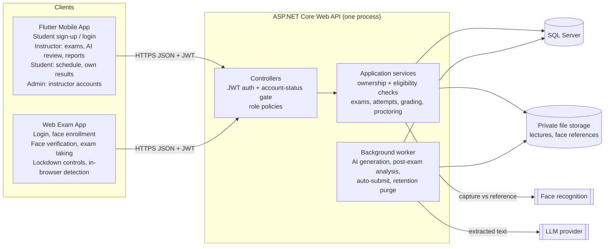
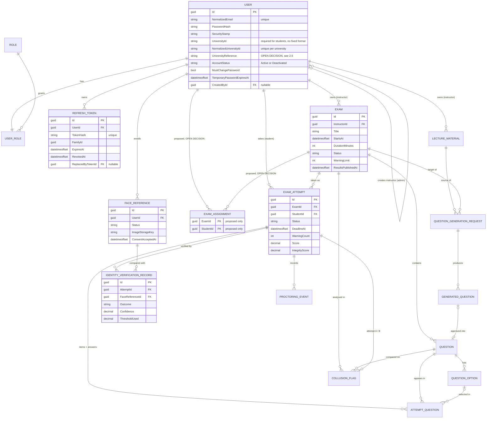
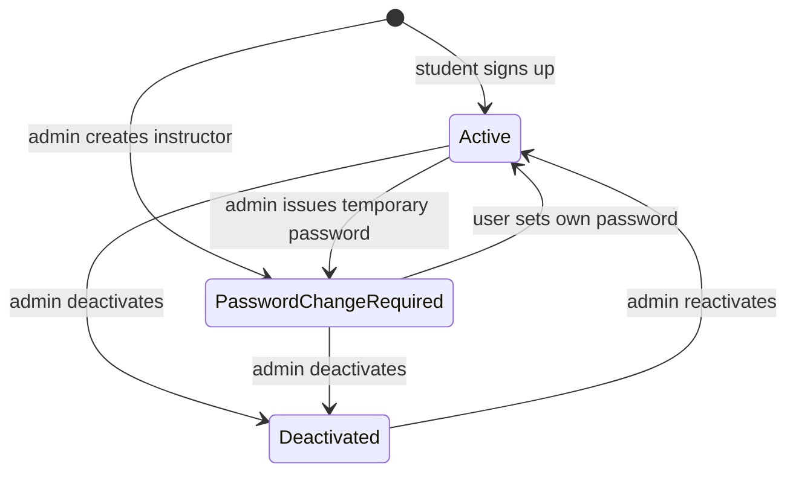

# AI-Based Exam Proctoring System: Final Architecture

**Status:** Revision 3.3, architecture targeting **.NET 10**, with two **OPEN DECISIONS**: exam assignment (§2.4) and how a student's university is identified (§2.5). Implementation starts with Phase 0 (Project Foundation), then Authentication and Authorization (§10). No code, repository, packages, migrations or database changes have been made.
**Sources:** `Grad Project/Analysis Pahse Updated.pdf` (14 pages, including the use case and activity diagrams), your project brief, and your decisions of 2026-10-18, 2026-10-19 and 2026-10-20. Earlier revisions are kept in `architecture/history/`.

| Revision | Date | Change |
|---|---|---|
| 1 | 2026-10-18 | Analysis and initial proposal |
| 2 | 2026-10-18 | Confirmed decisions D1-D6 (account approval, face verification, assignment, web exam app) |
| 3 | 2026-10-18 | Final: open questions resolved with defaults, .NET target selected from your machine, authentication/authorization architecture and permission model, final data model |
| 3.1 | 2026-10-19 | **.NET 10 is the final target** [CONF]: target framework, SDK pin, packages and .NET 10 configuration notes (§4.2, §4.4-§4.6, §6.8, §8, §10, §11). Architecture, requirements, security model and data model unchanged. |
| 3.2 | 2026-10-19 | **Account rules changed** [CONF]: students sign up and use the system immediately (no approval); instructors are created only by an admin with a temporary password that must be changed at first login. **Exam assignment mechanism marked OPEN DECISION**; `ExamAssignment` kept only as a proposal. Affected: §1, §2, §3, §4.3, §5, §6, §7, §8, §9, §10, §11. |
| 3.3 | 2026-10-20 | **Students from any university** [CONF]: no fixed `UniversityId` format, no university email domain, `UniversityId` unique **per university** instead of globally. **How a student's university is identified marked OPEN DECISION (§2.5).** Affected: §2.1 (D11), §2.2, §2.5, §2.6, §3.3, §5.2, §5.3, §5.6, §6.4, §6.7, §6.10, §8, §9, §10, §11. All other Revision 3.2 decisions unchanged. |

Tags used: **[DOC]** Analysis Phase document · **[CONF]** decided by you · **[DEF]** default adopted in Revision 3 (changeable later, not blocking) · **[DEFER]** intentionally decided in a later phase, not blocking authentication · **[OPEN DECISION]** a business decision you have not made yet; the design deliberately does not choose it.

---

## 1. Analysis Summary

**Purpose [DOC]:** a controlled, secure environment for university exams with identity verification, AI proctoring, automated grading where applicable, AI question generation, randomized exams, an integrity score and a collusion report.

**Actors:** Instructor (the document's "Teacher"), Student, Administrator, AI Proctoring Module (system actor). This document uses **Instructor** everywhere, including role and column names.

| Area | Documented requirements |
|---|---|
| Authentication | Secure login for instructors and students (FR-01, FR-13); role-based access (use case "Login"). |
| Exam management | Create/manage exams (FR-02), questions and model answers (FR-03), date/time/duration (FR-04), publish (FR-05), view results (FR-06). |
| Student information | Upcoming exams and schedules (FR-14), previous grades (FR-15), exam info without taking the exam on mobile (FR-16). |
| Exam taking | Access assigned exams (FR-17; how students are matched to exams is an OPEN DECISION, §2.4), verify identity (FR-18), webcam and permissions (FR-19), take and submit in time (FR-20), store answers and grade (FR-23), randomized question and option order (FR-25). |
| Secure environment | Prevent window/tab switching (FR-24.1), block copy/paste, screenshots, recording (FR-24.2), log violations (FR-24.3); workflow 9.1 adds VMs and remote desktop. |
| AI proctoring | Monitor (FR-26), detect predefined behaviors (FR-27), warnings (FR-21, FR-28), voice detection (FR-29), terminate at the warning limit (FR-22). |
| Integrity score | Weighted violations per student per exam (FR-30), risk Low/Medium/High, instructor views after the exam (FR-11). |
| Anti-collusion | Post-exam answer similarity, especially essays (FR-31); instructor views flagged pairs (FR-12). |
| AI question generation | Upload PDF/Word lectures (FR-08), difficulty and count (FR-09), generate (FR-07), review/edit/reject before use (FR-10). |
| Non-functional | Security, privacy of identity/webcam data, low-latency proctoring, reliability of answers, schedule-based availability, scalability, maintainability. |
| Decision support | Score and collusion report support decisions; humans decide (Assumption 12). |

## 2. Decisions

### 2.1 Confirmed by you [CONF]

| # | Decision |
|---|---|
| D1 | Students use the Flutter app to see upcoming exams intended for them and their own results once results are made available. Students never access another student's private data. |
| D2 | **Superseded in Revision 3.2 by D8 and D9.** (It was: every account stays Pending until an admin approves it.) |
| D3 | Exams are taken only in a separate web exam application. The backend decides whether the student may access the exam. A website **cannot guarantee** prevention of OS-level screenshots or screen recording, and cannot detect VMs or remote desktop; this stays a documented limitation of FR-24.2. |
| D4 | Camera-based face verification must succeed before exam questions are released. Model/provider is replaceable. A face match is supporting evidence of identity, not proof. Not Apple Face ID. |
| D5 | **Revised in Revision 3.2.** Students may only see and access exams intended for them, and the backend enforces this. **How the system determines which students are intended for an exam is an OPEN DECISION (§2.4).** |
| D6 | Flutter serves instructor workflows. The integrity/suspicion score is not a grade and is never shown to students. |
| D7 | Architecture: ASP.NET Core Web API, SQL Server, EF Core, modular monolith (Domain, Application, Infrastructure, Api, UnitTests, IntegrationTests). AI-generated questions need instructor approval before they become exam questions. Proctoring, integrity scoring, randomization and anti-collusion stay in scope. |
| D8 | **Students** create their own accounts through sign-up and can log in immediately. There is no approval workflow for students. |
| D9 | **Instructors** cannot register. Only an admin creates instructor accounts. The instructor can sign in immediately with a temporary password and must change it at first login. Account deactivation and the other security controls stay. |
| D10 | .NET 10 (`net10.0`), SDK 10.0.402, EF Core 10, SQL Server (Revision 3.1). |
| D11 | The system serves **students from any university**. `UniversityId` is required but has no fixed format. No university email domain is required, and email addresses are not assumed to be student IDs. A `UniversityId` must be unique **within the same university**, not globally, because different universities can use the same ID values. How the student's university is identified is an **OPEN DECISION (§2.5)**. |

### 2.2 Defaults [DEF]

| Topic | Default |
|---|---|
| Roles | Three roles: `Admin`, `Instructor`, `Student`. **Exactly one role per user**, assigned when the account is created. |
| How accounts are created | Student: self sign-up only. Instructor: admin only. Admin: startup seed from configuration only. The API cannot create admins, and admins cannot create students. |
| Account status | `Active` or `Deactivated`. No `Pending`/`Rejected` states. |
| Instructor credentials | The server generates a random 16-character temporary password that meets the password policy. It is returned **once** to the admin in the creation response, never stored in plain text, never logged and never retrievable again. The admin hands it to the instructor in person or through an official university channel, because the system has no email service. It expires after 72 hours. The instructor must set a new password at first login (§6.4). |
| Lost passwords | An admin can issue a new temporary password for an instructor or student account, using the same rules. Self-service "forgot password" needs an email service and is **[DEFER]**. |
| `UniversityId` | Required for students at sign-up, not used for instructors. **No format rule, pattern or university-specific regular expression.** Only generic checks: trimmed; not empty; at most 64 characters; no control characters. Letters, digits, spaces, punctuation and email-like values are all accepted, but the value is never treated as an email or login. For duplicate checks it is compared case-insensitively via a normalized copy (trimmed, upper-case invariant), while the value as entered is kept for display. Unique **per university** (§2.5, §5.3). |
| Email | Required as the login name and unique across the whole system. **Any email domain is accepted**; no university domain is required. |
| Deactivation | Admin can deactivate and reactivate instructor and student accounts. An admin cannot change their own status, and the last active admin cannot be deactivated. Deactivation ends all sessions immediately. |
| Question types | MCQ (one correct option; True/False is a 2-option MCQ) and Essay. |
| Grading | MCQ auto-graded on submit. Essays are marked by the exam owner. No AI essay grading. |
| Results release | The exam owner releases results per exam (`Exam.ResultsPublishedAt`). Students see only their own grade, and only after release. |
| Exam timing | Fixed window: `EndsAt = StartsAt + DurationMinutes`; a late student gets the remaining time; auto-submit at the deadline. |
| Editing | Exam content is locked once published; unpublish is allowed only before `StartsAt` and while no attempt exists. One attempt per student per exam. |
| Proctoring | Detection runs in the browser; only events are sent and stored, with no video, audio or screenshots. Event catalog and weights in §5.4; per-exam `WarningLimit` default 3; risk Low < 30 ≤ Medium < 60 ≤ High (configurable). |
| Face enrollment | Any time after sign-up, the student captures a reference face in the web exam app and gives consent → `FaceReference` is `PendingReview` → an admin compares it with the account details and approves it → `Active`. Only an `Active` reference allows exam attempts. Re-enrolling revokes the old reference. This review covers the face reference only; it is not account approval, and the student uses the rest of the system without it. |
| Face data | Reference image kept in private file storage (needed for admin review and for switching models). The face template, if the model produces one, is stored encrypted with ASP.NET Core Data Protection. Probe captures taken at exam time are discarded after matching. |
| Face matching | Server-side only (a browser result could be forged). Global configurable threshold, stored on every verification record. Liveness is used if the chosen model/provider supports it; otherwise it is a documented limitation. |
| Failed verification | Up to 3 tries per attempt. After that the attempt is `VerificationFailed`. The exam owner may record a manual override with a reason, which moves it to `InProgress`. No re-verification during the exam (face-presence proctoring covers it). |
| Retention | Face reference image and template deleted when the account is deactivated or on the student's request. Proctoring events and verification records (no images) kept 1 year after the exam (configurable), then purged. |
| Lecture files | `.pdf` and `.docx` only, 20 MB maximum. |
| Admin client | Role-gated admin screens in the Flutter app (instructor accounts, status, temporary passwords, face references). Swagger can be used during development. |
| Ownership | One instructor owns each exam and lecture. No co-instructors. |
| Admin data access | Admins manage accounts and face references only. They have no access to exams, answers, results or proctoring data. |

### 2.3 Deferred, not blocking authentication [DEFER]

| Item | Decided in |
|---|---|
| LLM provider for question generation (behind `IQuestionGenerator`) | Phase 3 |
| Face recognition model/provider (behind `IFaceVerifier`) and liveness support | Phase 4 |
| Web exam app front-end framework | Phase 4 |
| Self-service password reset (needs an email service) | After the core phases |

### 2.4 OPEN DECISION: exam visibility and student assignment

| | |
|---|---|
| **Confirmed requirement** [CONF D5] | Students may only see and access exams intended for them. The backend enforces this on every student-facing exam endpoint. |
| **Undecided** [OPEN DECISION] | How the system determines **which** students are intended for each exam. |

**Not assumed.** The design does not assume any of these: roster files (Excel, CSV, PDF or other) uploaded by instructors, course enrollment, groups, manual selection, uploaded lists, AI extraction, or any other mechanism. **No student account is ever created automatically from uploaded or imported data**; student accounts come only from sign-up (D8).

**What the architecture fixes now (mechanism-neutral):**
- One backend **eligibility check** answers "is student S intended for exam E?" and "which exams is student S intended for?". Every student-facing exam endpoint (exam list, exam info, attempt start and every attempt call) uses it, so whatever mechanism you choose plugs in at one place.
- **Deny by default.** Until the decision is made and implemented, the check returns no exams, so no student can see or start any exam.

**Proposed only:** `ExamAssignment` (exam ↔ student) is one candidate way to store the result. Its creation workflow, who writes it, whether it is stored or derived from another source, and its link to any future data source are **not decided**. It is not built in Phases 0 or 1.

**Questions the decision has to answer:** who decides which students an exam is for; what information it is based on; when it is set (before publish, and can it change after publish or after attempts start); and what happens to students who sign up after an exam is published.

**Needed before:** the student side of Phase 2 (`me/exams`) and Phase 4 (exam taking). It does not block Phases 0 and 1.

### 2.5 OPEN DECISION: identifying the student's university

| | |
|---|---|
| **Confirmed requirement** [CONF D11] | Every student account must be linked to the university it belongs to, so that `UniversityId` can be unique within that university. |
| **Undecided** [OPEN DECISION] | **How** the university is identified and selected at sign-up. |

**Not chosen.** The design does not choose between a university dropdown (a list of universities kept in the system), a free-text university name, or any other mechanism. Who maintains a university list, if one exists, is also open.

**What the architecture fixes now (mechanism-neutral):**
- A student account carries a **university reference** next to its `UniversityId`.
- The database enforces uniqueness of **(university reference, normalized `UniversityId`)**, not `UniversityId` alone.
- Sign-up takes the university in whatever form §2.5 settles on; the rest of the auth design does not depend on that form.

**Candidate shapes, for the decision only (not chosen):**

| Shape | Data model consequence | Effect on per-university uniqueness |
|---|---|---|
| Reference list | A `University` table and a `UniversityRefId` FK on the student | Exact: everyone at the same university shares one key |
| Free-text name | `UniversityName` + a normalized copy on the student | Weaker: spelling variants ("Cairo Univ." vs "Cairo University") count as different universities |
| Other mechanism | Defined by the decision | Must give one stable key per university |

**Also not decided or assumed:** whether instructors or exams are linked to a university. Nothing in this design ties exams to universities. That would belong to the exam-assignment decision (§2.4), which stays open and unchanged.

**Needed before:** the student sign-up endpoint in Phase 1, because sign-up must store the university and enforce the per-university rule. It does not block Phase 0 or the rest of Phase 1 (login, tokens, instructor creation, admin endpoints).

### 2.6 Working assumptions
- All timestamps stored in UTC as `datetimeoffset`; clients display local time.
- Collusion detection is a server-side text-similarity algorithm, not an external AI service.
- Integrity scores and collusion flags are advisory; they never change grades automatically.

## 3. Architecture

### 3.1 Components

| Component | Responsibility | Talks to |
|---|---|---|
| **Flutter mobile app** | Student sign-up; login for all roles; instructor first-login password change. Instructor: exams, schedule, questions, lecture upload, AI review, results release, essay marking, integrity and collusion reports. Student: schedules of exams intended for them (OPEN DECISION, §2.4), exam info, own released results. Admin: instructor account creation, deactivation, temporary passwords, face reference review. Never takes exams. | API, HTTPS JSON, JWT bearer |
| **Web exam app** (separate website) | Student only: login, face enrollment, exams intended for them, face verification capture, camera/mic checks, fullscreen lockdown controls, randomized exam, autosave, submit; in-browser presence and voice detectors and browser violation detectors; shows warnings returned by the API. | API, HTTPS JSON, JWT bearer |
| **ASP.NET Core Web API** (one deployable) | All rules and enforcement: authentication, account-status gate, role and ownership checks, exam eligibility check (mechanism OPEN DECISION), verification gate, attempt lifecycle, randomization, grading, warnings/termination, integrity score, collusion analysis, text extraction, AI generation orchestration. | SQL Server, file storage, LLM, face recognition |
| **Background worker** (`BackgroundService` in the API process) | AI question generation, post-exam integrity/collusion analysis, auto-submit of expired attempts, retention purge. DB status columns act as the queue; no broker. | SQL Server, LLM |
| **SQL Server** | System of record. | API only |
| **File storage** | Lectures and face reference images in separate private folders outside the web root, behind `IFileStorage`. Never served directly. | API only |
| **LLM provider** [DEFER] | Generates question suggestions from extracted lecture text. | API/worker |
| **Face recognition** [DEFER] | Compares a live capture with the active reference and returns match + confidence. | API only, via `IFaceVerifier` |

No message broker, SignalR or microservices. Warnings are detected in the browser and confirmed in the API's response to each event post, so no push channel is needed.

### 3.2 Diagram



### 3.3 Key flows

1. **Accounts:** a student signs up with their university (mechanism OPEN DECISION, §2.5) and `UniversityId` (Active) and logs in. An admin creates an instructor (Active, temporary password) → the instructor logs in and must change the password before anything else. Every request re-checks account status, and deactivation cuts access immediately (§6).
2. **Question generation:** instructor uploads a lecture → text extracted → generation request queued → worker calls the LLM → `GeneratedQuestion` rows (Pending) → instructor edits/approves/rejects → approval **copies** into `Question`. Students are only ever served `Question` rows.
3. **Exam start:** student opens the exam in the web app → API checks active account, Student role, the **eligibility check** (OPEN DECISION, §2.4), published, window open, no prior attempt, active face reference → attempt `AwaitingVerification` → capture sent → server-side match recorded → `InProgress`, randomized order persisted, questions returned without correct or model answers. After 3 failed tries → `VerificationFailed` until an owner override.
4. **During exam:** per-question autosave; proctoring events posted; server applies weights, counts warnings and terminates at the limit; all writes rejected outside `InProgress` or after `DeadlineAt` (+ small grace).
5. **After exam:** submit/auto-submit → MCQ graded → after the window closes the worker computes integrity scores and collusion pairs → instructor marks essays, reviews reports, releases results → students see their own grade only.

## 4. Backend Solution Structure

### 4.1 Approach
Layered **modular monolith**: four projects for compile-time dependency direction, with features as folders inside them. Not used: microservices, MediatR/CQRS, AutoMapper, generic repositories, domain events, specification pattern. EF Core `DbContext` is the unit of work; mapping is hand-written.

### 4.2 Projects and references

```
ExamProctoring.slnx                solution (XML format, the .NET 10 SDK / VS 2026 default)
global.json                        pins SDK 10.0.402 (§4.4)
Directory.Build.props              net10.0, nullable, implicit usings for every project
Directory.Packages.props           one version per package (central package management)
.config/dotnet-tools.json          local dotnet-ef 10 tool
src/
  ExamProctoring.Domain            no references, no packages
  ExamProctoring.Application       → Domain
  ExamProctoring.Infrastructure    → Application, Domain
  ExamProctoring.Api               → Application, Infrastructure (DI registration only)
tests/
  ExamProctoring.UnitTests         → Domain, Application
  ExamProctoring.IntegrationTests  → Api
```

Direction: `Api → Infrastructure → Application → Domain`, no cycles. Application uses EF Core through `IAppDbContext` (DbSets + `SaveChangesAsync`) instead of repositories. `ApplicationUser` lives in Domain and inherits `IdentityUser<Guid>`, so Domain references the `Microsoft.Extensions.Identity.Stores` package (entity classes only, no EF). This is the one package exception in Domain, accepted to avoid a duplicate user entity.

### 4.3 Folder tree

```
src/ExamProctoring.Domain/
  Common/                 Entity base, shared enums
  Users/                  ApplicationUser, AccountStatus (Active/Deactivated), RefreshToken, RoleNames
  IdentityVerification/   FaceReference, IdentityVerificationRecord, enums
  Exams/                  Exam, Question, QuestionOption, enums (ExamAssignment only once §2.4 is decided)
  Lectures/               LectureMaterial, QuestionGenerationRequest, GeneratedQuestion, enums
  Attempts/               ExamAttempt, AttemptQuestion, AttemptStatus, grading rules
  Proctoring/             ProctoringEvent, ProctoringEventType, CollusionFlag, RiskLevel, score rule

src/ExamProctoring.Application/
  Abstractions/           IAppDbContext, ICurrentUser, ITokenService, IFileStorage, ITextExtractor,
                          IQuestionGenerator, IFaceVerifier, IClock
  Auth/                   AuthService (student sign-up, login, refresh, logout, me, change password), DTOs, validators
  Accounts/               AccountAdminService (create instructor, list, deactivate, reactivate, issue temporary password),
                          TemporaryPasswordGenerator, DTOs, validators
  IdentityVerification/   enrollment, reference review, verification and override rules
  Exams/                  exam and question services; exam eligibility check (deny-all until §2.4 is decided), DTOs, validators
  Lectures/               lecture, generation and review services, DTOs, validators
  Attempts/               attempt service, Randomizer, Grader, DTOs, validators
  Proctoring/             event service, IntegrityScoreCalculator, CollusionAnalyzer, report DTOs
  Results/                instructor and student result services
  Common/                 Result/error codes, paging, options classes

src/ExamProctoring.Infrastructure/
  Persistence/            AppDbContext (IdentityDbContext<ApplicationUser, IdentityRole<Guid>, Guid>),
                          Configurations/ (one per entity), Migrations/, DataSeeder (roles, first admin)
  Identity/               JwtTokenService (ITokenService), refresh-token hashing
  Files/                  LocalFileStorage
  TextExtraction/         PDF and DOCX extractors
  AI/                     LLM question generator adapter (phase 3)
  FaceRecognition/        IFaceVerifier adapter (phase 4) + fake for tests
  BackgroundJobs/         generation, post-exam analysis, attempt expiry, retention workers
  DependencyInjection.cs

src/ExamProctoring.Api/
  Controllers/            one per module in §7
  Authorization/          policy names and registration, JWT events (account-status gate), CurrentUser
  Middleware/             exception → ProblemDetails
  Program.cs, appsettings.json, appsettings.Development.json (no secrets)

tests/ExamProctoring.UnitTests/         domain and application rules
tests/ExamProctoring.IntegrationTests/  API + real SQL Server: auth, authorization boundaries, workflows
```

Placement: entities → Domain; DTOs, validators, interfaces, services → Application by feature; DbContext, configurations, migrations, token service, external adapters → Infrastructure; controllers, policies, middleware → Api. Ownership checks live in Application services, not controllers.

**Clients** live outside the .NET solution (separate repositories, or `mobile/` and `web-exam/` folders beside `backend/`). They share only the OpenAPI contract.

### 4.4 Target framework: **.NET 10 (`net10.0`)** [CONF]

Your development environment: Windows, Visual Studio 2026 Community, .NET SDK 10.0.402, SQL Server. On your laptop I can see the Visual Studio 2026 install folder (`Microsoft Visual Studio\18`) next to 2022, the SDKs `10.0.402` and `9.0.316`, the ASP.NET Core runtime `10.0.13`, and SQL Server 2022 instances `MSSQLSERVER` and `MSSQLSERVER01`.

| Item | Final value |
|---|---|
| Target framework, all 6 projects | `net10.0` (set once in `Directory.Build.props`) |
| Language | C# 14 (the .NET 10 default; no `LangVersion` override) |
| SDK pin | `global.json`: `"version": "10.0.402"`, `"rollForward": "latestPatch"`, `"allowPrerelease": false` |
| IDE | Visual Studio 2026 (18.x). The 10.0.4xx SDK band requires VS 18.0 or later and ships with 18.9, so keep VS 2026 updated. |
| Support window | .NET 10 is LTS, supported until November 2028, so it covers the whole project. This replaces the Revision 3 concern that .NET 8/9 support ends in November 2026. |

`rollForward: latestPatch` allows newer 10.0.4xx patch SDKs but never a different feature band or major version, so Visual Studio and `dotnet` command-line builds use the same SDK.

### 4.5 Packages (.NET 10 compatible)

All `Microsoft.AspNetCore.*`, `Microsoft.EntityFrameworkCore.*` and `Microsoft.Extensions.*` packages use **one identical 10.0.x patch version**: the latest 10.0.x on NuGet when Phase 0 starts, recorded once in `Directory.Packages.props`. EF Core 10 runs only on .NET 10, so mixing 9.x and 10.x packages must not happen.

| Package | Version line | Project | Purpose |
|---|---|---|---|
| Microsoft.Extensions.Identity.Stores | 10.0.x | Domain | `IdentityUser<Guid>` base class |
| Microsoft.EntityFrameworkCore | 10.0.x | Application | `IAppDbContext` (DbSet, async LINQ) |
| Microsoft.AspNetCore.Identity.EntityFrameworkCore | 10.0.x | Infrastructure | Identity stores, password hashing, lockout |
| Microsoft.EntityFrameworkCore.SqlServer | 10.0.x | Infrastructure | SQL Server provider (uses Microsoft.Data.SqlClient 6.x) |
| Microsoft.EntityFrameworkCore.Design | 10.0.x, `PrivateAssets=all` | **Api** | Migrations tooling; EF requires it in the startup project. Revision 3 listed it under Infrastructure, which was wrong. |
| dotnet-ef (local tool) | 10.0.x, same as EF packages | repo | `dotnet ef migrations add / database update` |
| Microsoft.AspNetCore.Authentication.JwtBearer | 10.0.x | Api | JWT validation; brings Microsoft.IdentityModel.JsonWebTokens for token creation |
| Microsoft.AspNetCore.OpenApi | 10.0.x | Api | Built-in OpenAPI document generation (OpenAPI 3.1) |
| Swashbuckle.AspNetCore.SwaggerUI | 10.x | Api | Swagger UI page over the built-in document (Development only) |
| FluentValidation.DependencyInjectionExtensions | 12.x | Application | Request validation (FluentValidation 12 supports .NET 8 and later) |
| UglyToad.PdfPig, DocumentFormat.OpenXml | latest stable | Infrastructure | Lecture text extraction (phase 3; .NET Standard 2.0 libraries, compatible) |
| xunit.v3, xunit.runner.visualstudio 3.x, Microsoft.NET.Test.Sdk | latest stable | tests | Test framework and VS 2026 Test Explorer / `dotnet test` runner |
| Microsoft.AspNetCore.Mvc.Testing | 10.0.x | IntegrationTests | `WebApplicationFactory<Program>` |

Change from Revision 3: Swagger now uses the **built-in OpenAPI generator plus the Swagger UI package** instead of full Swashbuckle. This is the .NET 10 template approach. It avoids running two document generators, and Swashbuckle 10's move to Microsoft.OpenApi 2.x breaks most older Swashbuckle examples anyway.

Integration tests use the **local SQL Server instance** with a dedicated, recreated test database (`ExamProctoring_Tests`), not Testcontainers. Built-in features replace packages for logging, rate limiting, background services, Data Protection and ProblemDetails.

### 4.6 .NET 10 configuration notes for Phases 0-1

| Area | Decision |
|---|---|
| API host | Controllers (`AddControllers`, `[ApiController]`), `AddProblemDetails` + `IExceptionHandler`, `AddRateLimiter`, CORS, HTTPS redirection, HSTS outside Development. .NET 10's new built-in validation (`AddValidation`) targets Minimal APIs, so we keep FluentValidation for controllers. |
| OpenAPI / Swagger | `AddOpenApi()` + `MapOpenApi()` (document at `/openapi/v1.json`) and `UseSwaggerUI` pointed at it, Development only. A document transformer adds the Bearer security scheme so Swagger UI shows an Authorize button. |
| EF Core 10 + SQL Server | `UseSqlServer(connectionString, sql => sql.UseCompatibilityLevel(160))`. Level 160 is SQL Server 2022. EF Core 10 switches to the native `json` column type at level 170 (SQL Server 2025), and SQL Server 2022 doesn't have that type. Pinning 160 keeps `OptionsJson`/`OptionOrder` as `nvarchar(max)`. `DbContext` lives in Infrastructure; migrations are in `Infrastructure/Persistence/Migrations`. |
| Connection string (dev, User Secrets) | `Server=localhost;Database=ExamProctoring;Trusted_Connection=True;TrustServerCertificate=True` (default instance `MSSQLSERVER`). Microsoft.Data.SqlClient encrypts by default, and a local SQL Server uses a self-signed certificate, so `TrustServerCertificate=True` is for development only. |
| Migrations | `dotnet ef migrations add <Name> --project src/ExamProctoring.Infrastructure --startup-project src/ExamProctoring.Api`, then `dotnet ef database update` with the same options. Never applied automatically at startup. |
| Identity | `AddIdentityCore<ApplicationUser>(...)`, `.AddRoles<IdentityRole<Guid>>()`, `.AddEntityFrameworkStores<AppDbContext>()`, `.AddSignInManager()`. Not `AddIdentity` (it adds cookie schemes) and not `MapIdentityApi` (opaque tokens, no account-status gate or forced password change). Passkey support, new in .NET 10 Identity, is not used. |
| JWT | `AddAuthentication(JwtBearerDefaults.AuthenticationScheme).AddJwtBearer(...)` with `MapInboundClaims = false`, `NameClaimType = "sub"`, `RoleClaimType = "role"`, `ValidAlgorithms = [HS256]`, 30 s clock skew. Tokens are created with `JsonWebTokenHandler` (the handler JwtBearer uses since .NET 8), not the legacy `JwtSecurityTokenHandler`. |
| Data Protection | Keys persisted to a private folder (`PersistKeysToFileSystem`), so face templates encrypted in phase 4 stay readable after restarts. |
| Tests | `WebApplicationFactory<Program>` with the test database's connection string. Default VSTest runner (works in VS 2026 Test Explorer and `dotnet test`); no Microsoft.Testing.Platform opt-in. |

## 5. Database Design

### 5.1 Conventions
- Primary keys: `Guid` (EF Core generates sequential GUIDs for SQL Server). Composite keys only where shown.
- Enums stored as `nvarchar(30)` strings, so the database is readable.
- Times: `datetimeoffset` in UTC. Marks and scores: `decimal(6,2)`. Confidence and thresholds: `decimal(5,4)`.
- Concurrency: `rowversion` on `Exam` and `ExamAttempt`.
- Deletes: `Restrict` by default. `Cascade` only Exam (Draft) → Question → QuestionOption, and User → RefreshToken. Published exams, attempts and history are never hard-deleted.

### 5.2 Entities

| Entity | Purpose | Columns (beyond `Id`) |
|---|---|---|
| **`ApplicationUser`** (`AspNetUsers`) | Every account, its status and its credential state | Identity columns: `Email`, `NormalizedEmail` (unique), `UserName` (= email), `PasswordHash`, `SecurityStamp`, `ConcurrencyStamp`, `LockoutEnd`, `LockoutEnabled`, `AccessFailedCount`. Custom: `FullName` nvarchar(150), `UniversityId` nvarchar(64) null (required for students; value as entered), `NormalizedUniversityId` nvarchar(64) null (trimmed, upper-case; used for uniqueness), **university reference** null (required for students; column shape OPEN DECISION §2.5, e.g. `UniversityRefId` FK or a normalized university name), `AccountStatus` (Active/Deactivated), `CreatedAt`, `CreatedById` null FK → user (the admin who created an instructor; null for self-registered students and the seeded admin), `MustChangePassword` bit, `TemporaryPasswordExpiresAt` null, `PasswordChangedAt` null, `StatusChangedAt` null, `StatusChangedById` null FK → user, `StatusReason` nvarchar(500) null, `LastLoginAt` null |
| `AspNetRoles`, `AspNetUserRoles` | Roles `Admin`, `Instructor`, `Student`; one row per user, assigned at creation | Identity standard. Other Identity tables are created by default and unused. |
| **`RefreshToken`** | Session renewal, rotation and revocation | `UserId` FK, `TokenHash` char(64) (SHA-256 hex), `FamilyId` Guid, `CreatedAt`, `ExpiresAt`, `RevokedAt` null, `RevokedReason` nvarchar(50) null, `ReplacedByTokenId` null FK → RefreshToken |
| `Exam` | Exam and its schedule | `InstructorId` FK (owner), `Title` nvarchar(200), `Description` null, `StartsAt`, `DurationMinutes`, `Status` (Draft/Published/Cancelled), `WarningLimit` (default 3), `PublishedAt`, `ResultsPublishedAt`, `AnalysisCompletedAt`, `RowVersion` |
| `Question` | Exam-ready question (authored or approved) | `ExamId` FK, `Type` (Mcq/Essay), `Text`, `ModelAnswer` null, `Marks`, `Position`, `SourceGeneratedQuestionId` null FK |
| `QuestionOption` | MCQ option | `QuestionId` FK, `Text`, `IsCorrect`, `Position` |
| `ExamAssignment` **[PROPOSED, OPEN DECISION]** | Candidate record of which students an exam is intended for (§2.4) | Proposed shape only: PK (`ExamId`, `StudentId`). Creation workflow, who writes it, extra columns and its link to any source are undecided. Not created until §2.4 is decided. |
| `LectureMaterial` | Uploaded lecture | `InstructorId` FK (owner), `OriginalFileName`, `StorageKey`, `FileType` (Pdf/Docx), `SizeBytes`, `UploadedAt`, `ExtractedText` nvarchar(max), `ExtractionStatus` |
| `QuestionGenerationRequest` | One AI run | `LectureMaterialId` FK, `ExamId` FK, `RequestedById` FK, `Difficulty` (Easy/Medium/Hard), `RequestedCount`, `Status` (Pending/Processing/Completed/Failed), `FailureReason` null, `CreatedAt`, `CompletedAt` null |
| `GeneratedQuestion` | AI suggestion awaiting review | `GenerationRequestId` FK, `Type`, `Difficulty`, `Text`, `OptionsJson`, `SuggestedAnswer`, `ReviewStatus` (Pending/Approved/Rejected), `ReviewedAt` null, `ApprovedQuestionId` null FK |
| **`FaceReference`** | Student's enrolled face | `UserId` FK, `Status` (PendingReview/Active/Revoked/Rejected), `ImageStorageKey`, `TemplateData` varbinary(max) null (encrypted), `ModelVersion` null, `ConsentAcceptedAt`, `CapturedAt`, `ReviewedById` null FK, `ReviewedAt` null |
| `ExamAttempt` | One student's sitting | `ExamId` FK, `StudentId` FK, `Status` (AwaitingVerification/VerificationFailed/InProgress/Submitted/AutoSubmitted/Terminated), `CreatedAt`, `IdentityVerifiedAt` null, `StartedAt` null, `DeadlineAt`, `SubmittedAt` null, `WarningCount`, `Score` null, `GradingStatus` (Pending/Graded), `IntegrityScore` null, `RiskLevel` null, `RowVersion` |
| **`IdentityVerificationRecord`** | One verification try or override | `AttemptId` FK, `FaceReferenceId` FK, `OccurredAt`, `Outcome` (Matched/NotMatched/NoFace/MultipleFaces/LivenessFailed/ProviderError/ManualOverride), `Confidence` null, `ThresholdUsed`, `ModelVersion`, `OverriddenById` null FK, `OverrideReason` null |
| `AttemptQuestion` | Randomized order and answer | PK (`AttemptId`, `QuestionId`), `DisplayOrder`, `OptionOrder` (JSON array of option ids), `SelectedOptionId` null FK, `EssayAnswer` null, `AwardedMarks` null, `AnsweredAt` null |
| `ProctoringEvent` | Violation/warning event | `AttemptId` FK, `EventType`, `Source` (Browser/Video/Audio), `ClientOccurredAt`, `ReceivedAt`, `Weight` (snapshot), `CountedAsWarning`, `Details` nvarchar(500) null |
| `CollusionFlag` | Suspicious answer pair | `ExamId` FK, `QuestionId` FK, `AttemptAId` FK, `AttemptBId` FK, `SimilarityPercent`, `IsFlagged`, `CalculatedAt` |

Why these shapes:
- Schedule lives on `Exam`, because the document's Schedule Data repeats Exam Data.
- Randomization and answers share `AttemptQuestion`, because both are keyed by (attempt, question).
- Integrity score and risk are columns on `ExamAttempt`; the violations list is that attempt's events.
- Account status and credential state (temporary password, forced change) are columns on `ApplicationUser`; no separate approval or request table is needed now that accounts are not approved.
- `GeneratedQuestion` stays separate from `Question`. That is the structural guarantee that unapproved AI output never reaches students.

**Persisted:** account status and credential state, verification outcomes and thresholds, `WarningCount`, scores, marks, integrity score and risk level (snapshots), collusion pairs, event weights.
**Calculated on read:** exam phase (Upcoming/Open/Closed), totals and averages, verification tries used, violation breakdowns, student schedules.

### 5.3 Constraints and indexes

| Table | Constraint / index | Purpose |
|---|---|---|
| AspNetUsers | Unique `NormalizedEmail`; **unique (university reference, `NormalizedUniversityId`)** where both are not null; index (`AccountStatus`, `CreatedAt`) | One account per email; one account per student ID **within a university** (the same ID at two universities is allowed); admin account lists. "University and UniversityId required for students" is enforced in the Application layer, because the role lives in another table. |
| AspNetUserRoles | Unique `UserId` (enforces one role per user) | Single-role model |
| RefreshToken | Unique `TokenHash`; index `UserId`; index `FamilyId` | Lookup, revoke all, reuse detection |
| Exam | Index (`InstructorId`, `StartsAt`); check `DurationMinutes > 0`, `WarningLimit > 0` | Instructor lists, validity |
| Question | Unique (`ExamId`, `Position`); check `Marks > 0` | Ordering |
| QuestionOption | Unique (`QuestionId`, `Position`) | Ordering; "exactly one correct option" enforced in Domain |
| ExamAssignment *(proposed, OPEN DECISION)* | PK (`ExamId`, `StudentId`); index `StudentId` | Only if §2.4 selects this shape |
| FaceReference | Unique `UserId` where `Status = 'Active'`; index (`Status`, `CapturedAt`) | One active reference; admin review queue |
| ExamAttempt | Unique (`ExamId`, `StudentId`); index (`Status`, `DeadlineAt`) | One attempt; expiry sweep |
| IdentityVerificationRecord | Index (`AttemptId`, `OccurredAt`) | Retry count, audit |
| AttemptQuestion | Unique (`AttemptId`, `DisplayOrder`) | Ordering |
| GeneratedQuestion | Index (`GenerationRequestId`, `ReviewStatus`); unique `ApprovedQuestionId` where not null | No double approval |
| ProctoringEvent | Index (`AttemptId`, `ReceivedAt`) | Reports |
| CollusionFlag | Unique (`QuestionId`, `AttemptAId`, `AttemptBId`); check `AttemptAId < AttemptBId` | No duplicate or mirrored pairs |

### 5.4 Proctoring event catalog (enum + weights in configuration)

| Event | Browser-detectable | Weight |
|---|---|---|
| TabOrWindowSwitch, FullscreenExit | Yes | 3 |
| CopyPasteAttempt, ContextMenuAttempt, ScreenshotKeyPressed | Yes (key/clipboard events only) | 2 |
| NoFaceDetected / MultipleFacesDetected / LookingAway | Yes, client ML | 3 / 5 / 2 |
| VoiceDetected | Yes, voice activity detection | 3 |
| CameraOrMicLost | Yes | 4 |
| VirtualMachine, RemoteAccess, ScreenRecording | **No** (D3 limitation) | reserved |

### 5.5 Ownership rules

| Data | Owner / who may read |
|---|---|
| Account, own profile | The user. Admins create instructor accounts, change account status and issue temporary passwords. |
| `FaceReference` | Student owner (status only); admins review the image. Instructors never see reference images. |
| `Exam`, `Question`, `QuestionOption`, `LectureMaterial`, generation data | Owning instructor (`InstructorId`) only |
| Exam schedule/info (no questions) | Students the exam is intended for, via the eligibility check. Mechanism: OPEN DECISION (§2.4). |
| Who may write student-to-exam data | OPEN DECISION (§2.4) |
| `ExamAttempt`, `AttemptQuestion` | Student owner during the attempt; owning instructor for results and marking |
| Released grade | Student owner, after `ResultsPublishedAt` |
| `IntegrityScore`, `RiskLevel`, `ProctoringEvent`, `CollusionFlag`, verification confidence | Owning instructor only. Never students [CONF D6] and never admins. |

### 5.6 ER diagram



Entities not expanded above (`QUESTION`, `QUESTION_OPTION`, `LECTURE_MATERIAL`, `QUESTION_GENERATION_REQUEST`, `GENERATED_QUESTION`, `ATTEMPT_QUESTION`, `PROCTORING_EVENT`, `COLLUSION_FLAG`) have the columns listed in §5.2.

## 6. Authentication and Authorization Architecture

This is the specification for the next phase.

### 6.1 Five separate checks

| # | Check | Question it answers | Where | Failure |
|---|---|---|---|---|
| 1 | **Authentication** | Is this a valid, unexpired JWT from us? | JwtBearer middleware (issuer, audience, lifetime, signature) | 401 |
| 2 | **Account gate** | Is the account still `Active`, with an unchanged security stamp? If `MustChangePassword` is set, is this one of the three allowed endpoints? | `JwtBearerEvents.OnTokenValidated`: one primary-key lookup of `AccountStatus`, `SecurityStamp`, `MustChangePassword` per request | 401 `token_invalid`, or 403 `password_change_required` |
| 3 | **Role authorization** | Is the role allowed for this endpoint? | Policies `AdminOnly`, `InstructorOnly`, `StudentOnly` on controllers | 403 |
| 4 | **Ownership / eligibility** | Does the resource belong to the caller, or (students) is the exam intended for them? | Application services, filtered queries using `ICurrentUser`; the student exam eligibility check (mechanism OPEN DECISION, deny by default) | 404 (no information leak) |
| 5 | **Workflow state** | Is the action allowed now (exam window, attempt status, verification passed)? | Domain/Application rules | 409 or 422 with code |

There is no account-approval check. Status (check 2), role (check 3) and ownership/eligibility (check 4) are independent of each other.

### 6.2 Permission model

| Capability | Admin | Instructor | Student |
|---|---|---|---|
| Sign up (anonymous) | — (seed only) | — (created by admin) | ✓ |
| Login, refresh, logout, me, change password | ✓ | ✓ | ✓ |
| Create instructor accounts | ✓ | — | — |
| List accounts, deactivate/reactivate, issue temporary password | ✓ (instructors and students; not own account) | — | — |
| Review face references | ✓ | — | — |
| Create/edit/publish exams and questions | — | own exams | — |
| Decide which students an exam is for | **OPEN DECISION** | **OPEN DECISION** | — |
| Upload lectures, generate and review AI questions | — | own lectures/exams | — |
| Mark essays, release results, view results | — | own exams | — |
| Integrity and collusion reports, verification override | — | own exams | — |
| Enroll own face reference | — | — | ✓ |
| View exam schedule/info | — | — | exams intended for them (eligibility check) |
| Start attempt, verify, answer, submit, send events | — | — | own attempt, eligible exam |
| View grades | — | — | own, after release |

### 6.3 Account lifecycle



- `PasswordChangeRequired` is not a separate status: it is `AccountStatus = Active` with `MustChangePassword = true`.
- Only `Active` accounts receive tokens or pass check 2. While `MustChangePassword` is set, only `change-password`, `me` and `logout` work.
- Creating an instructor, issuing a temporary password, deactivating, reactivating and changing a password all regenerate `SecurityStamp` and revoke all refresh tokens, so existing access tokens stop working on the next request.
- Status changes record `StatusChangedAt`, `StatusChangedById` and `StatusReason`.

### 6.4 Sign-up, instructor creation and login

**Student sign-up** `POST /api/auth/register` (anonymous): `fullName`, `email` (any domain), `password`, `universityId` (flexible format, §2.2), and the student's **university** (form OPEN DECISION, §2.5). The role is always `Student`; the request has no role field. The account is `Active` immediately and returns 201. The client then calls login, so login stays the only place tokens are issued. A duplicate email, or a `UniversityId` already used **at the same university**, returns 409; the same `UniversityId` at a different university is accepted. This reveals that an account exists; the risk is accepted for usability and limited by rate limiting. No student account is ever created any other way.

**Instructor creation** `POST /api/admin/instructors` (Admin): `fullName`, `email`.
1. The server creates the account (`Active`, role `Instructor`, `CreatedById` = admin) with a generated 16-character temporary password, `MustChangePassword = true` and `TemporaryPasswordExpiresAt` = now + 72 hours.
2. The 201 response shows the temporary password to the admin **once**. It is never stored in plain text, logged or shown again.
3. The admin delivers it in person or through an official university channel.

**Temporary password for an existing account** `POST /api/admin/accounts/{id}/temporary-password` (Admin; instructor or student, not admins): same rules, and all sessions are revoked.

**Login** `POST /api/auth/login` (anonymous): `email`, `password`.
1. Find the user by normalized email; check the password with lockout counting.
2. Wrong email or password → 401 `invalid_credentials` (same response for both). Locked → 401 `account_locked`.
3. Only after a correct password: `Deactivated` → 403 `account_deactivated`; temporary password expired → 403 `temporary_password_expired` (an admin issues a new one).
4. Otherwise issue an access token and a refresh token, set `LastLoginAt`, and return `mustChangePassword` (true for a temporary password).

**First-login password change** `POST /api/auth/change-password` (current password + new password). The new password must differ from the temporary one. On success: `MustChangePassword = false`, `TemporaryPasswordExpiresAt = null`, `PasswordChangedAt` set, new `SecurityStamp`, all refresh tokens revoked, and a fresh token pair is returned.

### 6.5 Passwords
- ASP.NET Core Identity `PasswordHasher` (PBKDF2, HMAC-SHA512, 100,000 iterations, random salt per password). Passwords, including temporary ones, are never stored in plain text, logged or returned, except the single creation/reset response to the admin.
- Temporary passwords come from a cryptographically secure random generator (`RandomNumberGenerator`).
- Policy: at least 8 characters, with an upper-case letter, a lower-case letter and a digit.
- Lockout: 5 failed attempts → 15 minutes, enabled for every account.
- `POST /api/auth/change-password` requires the current password. It regenerates `SecurityStamp` and revokes all refresh tokens.
- HTTPS only (HSTS outside Development).

### 6.6 Tokens

| | Access token | Refresh token |
|---|---|---|
| Format | JWT, HS256, key ≥ 256 bits from secrets | 32 random bytes, Base64Url; only the SHA-256 hash is stored |
| Lifetime | 15 minutes (clock skew 30 s) | 7 days |
| Contents | `sub` (user id), `email`, `name`, `role`, `sstamp` (security stamp), `jti`; `iss`/`aud` from configuration | none (opaque) |
| Renewal | — | `POST /api/auth/refresh` rotates: old token revoked, new one in the same `FamilyId`; requires the account still `Active` |
| Reuse detection | — | A revoked or replaced token presented again → revoke the whole family, return 401 `refresh_token_reused`, log a warning |
| Logout | expires naturally | `POST /api/auth/logout` revokes the family |

Client storage: Flutter uses `flutter_secure_storage`. The web exam app keeps the access token in memory and the refresh token in `sessionStorage`, so a page reload during an exam does not log the student out; it is cleared when the tab closes. The web app uses a strict Content-Security-Policy. Both clients receive tokens in the JSON body. No cookies, so no CSRF handling is needed.

### 6.7 Authorization implementation rules
- A **fallback policy** requires an authenticated user for every endpoint. Only `register`, `login`, `refresh` and the health check are `[AllowAnonymous]`.
- Role policies are applied at controller level. A user has exactly one role.
- Ownership is enforced inside queries, never by loading and comparing afterwards: `Exams.Where(e => e.Id == id && e.InstructorId == me)`, `Attempts.Where(a => a.Id == id && a.StudentId == me)`. Student access to an exam always goes through the single **eligibility check** (OPEN DECISION, §2.4), which denies everything until the mechanism is decided. A miss returns 404.
- `ICurrentUser` (UserId, Role) is read from claims and is the only way services learn who the caller is.
- Admins get no implicit access to exam data.
- CORS allows only the configured web exam app origin(s).
- Rate limits (per IP, fixed window): register 5/min, login 10/min, refresh 30/min.
- Errors use ProblemDetails with a stable `code` extension (`invalid_credentials`, `account_locked`, `account_deactivated`, `temporary_password_expired`, `password_change_required`, `token_invalid`, `refresh_token_reused`, `validation_failed`, `duplicate_account`).

### 6.8 Seeding and configuration
- At startup an idempotent seeder creates the three roles and, if no admin exists, the first admin from `Seed:AdminEmail` / `Seed:AdminPassword` (User Secrets in development, environment variables elsewhere) with status `Active` and `MustChangePassword = false`.
- Configuration (.NET 10 specifics in §4.6): `Jwt:Issuer`, `Jwt:Audience`, `Jwt:SigningKey` (secret), `Jwt:AccessTokenMinutes`, `Jwt:RefreshTokenDays`, `Auth:TemporaryPasswordHours` (72), `Cors:WebExamOrigins`, `ConnectionStrings:Default` (secret).
- Migrations are applied manually with the local `dotnet-ef` 10 tool (command in §4.6), never automatically at startup.

### 6.9 Phase 1 API boundary

| Endpoint | Access |
|---|---|
| `POST /api/auth/register` (students only), `POST /api/auth/login`, `POST /api/auth/refresh` | Anonymous, rate limited |
| `POST /api/auth/logout`, `GET /api/auth/me`, `POST /api/auth/change-password` | Any active user (also while `MustChangePassword`) |
| `POST /api/admin/instructors` | Admin |
| `GET /api/admin/accounts?role=&status=&page=`, `GET /api/admin/accounts/{id}` | Admin |
| `POST /api/admin/accounts/{id}/deactivate` (`reason`), `/reactivate`, `/temporary-password` | Admin; instructor and student accounts only, not own account; last active admin protected |

No exam-assignment endpoints exist in Phase 1 (§2.4).

### 6.10 Required auth tests
- Student sign-up: validation, role is always Student, can log in immediately.
- `UniversityId` flexibility: purely numeric, alphanumeric, hyphenated, slash-separated, space-containing and email-like IDs are all accepted; empty, whitespace-only, over 64 characters or containing control characters are rejected with `validation_failed`.
- Per-university uniqueness: the same `UniversityId` at two different universities is accepted; the same ID at the same university → 409 `duplicate_account`, including when it differs only by letter case or leading/trailing spaces.
- Email: addresses from any domain are accepted; duplicate email → 409.
- Sign-up without a university or without a `UniversityId` is rejected.
- A request trying to register as Instructor or Admin cannot create one.
- Instructor creation: admin only; temporary password returned once and never stored in plain text; instructor can log in; every endpoint except change-password/me/logout returns 403 `password_change_required` until the password is changed; expired temporary password → 403; the new password must differ.
- Admin temporary-password reset revokes existing sessions.
- Deactivated accounts cannot log in, and deactivation invalidates an existing access token on the next request; reactivation restores access.
- Login messages: same 401 for a wrong email or password; status codes only after a correct password; lockout.
- Refresh rotation and reuse detection.
- Role policies (Student or Instructor → admin endpoint = 403); admin cannot deactivate self or the last admin; anonymous access only on the four endpoints.

## 7. API Module Overview

Routes under `/api`, JSON, JWT bearer, ProblemDetails. All checks in §6.1 apply everywhere.

| Module | Representative endpoints | Access |
|---|---|---|
| Auth / Account admin | §6.9 | §6.9 |
| Face enrollment | `POST me/face-reference`, `GET me/face-reference`; `GET admin/face-references?status=PendingReview`, `POST admin/face-references/{id}/approve`, `/reject` | Student (own); Admin |
| Exams | `GET/POST exams`, `GET/PUT/DELETE exams/{id}`, `POST exams/{id}/publish`, `/unpublish` | Instructor, own |
| Questions | `GET/POST exams/{id}/questions`, `PUT/DELETE questions/{id}` | Instructor, own Draft exam |
| Student-to-exam assignment | **OPEN DECISION (§2.4).** No endpoints are defined until the mechanism is chosen. | Undecided |
| Lectures | `POST lectures`, `GET lectures`, `DELETE lectures/{id}` | Instructor, own |
| Question generation | `POST lectures/{id}/generations`, `GET generations/{id}`, `GET generations/{id}/questions`, `PUT generated-questions/{id}`, `POST generated-questions/{id}/approve`, `/reject` | Instructor, own lecture and own exam |
| Student exams | `GET me/exams`, `GET me/exams/{id}` (schedule/info, no questions) | Student; only exams passed by the eligibility check (returns none until §2.4 is decided) |
| Attempts | `POST exams/{id}/attempts`, `POST attempts/{id}/identity-verification`, `GET attempts/{id}`, `PUT attempts/{id}/answers/{questionId}`, `POST attempts/{id}/submit` | Student, own attempt, eligible exam; questions only when `InProgress` |
| Verification override | `POST attempts/{id}/identity-verification/override` | Instructor, own exam |
| Proctoring | `POST attempts/{id}/events` → `{warningCount, warningLimit, terminated}` | Student, own `InProgress` attempt |
| Results | `GET exams/{id}/results`, `GET exams/{id}/attempts/{attemptId}`, `PUT .../answers/{questionId}/marks`, `POST exams/{id}/results/publish`; `GET me/results` | Instructor, own; Student, own after release (grade only) |
| Reports | `GET exams/{id}/integrity`, `GET exams/{id}/attempts/{attemptId}/events`, `GET exams/{id}/collusion` | Instructor, own, after analysis |

## 8. Security and Risk Checklist

| Area | Required control |
|---|---|
| Authentication & accounts | §6 in full. Temporary passwords: random, shown once, 72-hour expiry, forced change. Open self sign-up is rate limited. A self-declared university and `UniversityId` are not proof of identity or enrolment; the admin-reviewed face reference is the identity check before any exam. Because any email domain is accepted, email does not prove university membership either. |
| Exam visibility | Every student exam endpoint goes through one eligibility check; deny by default until §2.4 is decided. No student accounts are created from uploaded data. |
| Data leakage | Student DTOs never contain `IsCorrect`, `ModelAnswer`, other students' data, integrity scores, collusion flags or verification confidence. |
| Exam integrity | Server clock and `DeadlineAt`; status and deadline checked on every write; server-side warning count and termination; `rowversion` on attempts; auto-submit worker. |
| Identity verification | Server-side matching; questions withheld until `InProgress`; 3 tries; override audited; threshold and model version recorded; face match is evidence, not proof. |
| Biometric data | Consent recorded; private storage; template encrypted; probe images discarded; instructors never see reference images; deleted on deactivation or request; never logged. |
| AI approval | Only `Question` rows reach students; approval requires ownership of the request and the exam; publish requires ≥1 valid question. |
| File uploads | `.pdf`/`.docx` with magic-byte check, 20 MB limit, random storage names, outside the web root, never served directly, extraction timeout. |
| Validation | FluentValidation on every request DTO. |
| Secrets | User Secrets (dev) / environment variables; `.gitignore` before the first commit; nothing secret in `appsettings*.json`. |
| Errors & logging | ProblemDetails, no stack traces outside Development; never log passwords, tokens, answers, face data or lecture text. |
| AI failures | Timeouts, limited retries, `Failed` status with reason, validated JSON output, lecture text treated as data. |
| Retention | Purge worker per §2.2. |
| Testing | §6.10 plus ownership-boundary integration tests for every module. |

**Known limitations (for the report):** browser lockdown is best effort and cannot stop OS screenshots or recording or detect VMs/remote desktop (D3). Client-side detection can be bypassed. Face recognition can produce false matches or rejections and, without liveness, can be fooled by photos. Detection accuracy depends on camera, lighting, microphone and noise. Collusion detection is weak on short answers.

**Future options:** desktop wrapper or Safe Exam Browser, evidence snapshots, cloud blob storage, CI pipeline, audit log, email-based password reset.

## 9. Requirement-to-Design Mapping and Validation

| Requirement | Design |
|---|---|
| FR-01, FR-13 Login | §6: Identity, JWT, refresh tokens, account gate |
| D8 Student sign-up | `POST auth/register`, Active immediately |
| D11 Any university, flexible IDs | University reference + `UniversityId` on the student; unique (university reference, normalized `UniversityId`); no format or email-domain rule. **University identification OPEN DECISION (§2.5).** |
| D9 Admin-created instructors | `POST admin/instructors`, temporary password, `MustChangePassword`, check 2 |
| FR-02-05 Exams, questions, schedule, publish | Exams/Questions modules, `Exam`, `Question`, `QuestionOption` |
| FR-06 Results | Results module, essay marking, release |
| FR-07-10 AI generation and review | `LectureMaterial`, `QuestionGenerationRequest`, `GeneratedQuestion` → copy to `Question` |
| FR-11, FR-30 Integrity score | `IntegrityScoreCalculator`, `ExamAttempt.IntegrityScore/RiskLevel`, instructor-only report |
| FR-12, FR-31 Anti-collusion | `CollusionAnalyzer`, `CollusionFlag`, post-exam worker |
| FR-14-16 Student schedule and grades | `me/exams`, `me/results` |
| FR-17 / D5 Exams intended for the student | Single eligibility check on every student exam endpoint, deny by default. **Mechanism OPEN DECISION (§2.4)**; `ExamAssignment` proposed only. |
| FR-18 Identity verification | `FaceReference`, `IdentityVerificationRecord`, verification gate, `IFaceVerifier` |
| FR-19 Webcam/permissions | Web app pre-checks; `CameraOrMicLost` event |
| FR-20, FR-23 Take, submit, grade | Attempts module, `AttemptQuestion`, `Grader`, expiry worker |
| FR-21, 22, 26-29 Proctoring | Browser detectors → `ProctoringEvent`; server warning limit and termination |
| FR-24.1, 24.3 Lockdown + logging | Web app controls → events |
| FR-24.2, VM/remote detection | Documented limitation (D3) |
| FR-25 Randomization | `Randomizer`, `AttemptQuestion.DisplayOrder/OptionOrder` |
| NFRs | §6, §8, autosave and `rowversion` for reliability, modular monolith for maintainability, indexes in §5.3 |

| Consistency check | Result |
|---|---|
| Active-account rule is the same everywhere | Login, check 2 and refresh all refuse deactivated accounts; status and password changes revoke sessions; temporary-password accounts are limited to the password change until it is done. |
| One gate for student exam access | `me/exams`, `me/exams/{id}`, attempt start and all attempt endpoints use the same eligibility check; its mechanism stays OPEN DECISION and it denies by default. |
| University rules are the same everywhere | §2.2, §5.2, §5.3, §6.4 and §6.10 all use: `UniversityId` required, no format rule, unique per university, any email domain. The university selection mechanism appears only as OPEN DECISION (§2.5). |
| No approval workflow remains for students | Sign-up creates an Active Student; nothing in §5-§7 refers to Pending, Rejected or approval. |
| Questions released only after face verification | Questions are returned only for `InProgress` attempts, which require `Matched` or `ManualOverride`. |
| AI questions cannot bypass approval | Students read only `Question`; it is created only by instructor authoring or approval. |
| Students cannot see others' data or integrity data | Every student query filters by `StudentId`; integrity, collusion and confidence fields are absent from student DTOs. |
| Admin scope | Instructor creation, account status, temporary passwords and face references; no exam data. |
| No circular dependencies or duplicate logic | One-way references; rules live once in Domain/Application. |
| No unnecessary infrastructure | One API, one database, local private storage, two pluggable external services added in later phases. |

## 10. Implementation Roadmap

| Phase | Scope | Depends on |
|---|---|---|
| 0. Foundation | Git repo + `.gitignore`, `global.json` (SDK 10.0.402), `ExamProctoring.slnx` with 6 `net10.0` projects, `Directory.Build.props`, `Directory.Packages.props` (one 10.0.x version line), local `dotnet-ef` tool, configuration and User Secrets, ProblemDetails, OpenAPI + Swagger UI, `AppDbContext` with compatibility level 160, initial migration on local SQL Server. No exam or assignment tables. | — |
| **1. Authentication & Authorization** | `ApplicationUser` + `RefreshToken`, Identity setup, password/lockout policy, student sign-up (only once §2.5 is decided), login/refresh/logout/me/change-password, admin instructor creation and temporary passwords, deactivate/reactivate, JWT service, account gate (incl. forced password change), role policies, fallback policy, `ICurrentUser`, seeder, rate limiting, CORS, tests in §6.10 | 0; **OPEN DECISION §2.5** for student sign-up only |
| 2. Exam management | Instructor side: exams, questions, publish rules. Student side (`me/exams`) only after §2.4 is decided; until then the eligibility check denies all. | 1; **OPEN DECISION** for the student side |
| 3. Lectures & AI generation | Upload, extraction, LLM adapter (choose provider), worker, review/approve | 2 |
| 4. Face verification & exam taking | Requires the §2.4 decision implemented. Choose face model; `IFaceVerifier`; enrollment and admin review; attempt start, verification gate and override; randomization; autosave; submit; expiry; grading; results release | 2 |
| 5. Proctoring | Event endpoint, weights, warning limit, termination | 4 |
| 6. Post-exam analysis | Integrity score, collusion analysis, reports | 5 |
| 7. Hardening | Retention purge, security-boundary test sweep, load check | all |

Flutter work can start in phase 1 (student sign-up, login, first-login password change, admin instructor-account screens). The web exam app starts in phase 1 for login and gets most of its work in phases 4-5.

## 11. Readiness

Phase 0 is not blocked. Phase 1 is not blocked except for the student sign-up endpoint. Business decisions still needed from you:
1. **OPEN DECISION (§2.4):** how the system determines which students each exam is intended for. Needed before the student side of Phase 2 and Phase 4.
2. **OPEN DECISION (§2.5):** how a student's university is identified at sign-up (for example a list of universities or a typed name). Needed before student sign-up is built in Phase 1.
3. Temporary-password handling for instructors: the admin delivers it outside the system, it expires after 72 hours, and admins can also issue one for a student who forgets their password. Confirm or change.
4. Admin review of each student's face reference before their first exam (from Revision 3) is kept as the identity check, now that accounts are not approved. Confirm.

Environment checks before Phase 0 (unchanged): Visual Studio 2026 is 18.0 or later (18.9 recommended), and the default SQL Server instance `MSSQLSERVER` is the one to use.

**Verdict: consistent with .NET 10. Ready for Phase 0 after your review, and for Phase 1 except student sign-up, which waits for §2.5. Exam assignment (§2.4) and university identification (§2.5) remain OPEN DECISIONS.**
