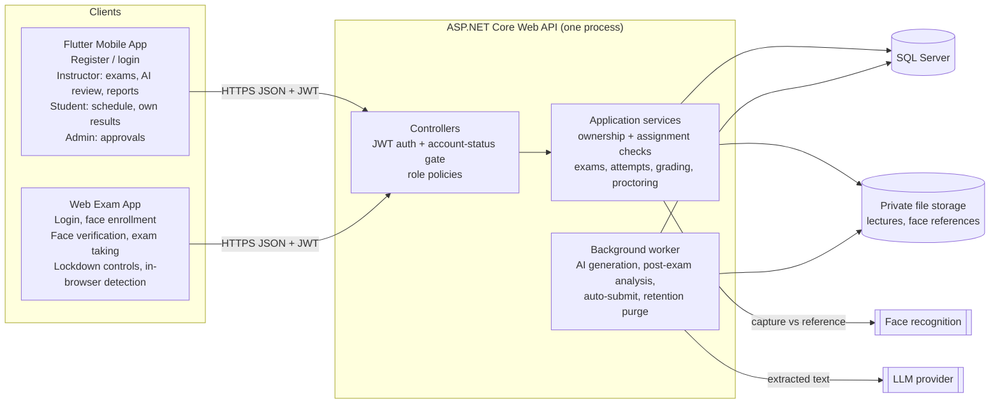
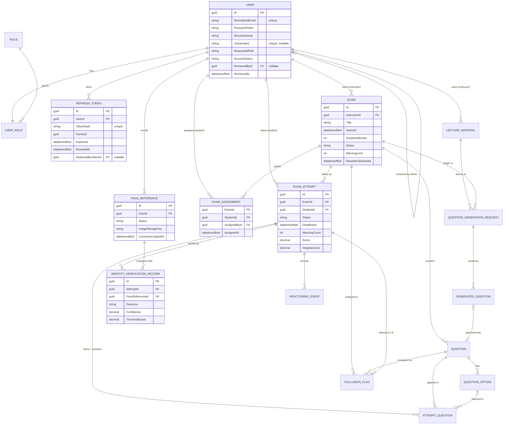
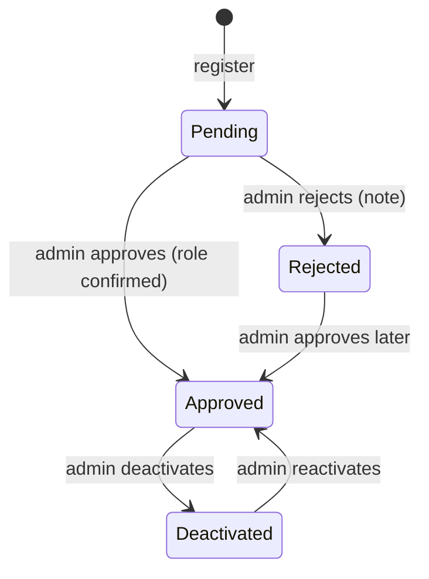

# AI-Based Exam Proctoring System: Final Architecture

**Status:** Revision 3, final architecture. Implementation starts with Authentication and Authorization (§10 phase 1). No code, repository, packages, migrations or database changes have been made.
**Sources:** `Grad Project/Analysis Pahse Updated.pdf` (14 pages, including the use case and activity diagrams), your project brief, and your decisions of 2026-10-18.

| Revision | Date | Change |
|---|---|---|
| 1 | 2026-10-18 | Analysis and initial proposal |
| 2 | 2026-10-18 | Confirmed decisions D1-D6 (account approval, face verification, assignment, web exam app) |
| 3 | 2026-10-18 | Final: open questions resolved with defaults, .NET target selected from your machine, authentication/authorization architecture and permission model, final data model |

Tags used: **[DOC]** Analysis Phase document · **[CONF]** decided by you · **[DEF]** default adopted in Revision 3 (changeable later, not blocking) · **[DEFER]** intentionally decided in a later phase, not blocking authentication.

---

## 1. Analysis Summary

**Purpose [DOC]:** a controlled, secure environment for university exams with identity verification, AI proctoring, automated grading where applicable, AI question generation, randomized exams, an integrity score and a collusion report.

**Actors:** Instructor (the document's "Teacher"), Student, Administrator, AI Proctoring Module (system actor). This document uses **Instructor** everywhere, including role and column names.

| Area | Documented requirements |
|---|---|
| Authentication | Secure login for instructors and students (FR-01, FR-13); role-based access (use case "Login"). |
| Exam management | Create/manage exams (FR-02), questions and model answers (FR-03), date/time/duration (FR-04), publish (FR-05), view results (FR-06). |
| Student information | Upcoming exams and schedules (FR-14), previous grades (FR-15), exam info without taking the exam on mobile (FR-16). |
| Exam taking | Access assigned exams (FR-17), verify identity (FR-18), webcam and permissions (FR-19), take and submit in time (FR-20), store answers and grade (FR-23), randomized question and option order (FR-25). |
| Secure environment | Prevent window/tab switching (FR-24.1), block copy/paste, screenshots, recording (FR-24.2), log violations (FR-24.3); workflow 9.1 adds VMs and remote desktop. |
| AI proctoring | Monitor (FR-26), detect predefined behaviors (FR-27), warnings (FR-21, FR-28), voice detection (FR-29), terminate at the warning limit (FR-22). |
| Integrity score | Weighted violations per student per exam (FR-30), risk Low/Medium/High, instructor views after the exam (FR-11). |
| Anti-collusion | Post-exam answer similarity, especially essays (FR-31); instructor views flagged pairs (FR-12). |
| AI question generation | Upload PDF/Word lectures (FR-08), difficulty and count (FR-09), generate (FR-07), review/edit/reject before use (FR-10). |
| Non-functional | Security, privacy of identity/webcam data, low-latency proctoring, reliability of answers, schedule-based availability, scalability, maintainability. |
| Decision support | Score and collusion report support decisions; humans decide (Assumption 12). |

## 2. Decisions

### 2.1 Confirmed by you [CONF]

| # | Decision |
|---|---|
| D1 | Students use the Flutter app to see their assigned/upcoming exam schedules and their own results once results are made available. Students never access another student's private data. |
| D2 | Users register themselves. A new account is **Pending** until an administrator approves it. Only approved, active accounts can use protected features. |
| D3 | Exams are taken only in a separate web exam application. The backend verifies the student is assigned to the exam. A website **cannot guarantee** prevention of OS-level screenshots or screen recording, and cannot detect VMs or remote desktop; this stays a documented limitation of FR-24.2. |
| D4 | Camera-based face verification must succeed before exam questions are released. Model/provider is replaceable. A face match is supporting evidence of identity, not proof. Not Apple Face ID. |
| D5 | `ExamAssignment` is the only source of student exam access. |
| D6 | Flutter serves instructor workflows. The integrity/suspicion score is not a grade and is never shown to students. |
| D7 | Architecture: ASP.NET Core Web API, SQL Server, EF Core, modular monolith (Domain, Application, Infrastructure, Api, UnitTests, IntegrationTests). AI-generated questions need instructor approval before they become exam questions. Proctoring, integrity scoring, randomization and anti-collusion stay in scope. |

### 2.2 Defaults adopted in Revision 3 [DEF]

| Topic | Final default |
|---|---|
| Roles | Three roles: `Admin`, `Instructor`, `Student`. **Exactly one role per user.** |
| Who can register | Anyone can request `Student` or `Instructor`. `Admin` can never be requested; admins are created only by the startup seed from configuration. |
| Approval | Same admin approval for both roles. When approving, the admin confirms or changes the requested role (Student ↔ Instructor). `UniversityId` is required for students, optional for instructors. |
| Rejected users | Cannot log in or re-register with the same email. An admin can later approve a rejected account directly. |
| Deactivation | Admin can deactivate and reactivate accounts. An admin cannot change their own status, and the last active admin cannot be deactivated. |
| Email confirmation / password reset | No email service. Admin approval replaces email confirmation. Self-service "forgot password" is **[DEFER]** (non-blocking). |
| Assignment workflow | The **exam owner (instructor)** assigns students to their own exams by a list of student `UniversityId`s (one or many per request). Admins do not assign. A student can be unassigned only while they have no attempt. Future bulk import or course/group features must only create or remove `ExamAssignment` rows. |
| Question types | MCQ (one correct option; True/False is a 2-option MCQ) and Essay. |
| Grading | MCQ auto-graded on submit. Essays are marked by the exam owner. No AI essay grading. |
| Results release | The exam owner releases results per exam (`Exam.ResultsPublishedAt`). Students see only their own grade, and only after release. |
| Exam timing | Fixed window: `EndsAt = StartsAt + DurationMinutes`; a late student gets the remaining time; auto-submit at the deadline. |
| Editing | Exam content is locked once published; unpublish is allowed only before `StartsAt` and while no attempt exists. One attempt per student per exam. |
| Proctoring | Detection runs in the browser; only events are sent and stored, with no video, audio or screenshots. Event catalog and weights in §5.4; per-exam `WarningLimit` default 3; risk Low < 30 ≤ Medium < 60 ≤ High (configurable). |
| Face enrollment | After account approval, the student captures a reference face in the web exam app and gives consent → `FaceReference` is `PendingReview` → an admin compares it with the account details and approves it → `Active`. Only an `Active` reference allows exam attempts. Re-enrolling revokes the old reference. |
| Face data | Reference image kept in private file storage (needed for admin review and for switching models). The face template, if the model produces one, is stored encrypted with ASP.NET Core Data Protection. Probe captures taken at exam time are discarded after matching. |
| Face matching | Server-side only (a browser result could be forged). Global configurable threshold, stored on every verification record. Liveness is used if the chosen model/provider supports it; otherwise it is a documented limitation. |
| Failed verification | Up to 3 tries per attempt. After that the attempt is `VerificationFailed`. The exam owner may record a manual override with a reason, which moves it to `InProgress`. No re-verification during the exam (face-presence proctoring covers it). |
| Retention | Face reference image and template deleted when the account is deactivated or on the student's request. Proctoring events and verification records (no images) kept 1 year after the exam (configurable), then purged. |
| Lecture files | `.pdf` and `.docx` only, 20 MB maximum. |
| Admin client | Role-gated admin screens in the Flutter app. Swagger can be used for approvals during development. |
| Ownership | One instructor owns each exam and lecture. No co-instructors. |
| Admin data access | Admins manage accounts and face references only. They have no access to exams, answers, results or proctoring data. |

### 2.3 Deferred, not blocking authentication [DEFER]

| Item | Decided in |
|---|---|
| LLM provider for question generation (behind `IQuestionGenerator`) | Phase 3 |
| Face recognition model/provider (behind `IFaceVerifier`) and liveness support | Phase 4 |
| Web exam app front-end framework | Phase 4 |
| Self-service password reset (needs an email service) | After the core phases |
| Retargeting to .NET 10 (needs Visual Studio 2026, §4.4) | When you switch IDE |

### 2.4 Working assumptions
- All timestamps stored in UTC as `datetimeoffset`; clients display local time.
- Collusion detection is a server-side text-similarity algorithm, not an external AI service.
- Integrity scores and collusion flags are advisory; they never change grades automatically.

## 3. Architecture

### 3.1 Components

| Component | Responsibility | Talks to |
|---|---|---|
| **Flutter mobile app** | Registration and login. Instructor: exams, schedule, questions, assignment, lecture upload, AI review, results release, essay marking, integrity and collusion reports. Student: assigned schedules, exam info, own released results. Admin: account approval screens. Never takes exams. | API, HTTPS JSON, JWT bearer |
| **Web exam app** (separate website) | Student only: login, face enrollment, assigned exams, face verification capture, camera/mic checks, fullscreen lockdown controls, randomized exam, autosave, submit; in-browser presence and voice detectors and browser violation detectors; shows warnings returned by the API. | API, HTTPS JSON, JWT bearer |
| **ASP.NET Core Web API** (one deployable) | All rules and enforcement: authentication, account-status gate, role and ownership checks, assignment check, verification gate, attempt lifecycle, randomization, grading, warnings/termination, integrity score, collusion analysis, text extraction, AI generation orchestration. | SQL Server, file storage, LLM, face recognition |
| **Background worker** (`BackgroundService` in the API process) | AI question generation, post-exam integrity/collusion analysis, auto-submit of expired attempts, retention purge. DB status columns act as the queue; no broker. | SQL Server, LLM |
| **SQL Server** | System of record. | API only |
| **File storage** | Lectures and face reference images in separate private folders outside the web root, behind `IFileStorage`. Never served directly. | API only |
| **LLM provider** [DEFER] | Generates question suggestions from extracted lecture text. | API/worker |
| **Face recognition** [DEFER] | Compares a live capture with the active reference and returns match + confidence. | API only, via `IFaceVerifier` |

No message broker, SignalR or microservices. Warnings are detected in the browser and confirmed in the API's response to each event post, so no push channel is needed.

### 3.2 Diagram



### 3.3 Key flows

1. **Account:** register (Pending, no tokens) → admin approves with role → login issues tokens → every request re-checks status → deactivation cuts access immediately (§6).
2. **Question generation:** instructor uploads a lecture → text extracted → generation request queued → worker calls the LLM → `GeneratedQuestion` rows (Pending) → instructor edits/approves/rejects → approval **copies** into `Question`. Students are only ever served `Question` rows.
3. **Exam start:** student opens the exam in the web app → API checks approved account, Student role, `ExamAssignment` row, published, window open, no prior attempt, active face reference → attempt `AwaitingVerification` → capture sent → server-side match recorded → `InProgress`, randomized order persisted, questions returned without correct or model answers. After 3 failed tries → `VerificationFailed` until an owner override.
4. **During exam:** per-question autosave; proctoring events posted; server applies weights, counts warnings and terminates at the limit; all writes rejected outside `InProgress` or after `DeadlineAt` (+ small grace).
5. **After exam:** submit/auto-submit → MCQ graded → after the window closes the worker computes integrity scores and collusion pairs → instructor marks essays, reviews reports, releases results → students see their own grade only.

## 4. Backend Solution Structure

### 4.1 Approach
Layered **modular monolith**: four projects for compile-time dependency direction, with features as folders inside them. Not used: microservices, MediatR/CQRS, AutoMapper, generic repositories, domain events, specification pattern. EF Core `DbContext` is the unit of work; mapping is hand-written.

### 4.2 Projects and references

```
ExamProctoring.sln
global.json                        pins the .NET SDK (§4.4)
src/
  ExamProctoring.Domain            no references, no packages
  ExamProctoring.Application       → Domain
  ExamProctoring.Infrastructure    → Application, Domain
  ExamProctoring.Api               → Application, Infrastructure (DI registration only)
tests/
  ExamProctoring.UnitTests         → Domain, Application
  ExamProctoring.IntegrationTests  → Api
```

Direction: `Api → Infrastructure → Application → Domain`, no cycles. Application uses EF Core through `IAppDbContext` (DbSets + `SaveChangesAsync`) instead of repositories. `ApplicationUser` lives in Domain and inherits `IdentityUser<Guid>`, so Domain references the `Microsoft.Extensions.Identity.Stores` package (entity classes only, no EF). This is the one package exception in Domain, accepted to avoid a duplicate user entity.

### 4.3 Folder tree

```
src/ExamProctoring.Domain/
  Common/                 Entity base, shared enums
  Users/                  ApplicationUser, AccountStatus, RefreshToken, RoleNames
  IdentityVerification/   FaceReference, IdentityVerificationRecord, enums
  Exams/                  Exam, Question, QuestionOption, ExamAssignment, enums
  Lectures/               LectureMaterial, QuestionGenerationRequest, GeneratedQuestion, enums
  Attempts/               ExamAttempt, AttemptQuestion, AttemptStatus, grading rules
  Proctoring/             ProctoringEvent, ProctoringEventType, CollusionFlag, RiskLevel, score rule

src/ExamProctoring.Application/
  Abstractions/           IAppDbContext, ICurrentUser, ITokenService, IFileStorage, ITextExtractor,
                          IQuestionGenerator, IFaceVerifier, IClock
  Auth/                   AuthService (register, login, refresh, logout, me, change password), DTOs, validators
  Accounts/               AccountAdminService (list, approve, reject, deactivate, reactivate), DTOs, validators
  IdentityVerification/   enrollment, reference review, verification and override rules
  Exams/                  exam, question and assignment services, DTOs, validators
  Lectures/               lecture, generation and review services, DTOs, validators
  Attempts/               attempt service, Randomizer, Grader, DTOs, validators
  Proctoring/             event service, IntegrityScoreCalculator, CollusionAnalyzer, report DTOs
  Results/                instructor and student result services
  Common/                 Result/error codes, paging, options classes

src/ExamProctoring.Infrastructure/
  Persistence/            AppDbContext (IdentityDbContext<ApplicationUser, IdentityRole<Guid>, Guid>),
                          Configurations/ (one per entity), Migrations/, DataSeeder (roles, first admin)
  Identity/               JwtTokenService (ITokenService), refresh-token hashing
  Files/                  LocalFileStorage
  TextExtraction/         PDF and DOCX extractors
  AI/                     LLM question generator adapter (phase 3)
  FaceRecognition/        IFaceVerifier adapter (phase 4) + fake for tests
  BackgroundJobs/         generation, post-exam analysis, attempt expiry, retention workers
  DependencyInjection.cs

src/ExamProctoring.Api/
  Controllers/            one per module in §7
  Authorization/          policy names and registration, JWT events (account-status gate), CurrentUser
  Middleware/             exception → ProblemDetails
  Program.cs, appsettings.json, appsettings.Development.json (no secrets)

tests/ExamProctoring.UnitTests/         domain and application rules
tests/ExamProctoring.IntegrationTests/  API + real SQL Server: auth, authorization boundaries, workflows
```

Placement: entities → Domain; DTOs, validators, interfaces, services → Application by feature; DbContext, configurations, migrations, token service, external adapters → Infrastructure; controllers, policies, middleware → Api. Ownership checks live in Application services, not controllers.

**Clients** live outside the .NET solution (separate repositories, or `mobile/` and `web-exam/` folders beside `backend/`). They share only the OpenAPI contract.

### 4.4 Target framework: **.NET 9 (`net9.0`)**

Checked on your Windows device (folder names only):

| Found | Value |
|---|---|
| .NET SDKs | `10.0.402`, `9.0.316` |
| ASP.NET Core runtimes | `8.0.11`, `8.0.29`, `9.0.18`, `10.0.13` |
| Visual Studio | 2022 Community only (no Visual Studio 2026 folder) |
| SQL Server | SQL Server 2022 instances `MSSQLSERVER` and `MSSQLSERVER01` |

Reasons:
- Visual Studio 2022 cannot build or open `net10.0` projects. .NET 10 needs Visual Studio 2026, which is not installed. That rules out .NET 10 for a VS 2022 workflow.
- .NET 9 is the newest framework VS 2022 supports. The installed `9.0.316` SDK is the 9.0.3xx band, which matches Visual Studio 2022 17.14. VS 2022 must be 17.12 or later; I could not read the exact VS version from folder names.
- .NET 8 (LTS) and .NET 9 both reach end of support on **10 November 2026**, so .NET 8 has no support advantage. .NET 9 adds built-in OpenAPI support and is a one-step upgrade to .NET 10.
- `global.json` pins SDK `9.0.316` with `rollForward: latestPatch`. Without it, the command line would pick SDK 10.0.402 while Visual Studio uses 9.0.x, and builds could behave differently.
- Risk: after 10 November 2026 the runtime gets no security patches. That is acceptable for development and a graduation demo. Moving to .NET 10 later means installing VS 2026, changing `TargetFramework` and bumping package versions. No architectural change.

### 4.5 Packages (versions matching .NET 9)

| Package | Project | Purpose |
|---|---|---|
| Microsoft.Extensions.Identity.Stores | Domain | `IdentityUser<Guid>` base class |
| Microsoft.EntityFrameworkCore | Application | `IAppDbContext` (DbSet, async LINQ) |
| Microsoft.AspNetCore.Identity.EntityFrameworkCore | Infrastructure | Identity stores, password hashing, lockout |
| Microsoft.EntityFrameworkCore.SqlServer, .Design | Infrastructure | SQL Server provider, migrations |
| Microsoft.AspNetCore.Authentication.JwtBearer | Api | JWT validation |
| Swashbuckle.AspNetCore | Api | Swagger UI with a bearer-token button (Development only) |
| FluentValidation.DependencyInjectionExtensions | Application | Request validation |
| UglyToad.PdfPig, DocumentFormat.OpenXml | Infrastructure | Lecture text extraction (phase 3) |
| xunit, Microsoft.AspNetCore.Mvc.Testing | tests | Unit and integration tests |

Integration tests use the **local SQL Server instance** with a dedicated, recreated test database (`ExamProctoring_Tests`), not Testcontainers, because Docker is not part of your setup. Built-in features replace packages for logging, rate limiting, background services, Data Protection and ProblemDetails.

## 5. Database Design

### 5.1 Conventions
- Primary keys: `Guid` (EF Core generates sequential GUIDs for SQL Server). Composite keys only where shown.
- Enums stored as `nvarchar(30)` strings, so the database is readable.
- Times: `datetimeoffset` in UTC. Marks and scores: `decimal(6,2)`. Confidence and thresholds: `decimal(5,4)`.
- Concurrency: `rowversion` on `Exam` and `ExamAttempt`.
- Deletes: `Restrict` by default. `Cascade` only Exam (Draft) → Question → QuestionOption, and User → RefreshToken. Published exams, attempts and history are never hard-deleted.

### 5.2 Entities

| Entity | Purpose | Columns (beyond `Id`) |
|---|---|---|
| **`ApplicationUser`** (`AspNetUsers`) | Every account, its approval state and its security state | Identity columns: `Email`, `NormalizedEmail` (unique), `UserName` (= email), `PasswordHash`, `SecurityStamp`, `ConcurrencyStamp`, `LockoutEnd`, `LockoutEnabled`, `AccessFailedCount`. Custom: `FullName` nvarchar(150), `UniversityId` nvarchar(30) null, `RequestedRole` nvarchar(30), `AccountStatus` (Pending/Approved/Rejected/Deactivated), `RegisteredAt`, `ReviewedById` null FK → user, `ReviewedAt` null, `ReviewNote` nvarchar(500) null, `LastLoginAt` null |
| `AspNetRoles`, `AspNetUserRoles` | Roles `Admin`, `Instructor`, `Student`; one row per user, assigned on approval | Identity standard. Other Identity tables are created by default and unused. |
| **`RefreshToken`** | Session renewal, rotation and revocation | `UserId` FK, `TokenHash` char(64) (SHA-256 hex), `FamilyId` Guid, `CreatedAt`, `ExpiresAt`, `RevokedAt` null, `RevokedReason` nvarchar(50) null, `ReplacedByTokenId` null FK → RefreshToken |
| `Exam` | Exam and its schedule | `InstructorId` FK (owner), `Title` nvarchar(200), `Description` null, `StartsAt`, `DurationMinutes`, `Status` (Draft/Published/Cancelled), `WarningLimit` (default 3), `PublishedAt`, `ResultsPublishedAt`, `AnalysisCompletedAt`, `RowVersion` |
| `Question` | Exam-ready question (authored or approved) | `ExamId` FK, `Type` (Mcq/Essay), `Text`, `ModelAnswer` null, `Marks`, `Position`, `SourceGeneratedQuestionId` null FK |
| `QuestionOption` | MCQ option | `QuestionId` FK, `Text`, `IsCorrect`, `Position` |
| **`ExamAssignment`** | Only source of student exam access | PK (`ExamId`, `StudentId`), `AssignedById` FK, `AssignedAt` |
| `LectureMaterial` | Uploaded lecture | `InstructorId` FK (owner), `OriginalFileName`, `StorageKey`, `FileType` (Pdf/Docx), `SizeBytes`, `UploadedAt`, `ExtractedText` nvarchar(max), `ExtractionStatus` |
| `QuestionGenerationRequest` | One AI run | `LectureMaterialId` FK, `ExamId` FK, `RequestedById` FK, `Difficulty` (Easy/Medium/Hard), `RequestedCount`, `Status` (Pending/Processing/Completed/Failed), `FailureReason` null, `CreatedAt`, `CompletedAt` null |
| `GeneratedQuestion` | AI suggestion awaiting review | `GenerationRequestId` FK, `Type`, `Difficulty`, `Text`, `OptionsJson`, `SuggestedAnswer`, `ReviewStatus` (Pending/Approved/Rejected), `ReviewedAt` null, `ApprovedQuestionId` null FK |
| **`FaceReference`** | Student's enrolled face | `UserId` FK, `Status` (PendingReview/Active/Revoked/Rejected), `ImageStorageKey`, `TemplateData` varbinary(max) null (encrypted), `ModelVersion` null, `ConsentAcceptedAt`, `CapturedAt`, `ReviewedById` null FK, `ReviewedAt` null |
| `ExamAttempt` | One student's sitting | `ExamId` FK, `StudentId` FK, `Status` (AwaitingVerification/VerificationFailed/InProgress/Submitted/AutoSubmitted/Terminated), `CreatedAt`, `IdentityVerifiedAt` null, `StartedAt` null, `DeadlineAt`, `SubmittedAt` null, `WarningCount`, `Score` null, `GradingStatus` (Pending/Graded), `IntegrityScore` null, `RiskLevel` null, `RowVersion` |
| **`IdentityVerificationRecord`** | One verification try or override | `AttemptId` FK, `FaceReferenceId` FK, `OccurredAt`, `Outcome` (Matched/NotMatched/NoFace/MultipleFaces/LivenessFailed/ProviderError/ManualOverride), `Confidence` null, `ThresholdUsed`, `ModelVersion`, `OverriddenById` null FK, `OverrideReason` null |
| `AttemptQuestion` | Randomized order and answer | PK (`AttemptId`, `QuestionId`), `DisplayOrder`, `OptionOrder` (JSON array of option ids), `SelectedOptionId` null FK, `EssayAnswer` null, `AwardedMarks` null, `AnsweredAt` null |
| `ProctoringEvent` | Violation/warning event | `AttemptId` FK, `EventType`, `Source` (Browser/Video/Audio), `ClientOccurredAt`, `ReceivedAt`, `Weight` (snapshot), `CountedAsWarning`, `Details` nvarchar(500) null |
| `CollusionFlag` | Suspicious answer pair | `ExamId` FK, `QuestionId` FK, `AttemptAId` FK, `AttemptBId` FK, `SimilarityPercent`, `IsFlagged`, `CalculatedAt` |

Why these shapes:
- Schedule lives on `Exam`, because the document's Schedule Data repeats Exam Data.
- Randomization and answers share `AttemptQuestion`, because both are keyed by (attempt, question).
- Integrity score and risk are columns on `ExamAttempt`; the violations list is that attempt's events.
- Account approval is columns on `ApplicationUser`, since only the current decision is needed.
- `GeneratedQuestion` stays separate from `Question`. That is the structural guarantee that unapproved AI output never reaches students.

**Persisted:** account status and review data, verification outcomes and thresholds, `WarningCount`, scores, marks, integrity score and risk level (snapshots), collusion pairs, event weights.
**Calculated on read:** exam phase (Upcoming/Open/Closed), totals and averages, verification tries used, violation breakdowns, student schedules.

### 5.3 Constraints and indexes

| Table | Constraint / index | Purpose |
|---|---|---|
| AspNetUsers | Unique `NormalizedEmail`; unique `UniversityId` where not null; index (`AccountStatus`, `RegisteredAt`) | One account per email and student ID; admin pending queue |
| AspNetUserRoles | Unique `UserId` (enforces one role per user) | Single-role model |
| RefreshToken | Unique `TokenHash`; index `UserId`; index `FamilyId` | Lookup, revoke all, reuse detection |
| Exam | Index (`InstructorId`, `StartsAt`); check `DurationMinutes > 0`, `WarningLimit > 0` | Instructor lists, validity |
| Question | Unique (`ExamId`, `Position`); check `Marks > 0` | Ordering |
| QuestionOption | Unique (`QuestionId`, `Position`) | Ordering; "exactly one correct option" enforced in Domain |
| ExamAssignment | PK (`ExamId`, `StudentId`); index `StudentId` | Access check, student schedule |
| FaceReference | Unique `UserId` where `Status = 'Active'`; index (`Status`, `CapturedAt`) | One active reference; admin review queue |
| ExamAttempt | Unique (`ExamId`, `StudentId`); index (`Status`, `DeadlineAt`) | One attempt; expiry sweep |
| IdentityVerificationRecord | Index (`AttemptId`, `OccurredAt`) | Retry count, audit |
| AttemptQuestion | Unique (`AttemptId`, `DisplayOrder`) | Ordering |
| GeneratedQuestion | Index (`GenerationRequestId`, `ReviewStatus`); unique `ApprovedQuestionId` where not null | No double approval |
| ProctoringEvent | Index (`AttemptId`, `ReceivedAt`) | Reports |
| CollusionFlag | Unique (`QuestionId`, `AttemptAId`, `AttemptBId`); check `AttemptAId < AttemptBId` | No duplicate or mirrored pairs |

### 5.4 Proctoring event catalog (enum + weights in configuration)

| Event | Browser-detectable | Weight |
|---|---|---|
| TabOrWindowSwitch, FullscreenExit | Yes | 3 |
| CopyPasteAttempt, ContextMenuAttempt, ScreenshotKeyPressed | Yes (key/clipboard events only) | 2 |
| NoFaceDetected / MultipleFacesDetected / LookingAway | Yes, client ML | 3 / 5 / 2 |
| VoiceDetected | Yes, voice activity detection | 3 |
| CameraOrMicLost | Yes | 4 |
| VirtualMachine, RemoteAccess, ScreenRecording | **No** (D3 limitation) | reserved |

### 5.5 Ownership rules

| Data | Owner / who may read |
|---|---|
| Account, own profile | The user; admins manage status and role |
| `FaceReference` | Student owner (status only); admins review the image. Instructors never see reference images. |
| `Exam`, `Question`, `QuestionOption`, `ExamAssignment`, `LectureMaterial`, generation data | Owning instructor (`InstructorId`) only |
| Exam schedule/info (no questions) | Assigned students (`ExamAssignment`) |
| `ExamAttempt`, `AttemptQuestion` | Student owner during the attempt; owning instructor for results and marking |
| Released grade | Student owner, after `ResultsPublishedAt` |
| `IntegrityScore`, `RiskLevel`, `ProctoringEvent`, `CollusionFlag`, verification confidence | Owning instructor only. Never students [CONF D6] and never admins. |

### 5.6 ER diagram



Entities not expanded above (`QUESTION`, `QUESTION_OPTION`, `LECTURE_MATERIAL`, `QUESTION_GENERATION_REQUEST`, `GENERATED_QUESTION`, `ATTEMPT_QUESTION`, `PROCTORING_EVENT`, `COLLUSION_FLAG`) have the columns listed in §5.2.

## 6. Authentication and Authorization Architecture

This is the specification for the next phase.

### 6.1 Five separate checks

| # | Check | Question it answers | Where | Failure |
|---|---|---|---|---|
| 1 | **Authentication** | Is this a valid, unexpired JWT from us? | JwtBearer middleware (issuer, audience, lifetime, signature) | 401 |
| 2 | **Account gate** | Is the account still `Approved`, with an unchanged security stamp? | `JwtBearerEvents.OnTokenValidated`: one primary-key lookup of `AccountStatus` + `SecurityStamp` per request | 401 `token_invalid` |
| 3 | **Role authorization** | Is the role allowed for this endpoint? | Policies `AdminOnly`, `InstructorOnly`, `StudentOnly` on controllers | 403 |
| 4 | **Ownership / assignment** | Does this resource belong to, or is it assigned to, the caller? | Application services, filtered queries using `ICurrentUser` | 404 (no information leak) |
| 5 | **Workflow state** | Is the action allowed now (exam window, attempt status, verification passed)? | Domain/Application rules | 409 or 422 with code |

Account approval is a lifecycle decision made by an admin. Check 2 is where it is enforced. Roles and ownership are independent of it.

### 6.2 Permission model

| Capability | Admin | Instructor | Student |
|---|---|---|---|
| Register (anonymous) | — (seed only) | request | request |
| Login, refresh, logout, me, change password | ✓ | ✓ | ✓ |
| List/approve/reject/deactivate/reactivate accounts | ✓ (not own account) | — | — |
| Review face references | ✓ | — | — |
| Create/edit/publish exams, questions, assignments | — | own exams | — |
| Upload lectures, generate and review AI questions | — | own lectures/exams | — |
| Mark essays, release results, view results | — | own exams | — |
| Integrity and collusion reports, verification override | — | own exams | — |
| Enroll own face reference | — | — | ✓ |
| View assigned exam schedule/info | — | — | assigned only |
| Start attempt, verify, answer, submit, send events | — | — | own attempt, assigned exam |
| View grades | — | — | own, after release |

### 6.3 Account lifecycle



- Only `Approved` accounts receive tokens or pass check 2.
- Approve, deactivate, reactivate and any role change regenerate `SecurityStamp` and revoke all refresh tokens, so existing access tokens stop working on the next request.
- Every review writes `ReviewedById`, `ReviewedAt`, `ReviewNote`.

### 6.4 Registration and login

**Register** `POST /api/auth/register` (anonymous): `fullName`, `email`, `password`, `requestedRole` (`Student` or `Instructor`), `universityId` (required for Student). Creates a `Pending` user with no role and **no tokens**, and returns 201 with status `Pending`. A duplicate email or university ID returns 409. This reveals that an account exists; the risk is accepted for usability and limited by rate limiting.

**Login** `POST /api/auth/login` (anonymous): `email`, `password`.
1. Find the user by normalized email; check the password with lockout counting.
2. Wrong email or password → 401 `invalid_credentials` (same response for both). Locked → 401 `account_locked`.
3. Only after a correct password: `Pending` → 403 `account_pending`, `Rejected` → 403 `account_rejected`, `Deactivated` → 403 `account_deactivated`.
4. `Approved` → issue an access token and a refresh token, and set `LastLoginAt`.

### 6.5 Passwords
- ASP.NET Core Identity `PasswordHasher` (PBKDF2, HMAC-SHA512, 100,000 iterations, random salt per password). Passwords are never stored, logged or returned.
- Policy: at least 8 characters, with an upper-case letter, a lower-case letter and a digit.
- Lockout: 5 failed attempts → 15 minutes, enabled for every account.
- `POST /api/auth/change-password` requires the current password. It regenerates `SecurityStamp` and revokes all refresh tokens.
- HTTPS only (HSTS outside Development).

### 6.6 Tokens

| | Access token | Refresh token |
|---|---|---|
| Format | JWT, HS256, key ≥ 256 bits from secrets | 32 random bytes, Base64Url; only the SHA-256 hash is stored |
| Lifetime | 15 minutes (clock skew 30 s) | 7 days |
| Contents | `sub` (user id), `email`, `name`, `role`, `sstamp` (security stamp), `jti`; `iss`/`aud` from configuration | none (opaque) |
| Renewal | — | `POST /api/auth/refresh` rotates: old token revoked, new one in the same `FamilyId`; requires the account still `Approved` |
| Reuse detection | — | A revoked or replaced token presented again → revoke the whole family, return 401 `refresh_token_reused`, log a warning |
| Logout | expires naturally | `POST /api/auth/logout` revokes the family |

Client storage: Flutter uses `flutter_secure_storage`. The web exam app keeps the access token in memory and the refresh token in `sessionStorage`, so a page reload during an exam does not log the student out; it is cleared when the tab closes. The web app uses a strict Content-Security-Policy. Both clients receive tokens in the JSON body. No cookies, so no CSRF handling is needed.

### 6.7 Authorization implementation rules
- A **fallback policy** requires an authenticated user for every endpoint. Only `register`, `login`, `refresh` and the health check are `[AllowAnonymous]`.
- Role policies are applied at controller level. A user has exactly one role.
- Ownership is enforced inside queries, never by loading and comparing afterwards: `Exams.Where(e => e.Id == id && e.InstructorId == me)`, `ExamAssignments.Any(a => a.ExamId == id && a.StudentId == me)`, `Attempts.Where(a => a.Id == id && a.StudentId == me)`. A miss returns 404.
- `ICurrentUser` (UserId, Role) is read from claims and is the only way services learn who the caller is.
- Admins get no implicit access to exam data.
- CORS allows only the configured web exam app origin(s).
- Rate limits (per IP, fixed window): register 5/min, login 10/min, refresh 30/min.
- Errors use ProblemDetails with a stable `code` extension (`invalid_credentials`, `account_pending`, `account_rejected`, `account_deactivated`, `account_locked`, `token_invalid`, `refresh_token_reused`, `validation_failed`).

### 6.8 Seeding and configuration
- At startup an idempotent seeder creates the three roles and, if no admin exists, the first admin from `Seed:AdminEmail` / `Seed:AdminPassword` (User Secrets in development, environment variables elsewhere) with status `Approved`.
- Configuration: `Jwt:Issuer`, `Jwt:Audience`, `Jwt:SigningKey` (secret), `Jwt:AccessTokenMinutes`, `Jwt:RefreshTokenDays`, `Cors:WebExamOrigins`, `ConnectionStrings:Default` (secret).
- Migrations are applied manually (`dotnet ef database update`), never automatically at startup.

### 6.9 Phase 1 API boundary

| Endpoint | Access |
|---|---|
| `POST /api/auth/register`, `POST /api/auth/login`, `POST /api/auth/refresh` | Anonymous, rate limited |
| `POST /api/auth/logout`, `GET /api/auth/me`, `POST /api/auth/change-password` | Any approved user |
| `GET /api/admin/accounts?status=&role=&page=`, `GET /api/admin/accounts/{id}` | Admin |
| `POST /api/admin/accounts/{id}/approve` (`role`), `/reject` (`note`), `/deactivate` (`note`), `/reactivate` | Admin, not on own account; last active admin protected |

### 6.10 Required auth tests
Registration validation and duplicates; pending/rejected/deactivated cannot log in; correct status codes and messages after a correct password only; lockout; refresh rotation and reuse detection; deactivation invalidates an existing access token on the next request; role policies (Student → admin endpoint = 403); admin cannot deactivate self or the last admin; anonymous access only on the four endpoints.

## 7. API Module Overview

Routes under `/api`, JSON, JWT bearer, ProblemDetails. All checks in §6.1 apply everywhere.

| Module | Representative endpoints | Access |
|---|---|---|
| Auth / Account admin | §6.9 | §6.9 |
| Face enrollment | `POST me/face-reference`, `GET me/face-reference`; `GET admin/face-references?status=PendingReview`, `POST admin/face-references/{id}/approve`, `/reject` | Student (own); Admin |
| Exams | `GET/POST exams`, `GET/PUT/DELETE exams/{id}`, `POST exams/{id}/publish`, `/unpublish` | Instructor, own |
| Questions | `GET/POST exams/{id}/questions`, `PUT/DELETE questions/{id}` | Instructor, own Draft exam |
| Assignments | `GET exams/{id}/assignments`, `POST exams/{id}/assignments` (UniversityId list), `DELETE exams/{id}/assignments/{studentId}` | Instructor, own exam |
| Lectures | `POST lectures`, `GET lectures`, `DELETE lectures/{id}` | Instructor, own |
| Question generation | `POST lectures/{id}/generations`, `GET generations/{id}`, `GET generations/{id}/questions`, `PUT generated-questions/{id}`, `POST generated-questions/{id}/approve`, `/reject` | Instructor, own lecture and own exam |
| Student exams | `GET me/exams`, `GET me/exams/{id}` (schedule/info, no questions) | Student, assigned |
| Attempts | `POST exams/{id}/attempts`, `POST attempts/{id}/identity-verification`, `GET attempts/{id}`, `PUT attempts/{id}/answers/{questionId}`, `POST attempts/{id}/submit` | Student, own attempt, assigned exam; questions only when `InProgress` |
| Verification override | `POST attempts/{id}/identity-verification/override` | Instructor, own exam |
| Proctoring | `POST attempts/{id}/events` → `{warningCount, warningLimit, terminated}` | Student, own `InProgress` attempt |
| Results | `GET exams/{id}/results`, `GET exams/{id}/attempts/{attemptId}`, `PUT .../answers/{questionId}/marks`, `POST exams/{id}/results/publish`; `GET me/results` | Instructor, own; Student, own after release (grade only) |
| Reports | `GET exams/{id}/integrity`, `GET exams/{id}/attempts/{attemptId}/events`, `GET exams/{id}/collusion` | Instructor, own, after analysis |

## 8. Security and Risk Checklist

| Area | Required control |
|---|---|
| Authentication & accounts | §6 in full. |
| Data leakage | Student DTOs never contain `IsCorrect`, `ModelAnswer`, other students' data, integrity scores, collusion flags or verification confidence. |
| Exam integrity | Server clock and `DeadlineAt`; status and deadline checked on every write; server-side warning count and termination; `rowversion` on attempts; auto-submit worker. |
| Identity verification | Server-side matching; questions withheld until `InProgress`; 3 tries; override audited; threshold and model version recorded; face match is evidence, not proof. |
| Biometric data | Consent recorded; private storage; template encrypted; probe images discarded; instructors never see reference images; deleted on deactivation or request; never logged. |
| AI approval | Only `Question` rows reach students; approval requires ownership of the request and the exam; publish requires ≥1 valid question. |
| File uploads | `.pdf`/`.docx` with magic-byte check, 20 MB limit, random storage names, outside the web root, never served directly, extraction timeout. |
| Validation | FluentValidation on every request DTO. |
| Secrets | User Secrets (dev) / environment variables; `.gitignore` before the first commit; nothing secret in `appsettings*.json`. |
| Errors & logging | ProblemDetails, no stack traces outside Development; never log passwords, tokens, answers, face data or lecture text. |
| AI failures | Timeouts, limited retries, `Failed` status with reason, validated JSON output, lecture text treated as data. |
| Retention | Purge worker per §2.2. |
| Testing | §6.10 plus ownership-boundary integration tests for every module. |

**Known limitations (for the report):** browser lockdown is best effort and cannot stop OS screenshots or recording or detect VMs/remote desktop (D3). Client-side detection can be bypassed. Face recognition can produce false matches or rejections and, without liveness, can be fooled by photos. Detection accuracy depends on camera, lighting, microphone and noise. Collusion detection is weak on short answers. .NET 9 support ends 10 November 2026 (§4.4).

**Future options:** desktop wrapper or Safe Exam Browser, evidence snapshots, cloud blob storage, CI pipeline, audit log, email-based password reset, .NET 10.

## 9. Requirement-to-Design Mapping and Validation

| Requirement | Design |
|---|---|
| FR-01, FR-13 Login | §6: Identity, JWT, refresh tokens, account gate |
| D2 Registration + approval | `AccountStatus`, review columns, admin endpoints, check 2 |
| FR-02-05 Exams, questions, schedule, publish | Exams/Questions modules, `Exam`, `Question`, `QuestionOption` |
| FR-06 Results | Results module, essay marking, release |
| FR-07-10 AI generation and review | `LectureMaterial`, `QuestionGenerationRequest`, `GeneratedQuestion` → copy to `Question` |
| FR-11, FR-30 Integrity score | `IntegrityScoreCalculator`, `ExamAttempt.IntegrityScore/RiskLevel`, instructor-only report |
| FR-12, FR-31 Anti-collusion | `CollusionAnalyzer`, `CollusionFlag`, post-exam worker |
| FR-14-16 Student schedule and grades | `me/exams`, `me/results` |
| FR-17 Assigned exams | `ExamAssignment`, checked by every student exam endpoint |
| FR-18 Identity verification | `FaceReference`, `IdentityVerificationRecord`, verification gate, `IFaceVerifier` |
| FR-19 Webcam/permissions | Web app pre-checks; `CameraOrMicLost` event |
| FR-20, FR-23 Take, submit, grade | Attempts module, `AttemptQuestion`, `Grader`, expiry worker |
| FR-21, 22, 26-29 Proctoring | Browser detectors → `ProctoringEvent`; server warning limit and termination |
| FR-24.1, 24.3 Lockdown + logging | Web app controls → events |
| FR-24.2, VM/remote detection | Documented limitation (D3) |
| FR-25 Randomization | `Randomizer`, `AttemptQuestion.DisplayOrder/OptionOrder` |
| NFRs | §6, §8, autosave and `rowversion` for reliability, modular monolith for maintainability, indexes in §5.3 |

| Consistency check | Result |
|---|---|
| Approved-account rule is the same everywhere | Login refuses non-approved accounts; check 2 refuses them on every request; refresh refuses them; status changes revoke sessions. |
| Assignment is the only student exam access | `me/exams`, `me/exams/{id}`, attempt start and all attempt endpoints use the same `ExamAssignment` query. |
| Questions released only after face verification | Questions are returned only for `InProgress` attempts, which require `Matched` or `ManualOverride`. |
| AI questions cannot bypass approval | Students read only `Question`; it is created only by instructor authoring or approval. |
| Students cannot see others' data or integrity data | Every student query filters by `StudentId`; integrity, collusion and confidence fields are absent from student DTOs. |
| Admin scope | Accounts and face references only; no exam data. |
| No circular dependencies or duplicate logic | One-way references; rules live once in Domain/Application. |
| No unnecessary infrastructure | One API, one database, local private storage, two pluggable external services added in later phases. |

## 10. Implementation Roadmap

| Phase | Scope | Depends on |
|---|---|---|
| 0. Foundation | Git repo + `.gitignore`, `global.json` (SDK 9.0.316), solution and 6 projects, configuration and User Secrets, ProblemDetails, Swagger, `AppDbContext` with conventions, initial migration on local SQL Server | — |
| **1. Authentication & Authorization** | `ApplicationUser` + `RefreshToken`, Identity setup, password/lockout policy, register/login/refresh/logout/me/change-password, JWT service, account gate, role policies, fallback policy, `ICurrentUser`, admin account endpoints, seeder, rate limiting, CORS, tests in §6.10 | 0 |
| 2. Exam management | Exams, questions, assignments, publish rules, `me/exams` | 1 |
| 3. Lectures & AI generation | Upload, extraction, LLM adapter (choose provider), worker, review/approve | 2 |
| 4. Face verification & exam taking | Choose face model; `IFaceVerifier`; enrollment and admin review; attempt start, verification gate and override; randomization; autosave; submit; expiry; grading; results release | 2 |
| 5. Proctoring | Event endpoint, weights, warning limit, termination | 4 |
| 6. Post-exam analysis | Integrity score, collusion analysis, reports | 5 |
| 7. Hardening | Retention purge, security-boundary test sweep, load check | all |

Flutter work can start in phase 1 (registration, login, admin approval screens). The web exam app starts in phase 1 for login and gets most of its work in phases 4-5.

## 11. Readiness

No decision blocks phase 1. Everything still open is listed in §2.3 and belongs to later phases. Before starting phase 1, confirm that Visual Studio 2022 is version 17.12 or later (Help → About); the installed 9.0.3xx SDK suggests 17.14.

**Verdict: READY TO START AUTHENTICATION & AUTHORIZATION.**
